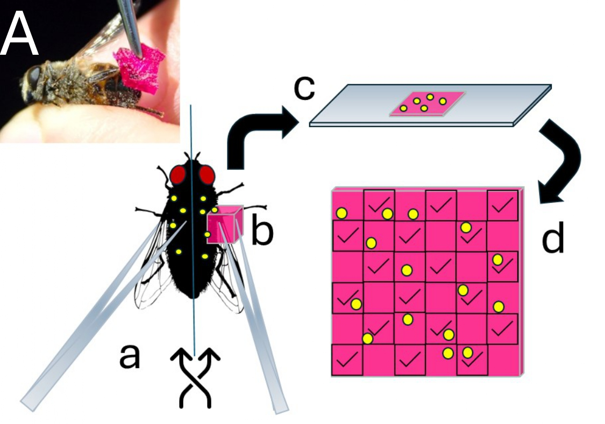
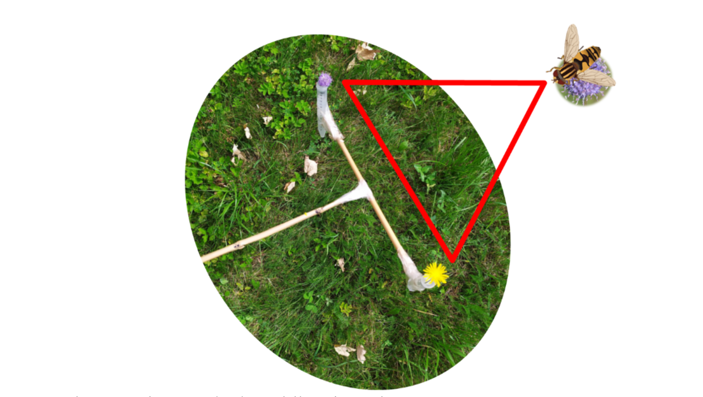
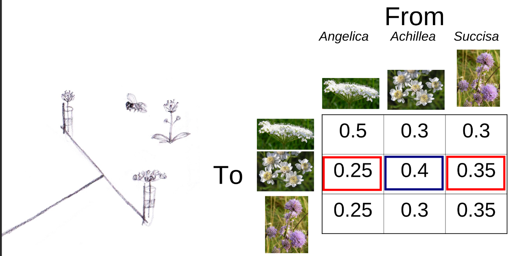
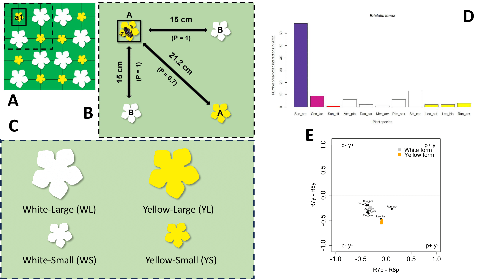
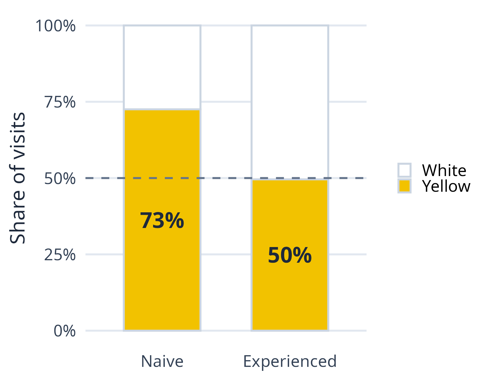
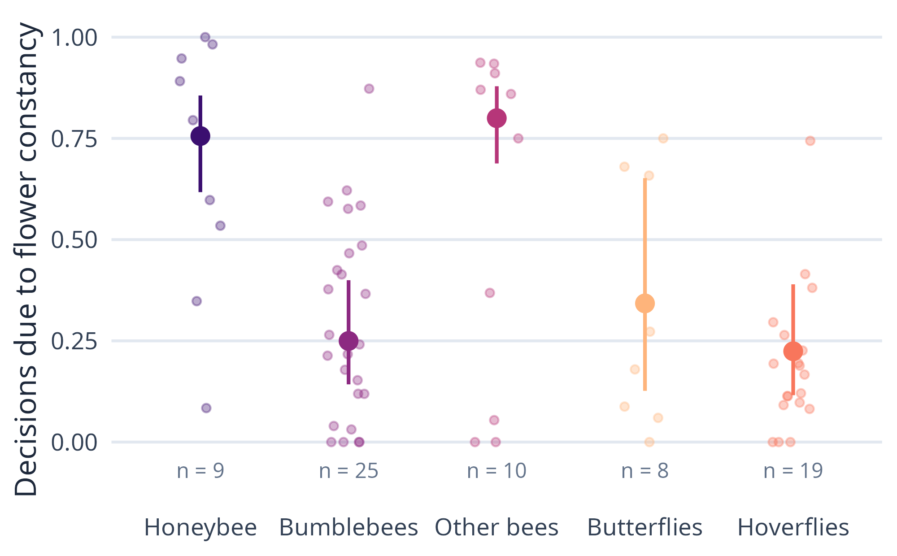
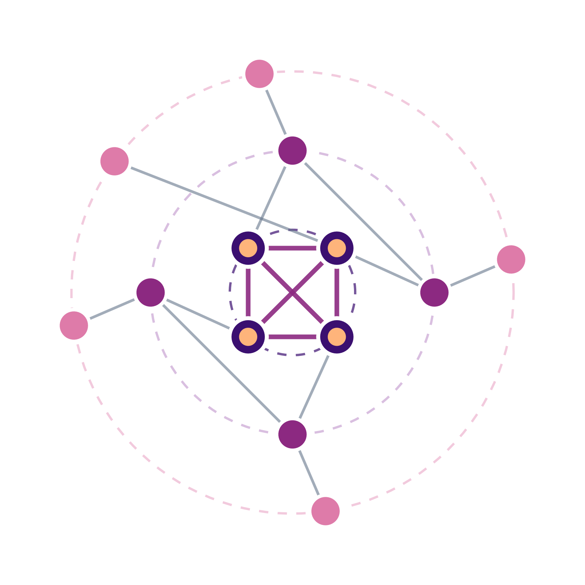

---
format:
  revealjs:
    embed-resources: false
    aspectratio: 43
    navigation: horizontal
    print-background: true
    partial-slides: true
    multiplex: false
    slide-number: c/t
    incremental: false
    theme: techroom/pp.scss
    css: techroom/gaps.css
    logo: images/pyl.png
    footer: "Jakub Štenc | Seminar Göteborg 2026 | Charles University & CREAF"
    background-transition: fade
    transition: none
    center-title-slide: false
    self_contained: true
    pdf-separate-fragments: true
bibliography: techroom/references.bib
keep-md: true
engine: knitr
---

<!--
=====================================================================
STORYBOARD  (40 min talk; timing chip in the top-right of each slide)
=====================================================================
Thread: "One pollen grain's journey through a shared meadow"
        anther -> pollinator body -> stigma -> community -> future

 0  Opening + the question ............................  2.5 min
 1  The system: K Handrkovu (Janovský et al. 2013) .....  4.5 min
 2  Pollen presentation and pollinators ................ 13   min   Štenc et al. 2023 AJB; Štenc et al. 2025 PPEES;
                                                                    Freudenfeld et al. 2025 AoB Plants; Matoušková et al. 2023;
                                                                    Haveldová et al. (subm.); constancy synthesis (in prep)
 3  Pollen deposition .................................. 16   min   LLN paper (New Phytologist, subm.); Slavkovský les (Oikos, in prep);
                                                                    deposition curves (in prep); synthesis slide
 4  Scaling up: the pollinator-sharing core ............  6   min
 5  Work in progress & future ..........................  4.5 min   pollen networks, price of the core (+ Succisa HP by year), diurnal
 6  Take-home + thanks .................................  2.5 min
                                                         -------
                                                          63 min of timing badges (+ ~1.5 min unbadged)  -> CUT ~24 min

 Suggested cuts (≈ 10 min):
   - Deposition curves meta-analysis -> backup ........................ -2
   - Merge "From body to stigma" into "Defining the deposition steps" .. -1
   - Merge "From one meadow to a landscape" + "Same question, 60 meadows" -1
   - Merge "Why should timing matter?" + "Three species" ............... -1
   - Drop "Pollinators track pollen" (schematic) ....................... -1
   - Merge "Who carries" + "Abundance, not identity" ................... -0.5
   - Merge "Recurring summer drought" into the visits slide ............ -0.5
   - "Time of day as a niche axis" -> backup ........................... -1
   - "The next dry summers" -> one sentence on take-home ............... -0.5
   - Shorten "15 years of networks" + "Permanent plots" ................ -1
Orange dashed boxes (.gap) = things to fill or decide. Delete them when done.
=====================================================================
-->

#  {background-image="images/90985051_3160362750661404_9121786830419656704_o.jpg" style="text-align: center;"}

<h2 style="text-align:center;font-size: 32px;color:white; text-align:center;">

::: {style="background-color: rgba(0, 0, 0, .55); backdrop-filter: blur(6px); box-shadow: 0 0 1.5rem 0 rgba(0, 0, 0, .6); border-radius: 8px; padding: 18px;"}
Sharing without losing: the journey of pollen through a species-rich meadow

**Jakub Štenc**^1,2,3^ & the Handrkov team

^1^Charles University (Botany) | ^2^Charles University (Zoology) | ^3^CREAF, Spain

:::

</h2>

{.absolute bottom="0%" left="0" width="230"}

{.absolute bottom="8%" left="0%" width="170"} {.absolute bottom="8%" right="0%" width="170"}

::: notes
Working title, alternatives:
- "From anther to stigma to community: how meadow plants cope with shared pollinators"
- "Pollen on the move: presentation, deposition and network structure in a Czech meadow"
Seminar audience in Göteborg: assume a broad ecology/plant biology department, not only pollination specialists. Keep jargon low, define CP/HP/SVD/TPD when first used.
:::

## About me

≈ 1 min

::::: columns
::: {.column width="62%"}

2015–2024

<b>BSc, MSc and PhD in Botany</b> Charles University, Prague · with Zdeněk Janovský

2019–2023

<b>Stays abroad</b> Tartu (Erasmus) · Madrid, URJC · Granada

2023–2025

<b>Pollination in tropical mountains</b> Andes, Ecuador · with Petr Sklenář

2024–2025

<b>Institute of Botany</b> Czech Academy of Sciences

2025–2028

<b>GAČR postdoc fellowship</b> Charles University · hosted at CREAF, Barcelona (Jordi Bosch)

:::

::: {.column width="38%"}
::: {style="background: #F1F5F9; border-radius: 12px; padding: 16px 18px; margin-top: 10px; font-size: 21px; line-height: 1.4;"}

What I work on

How plants share pollinators, and what this means for the pollen that reaches their stigmas
:::

::: {.fragment style="background: #F1F5F9; border-radius: 12px; padding: 16px 18px; margin-top: 14px; font-size: 19px; line-height: 1.4;"}

Sweden connection

SCAPE meetings since 2018, including Höör 2019
:::
:::
:::::

::: notes
Keep this short, about one minute. Botanist by training, working on pollination since the bachelor's thesis. PhD thesis: factors influencing pollen carryover effectiveness (cum laude, 2024).
Current project (GAČR Postdoc Individual Fellowship Outgoing, 25-17193O): long-term spatiotemporal dynamics in a plant–pollinator community and consequences for pollen transfer in a changing world. That project is what this talk is about.
:::

##  {background-video="images/video_intro_reduced_shorter.mp4" background-video-loop="true" background-video-muted="true"}

::: notes
[0:30] Let the meadow speak. Handrkov in August: dozens of plant species in flower at the same time, hundreds of insect species.
:::

## What is pollination?

≈ 1 min

<b>Pollen</b> is produced in the anthers

›

An <b>animal</b> carries it to another flower

›

It must land on a <b>stigma</b> of the <b>same species</b>

::: {.fragment fragment-index=3 style="text-align: center; font-size: 28px; font-weight: 600; color: #40695B; margin-top: 30px;"}
→ fertilisation → seeds
:::

::: notes
For the non-specialists: plants cannot move, so to mate they need a courier. Pollen from one flower has to reach the stigma of another flower of the same species. Pollen landing on the wrong species is lost, and can even block the stigma.
The three photos are from our meadow: Succisa anther, a hoverfly (Eristalis interruptus) covered in pollen, a Succisa stigma.
:::

## Why does it matter?

≈ 1.5 min

≈ 88 %

of flowering plants are pollinated by animals

@Ollerton2011

75 %

of leading crop types benefit from animal pollination

@Klein2007

5–8 %

of global crop production, US$ 235–577 billion per year

@Potts2016

::: {.fragment style="margin-top: 34px;"}
::: bigmsg
Pollinators are declining, and most pollination happens in diverse communities where plants share their pollinators.
:::
:::

::: notes
Ollerton et al. 2011: about 87.5 % of flowering plant species are animal-pollinated (higher in the tropics, about 78 % in temperate communities).
Klein et al. 2007: 87 of 115 leading global food crops (75 %) benefit from animal pollination.
Potts et al. 2016 (IPBES assessment): 5–8 % of global crop production is directly attributable to animal pollination, worth US$ 235–577 billion per year.
Decline: e.g. Hallmann et al. 2017 found a more than 75 % drop in flying insect biomass over 27 years in German protected areas.
Bridge: pollination is not one plant and one bee. In a meadow like ours, dozens of plants share the same insects. That is the starting point of our work.
:::

## Sharing is the norm

≈ 1.5 min

::: r-stack
{fig-align="center" width="620"}

{.fragment fig-align="center" width="625"}

{.fragment fig-align="center" width="630"}
:::

::: notes
Not only bees: in our meadow hoverflies, flies, beetles, butterflies and moths all visit flowers (photos: burnet moth on Sanguisorba, Eristalis on Achillea, butterflies on Succisa). In species-rich meadows most plants are generalists and share most of their visitors.
Sharing is a problem for a plant: pollen is lost to other species (consumption, wrong stigmas) and foreign pollen arrives on its own stigma (heterospecific pollen, HP).
Central question of the whole talk: how do plants in such a meadow still get enough of their own pollen (conspecific pollen, CP)?
:::

## The journey of a pollen grain

≈ 1 min

1&#46; Anther

Presentation &amp; dosing

Part 2

<svg width="42" height="30" viewBox="0 0 42 30" fill="none" style="display: block;">
<path d="M4 15h32M24 6l10 9-10 9" stroke="#40695B" stroke-width="4" stroke-linecap="round" stroke-linejoin="round"/>
</svg>

2&#46; Pollinator Body

Capacity &amp; shared loads

Part 2–3

<svg width="42" height="30" viewBox="0 0 42 30" fill="none" style="display: block;">
<path d="M4 15h32M24 6l10 9-10 9" stroke="#40695B" stroke-width="4" stroke-linecap="round" stroke-linejoin="round"/>
</svg>

3&#46; Stigma

Deposition: SVD → TPD

Part 3

<svg width="42" height="30" viewBox="0 0 42 30" fill="none" style="display: block;">
<path d="M4 15h32M24 6l10 9-10 9" stroke="#40695B" stroke-width="4" stroke-linecap="round" stroke-linejoin="round"/>
</svg>

4&#46; Community

Sharing network

Part 4–5

1The meadow

2Pollen presentation <small>anther → pollinator</small>

3Pollen deposition <small>pollinator → stigma</small>

4The community <small>sharing network</small>

5What's next

::: notes
Guiding idea: plants cannot choose their visitors, but they can control WHEN they offer pollen, and they profit from HOW MANY visits they get and WHERE they grow. Each part shows one of these levers.
:::

# The system: K Handrkovu {background-color="#40695B"}

1The meadow

2Presentation

3Deposition

4Community

5Next

## The locality

≈ 1 min

::::: {style="display: flex; justify-content: center; align-items: flex-end; gap: 50px; margin-top: 30px;"}
::: {.fragment style="text-align: center; flex: 1;"}

Czech Republic

:::

::: {.fragment style="text-align: center; flex: 1.3;"}

&gt; 50 entomophilous plant species

:::
:::::

::: {.fragment style="text-align: center; font-size: 34px; font-weight: 600; margin-top: 40px;"}
15 years of data collection (2011–2025)
:::

::: src
Study design: @Janovsky2013
:::

::: notes
K Handrkovu near Vernýřov, Central Bohemia (49.8466 N, 15.1498 E). Moist to mesophilous grassland mosaic, two flowering peaks (May, August), mown twice a year. Sampling at the August peak.
Where it started: Janovský et al. 2013 (PLoS ONE) set up the plot design and showed that conspecific and heterospecific flower densities at a scale of a few metres drive which pollinators visit a plant. This small-scale density effect comes back twice in this talk: dilution of foreign pollen on Succisa stigmas (Part 3) and the pull of the core species (Part 4).
:::

## Permanent plots

≈ 1 min

::::: {style="display: flex; justify-content: center; align-items: flex-start; gap: 28px; margin-top: 30px;"}
::: {.fragment style="text-align: center; flex: 1;"}

plots are marked

:::

::: {.fragment style="text-align: center; flex: 1;"}

recovered every year

:::

::: {.fragment style="text-align: center; flex: 1.25;"}

93 plots in total

:::
:::::

## Plant and pollinator survey

≈ 1.5 min

::::: {style="display: flex; justify-content: center; align-items: flex-start; gap: 28px; margin-top: 20px;"}
::: {style="text-align: center; flex: 1;"}

Flowering stalks in 64 cells per plot, twice per season

:::

::: {.fragment style="text-align: center; flex: 1;"}

"Snapshot" surveys: insects touching reproductive organs

:::
:::::

::: {.fragment style="text-align: center; font-size: 24px; margin-top: 14px;"}
42 378 plot surveys · 68 460 interactions · 176 pollinator taxa × 55 plant species
:::

::: notes
Numbers from the SCAPE 2026 dataset (2011–2025). Note: the DiuHanPolNet summary reports 58 451 interactions, 53 plants and 174 pollinators (different filtering). Use one consistent set in the talk.
:::

## 15 years of networks

≈ 1 min

{fig-align="center" height="560"}

::: notes
One plant-pollinator network per year. Same meadow, same method, very different networks: this year-to-year turnover will come back in Part 4.
Transition: before networks, start with the smallest unit, the pollen grain leaving the anther.
:::

# Pollen presentation {background-color="#40695B"}

1The meadow

2Presentation <small>anther → pollinator</small>

3Deposition

4Community

5Next

## Why should timing matter?

≈ 1 min

::: {style="font-size: 26px; margin-top: 20px;"}
-   Only a tiny fraction of pollen reaches a conspecific stigma
-   Pollen presentation theory: plants can **dose** pollen to pollinators [@harder1989]
-   With shared pollinators, **when** pollen is offered may decide **who** carries it
:::

::: {.gap .fragment style="margin-top: 20px; font-size: 17px;"}
Optional: add Harder & Wilson 1994, LeBuhn & Holsinger 1998 and Stone et al. 1998 to techroom/references.bib (from Psani_clanku/2021/START_paper/pollen_presentation_references.bib).
:::

::: notes
Pollen is lost through consumption, grooming and transfer to the wrong species. Gradual dispensing should pay off with many, inefficient pollinators; dumping all pollen at once should pay off with few, efficient ones.
:::

## Three species, three strategies

≈ 1 min

Succisa pratensis

Open flowers, pollen freely exposed Mainly pollen-feeding hoverflies

Centaurea jacea

Pollen pumped out of the anther tube Mainly bees

Trifolium hybridum

Closed flowers, pollen released when a bee opens them Bees only

::: src
Photos: Lukáš Janošík · @Stenc2023
:::

::: notes
Three co-flowering species at Handrkov that share part of their pollinators but differ in how pollen is presented.
Click: close-ups of pollen presentation. Succisa: anthers fully exposed, pollen easy to take. Centaurea: Asteraceae pump mechanism, the style pushes pollen out of the anther tube gradually. Trifolium: pollen hidden in the keel, released only when a bee forces the flower open.
Colours of the species names match the curves on the next slides.
:::

## How we measured pollen release

≈ 0.5 min

::::: columns
::: {.column width="42%"}
{fig-align="center" height="420" style="object-fit: cover; border-radius: 8px;"}
:::

::: {.column width="58%"}
::: {style="font-size: 24px; margin-top: 30px;"}
1.  Every hour, 8:00–17:00, two days
2.  Flowers offering pollen from 5 inflorescences per species → vial with stained detergent solution
3.  Pollen grains in each vial counted
4.  Flowers offering pollen counted on 20 inflorescences
:::

::: {.fragment style="font-size: 22px; margin-top: 20px; color: #40695B; font-weight: 600;"}
→ pollen available per inflorescence, hour by hour
:::
:::
:::::

::: src
Photo: Lukáš Janošík · @Stenc2023
:::

::: notes
START I methods (Štenc et al. 2023, AJB): 15 and 16 August 2021, hourly sampling, 5 vials per species per hour, each vial = flowers from 5 random inflorescences (3 flowers for Trifolium and Centaurea, 5 for Succisa) in 2 ml of detergent with basic fuchsin. Only flowers actively presenting pollen and visited by pollinators were taken.
Pollinator visitation was recorded in parallel, so pollen supply and visits can be compared hour by hour.
:::

## When is pollen available?

≈ 1.5 min

{fig-align="center" height="480"}

::: src
@Stenc2023
:::

::: {.fragment .absolute top="30%" left="15%" width="70%"}
::: bigmsg
*Succisa* releases its pollen in the morning. *Centaurea* and *Trifolium* peak in the early afternoon.
:::
:::

::: notes
Štenc et al. 2023, American Journal of Botany. Pollen available per inflorescence over the day.
:::

## Pollinators track pollen

≈ 1 min

{fig-align="center" height="440"}

::: {.gap style="font-size: 17px;"}
This image is a schematic (no axis values). Replace it with the real visitation-vs-pollen figure of START I (e.g. Tablo2.pdf or kombograf_ultra_mega6.pdf in Psani_clanku/2021/START_paper), or keep it as a concept and say so.
:::

::: notes
Key result of START I: visitation of C. jacea and T. hybridum closely matched pollen availability; S. pratensis pollinators peaked with a slight delay after the morning release.
:::

## Swabbing pollinators

≈ 1 min

::::: columns
::: {.column width="55%"}
{fig-align="center" height="440"}
:::

::: {.column width="45%"}
::: {style="font-size: 22px; margin-top: 20px;"}
a.  Catch the insect on the flower, swab **one half** of the body
b.  Cube of glycerine jelly with fuchsin picks up the pollen
c.  Melt the jelly on a slide
d.  Count every second square, identify 200 grains
:::

::: {.fragment style="font-size: 21px; margin-top: 18px; color: #40695B; font-weight: 600;"}
Result per insect: **load** (grains) and **purity** (share of own pollen)
:::
:::
:::::

::: src
@beattie1971technique · figure from @freudenfeld2025interannual
:::

::: notes
Same protocol in START II, in Freudenfeld et al. 2025 and in the deposition paper (body loads on Succisa visitors).
Bees: pollen packed in the corbiculae is not swabbed, because it no longer takes part in pollination.
Counts therefore refer to one quarter of the body (half the body swabbed, half of the squares counted).
Conspecific = pollen of the plant on which the insect was caught. Heterospecific = everything else.
:::

## What do pollinators carry?

≈ 1.5 min

::::: columns
::: {.column width="45%"}
{fig-align="center" height="520"}

::: src
@stenc2025pollen
:::
:::

::: {.column width="55%"}
::: {.fragment style="font-size: 23px; margin-top: 60px;"}
-   ***Succisa***: most pollen in the morning, then quantity **and** purity drop
-   ***Centaurea***, ***Trifolium***: more even loads through the day
-   Explained by plant density (*Centaurea*) and flower morphology with release strategy (*Trifolium*)
:::
:::
:::::

::: notes
Štenc et al. 2025, PPEES 67: 125868. Conspecific pollen on pollinator bodies over the day (log scale), by pollinator taxon.
:::

## Pollen must flow

≈ 1 min

{fig-align="center" height="530"}

::: src
@stenc2025pollen
:::

::: notes
Pollinator performance = visitation activity per flowering stalk × conspecific pollen grains on the body. Succisa is served by hoverflies early in the morning (Eristalis tenax, Helophilus), Centaurea and Trifolium by Apis in the afternoon. The plants split the day: diurnal stratification of pollen transfer lowers the cost of sharing pollinators.
:::

## Who carries the pollen?

≈ 1 min

::: r-stack
{.fragment .fade-out fragment-index=1 fig-align="center" height="500"}

{.fragment .fade-in fragment-index=1 fig-align="center" height="500"}
:::

::: src
618 pollinators, 2020–2021, Handrkov · @freudenfeld2025interannual
:::

::: notes
Bridge from the three focal plants: now the whole pollinator community. Pollen swabbed with fuchsin jelly from one half of the body; counts are per quarter of the body.
Step 1: every dot is one insect. Loads range from a few grains to thousands within the same group.
Step 2 (click): group means with 95 % CI. Groups do differ (ANOVA F(30, 531) = 21.3, p < 0.001, 54.6 % of variance), bees and large Eristalis carry most, Pieris and Coenonympha least. But most groups overlap broadly: the spread among individuals is as large as the spread among groups.
Figure redrawn from raw data (35 groups); the paper's model used 31 groups.
:::

## Who visits changes every year

≈ 1 min

::: r-stack
{.fragment .fade-out fragment-index=1 fig-align="center" height="500"}

{.fragment .fade-in fragment-index=1 fig-align="center" height="500"}
:::

::: src
45 472 visits, 2011–2021 · @freudenfeld2025interannual
:::

::: notes
Step 1: interaction density of each pollinator group per year (32 groups, grey lines).
Step 2 (click): the most abundant groups. Sarcophagidae, Apis and Sphaerophoria jump several-fold between consecutive years. Eristalis tenax is the most constant of the dominant groups.
:::

## Abundance, not identity

≈ 0.5 min

{fig-align="center" height="430"}

Coefficient of variation = SD / mean, i.e. spread relative to the average

::: src
Data: @freudenfeld2025interannual
:::

::: {.fragment .absolute top="22%" left="12%" width="76%"}
::: bigmsg
Pollinators differ little in how much pollen they carry. Their contribution is set by how abundant they are that year.
:::
:::

::: notes
Coefficients of variation: among group means of pollen load (0.75), median within-group CV of pollen load among individuals (0.77), median CV of visitation density among years within a group (1.13). Values computed for this slide from the paper's data (scripts/fig_freudenfeld_2025.R).
Conclusion of Freudenfeld et al. 2025: a pollinator's contribution to pollen transfer depends more on its abundance than on its capacity to carry pollen. A diverse pollinator community buffers the decline of any single taxon.
Bridge to Part 3: if many different, variable carriers deliver pollen, what finally arrives on the stigma?
:::

## Preference and constancy

≈ 1 min

::::: columns
::: {.column width="45%"}
{fig-align="center" height="300"}

::: {style="font-size: 20px; text-align: center;"}
Interview stick: offer two flowers, record which one the insect chooses next
:::
:::

::: {.column width="55%"}
{.fragment fig-align="center" height="230"}

::: {.fragment style="font-size: 21px;"}
-   **Preference**: which flower is chosen more often than expected
-   **Constancy**: staying on the same species in consecutive visits, more than preference alone predicts
:::
:::
:::::

::: notes
Two different behaviours that are often mixed up. Preference = choosing one flower type over another. Constancy = repeating the previous choice. A constant pollinator carries purer loads, so constancy matters directly for heterospecific pollen.
Interview stick (Thomson 1981): a stick carrying two flowers is offered to a foraging insect; the choice relative to the flower it just left is recorded. Arrays of real or artificial flowers do the same with many flowers at once.
The transition matrix shows how often an insect moves from each species to each other species; constancy is the excess on the diagonal.
:::

## How do pollinators choose?

≈ 1 min

{fig-align="center" width="100%"}

::: src
3D-printed flowers, 3 % sucrose, *Eristalis tenax* · @Matouskova2023; Haveldová et al. (submitted)
:::

::: notes
Bridge: the field tells us who visits. To see how an individual pollinator decides, we went to the lab.
A: arena with two flower forms in a chessboard pattern, 15 cm apart, so the fly must fly between flowers. B: each flight is scored as constant (same form) or switching. C: four forms, yellow or white, large or small. D: in the field E. tenax visits mostly Succisa. E: in the fly's colour space, the white form sits next to Succisa, Centaurea and Selinum, the yellow form next to Leontodon. So the artificial flowers mimic real core plants of the meadow.
Matoušková et al. 2023 (Biol. J. Linn. Soc.): naive E. tenax select colour most strongly, then size, symmetry only weakly; yellow is preferred, especially when large.
:::

## Experience changes the choice

≈ 1 min

::::: columns
::: {.column width="52%"}
{fig-align="center" height="440"}
:::

::: {.column width="48%"}
::: {style="font-size: 23px; margin-top: 50px;"}
-   **Naive** flies (lab-reared): strong innate preference for yellow
:::

::: {.fragment style="font-size: 23px;"}
-   **Experienced** flies (caught in the meadow): no colour preference left
-   Flower constancy **10–15 % lower** after experience
:::
:::
:::::

::: src
5 270 visits by naive and 31 973 by experienced flies · Haveldová, Štenc, Matoušková & Janovský (submitted)
:::

::: notes
Share of all visits that went to yellow forms, summed over the four forms (naive: YL 1 829 + YS 1 682 of 4 841 visits; experienced: 8 000 + 7 855 of 31 973). Caveat: visits were not spread evenly across treatments, so this is a summary of the raw counts, not the model. The GLMs show significant colour, size and interaction effects in both groups (Table 1 of the manuscript).
Experienced flies from a flower-rich meadow are more opportunistic: weaker preferences and lower constancy. They also reacted more to which flowers they could see from their position (angular area ratio).
Implication for the plant: an experienced hoverfly arriving on Succisa has likely just visited something else.
:::

## Who stays faithful?

≈ 1 min

{fig-align="center" height="440"}

::: {.fragment .absolute top="24%" left="14%" width="72%"}
::: bigmsg
Hoverflies, the main visitors of *Succisa*, are among the least constant pollinators.
:::
:::

::: src
Literature synthesis + our field experiments, 20 sources, experimental data only · Sedláčková, Štenc, Matoušková & Janovský (in prep.)
:::

::: notes
Share of foraging decisions explained by flower constancy, from interview-stick and array experiments (quasibinomial GLM, F = 15.8, p < 0.001). Honeybees and other bees about 0.75–0.80; bumblebees, butterflies and hoverflies 0.22–0.34. Points = individual studies or species pairs.
Bridge to Part 3: a meadow served by inconstant hoverflies should load stigmas with foreign pollen. So what actually lands on a Succisa stigma?
Manuscript is an early draft; numbers may change.
:::

## Part 2 in one sentence

≈ 0.5 min

::: {style="margin-top: 120px;"}
::: bigmsg
Plants cannot choose their pollinators, but they can choose **when** to offer pollen. Who carries it, and how faithfully, changes with the year and with experience.
:::
:::

# Pollen deposition {background-color="#40695B"}

1The meadow

2Presentation

3Deposition <small>pollinator → stigma</small>

4Community

5Next

## From body to stigma

≈ 1 min

::::: {style="display: flex; justify-content: center; align-items: flex-start; gap: 60px; margin-top: 25px;"}
::: {style="text-align: center; flex: 1; max-width: 450px;"}
{height="420px" style="object-fit: contain; display: block; margin: 0 auto;"}

Pollen on the body

:::

::: {.fragment style="text-align: center; flex: 1; max-width: 450px;"}
{height="420px" style="object-fit: contain; display: block; margin: 0 auto;"}

Pollen on the stigma

:::
:::::

::: notes
Define terms once: conspecific pollen (CP) = own species; heterospecific pollen (HP) = other species. Single-visit deposition (SVD) = what one visit leaves. Terminal pollen deposition (TPD) = the final load on an old stigma.
Focal species from now on: Succisa pratensis, a core species of the meadow network (Part 4).
:::

## Defining the deposition steps

≈ 1 min

1&#46; Pollinator Body Load

CP (Conspecific)

HP (Heterospecific)

Pollen carried by visitor. Can be own species (<strong>CP</strong>) or foreign (<strong>HP</strong>).

2&#46; Single Visit (SVD)

Pollen left by <strong>one visit</strong> on virgin stigma. Mechanically inefficient &amp; noisy (high CV).

3&#46; Terminal Load (TPD)

Final cumulative load on old stigma. Accumulated visits buffer noise (low CV).

::: notes
Define terms explicitly:
- CP = Conspecific Pollen (own species)
- HP = Heterospecific Pollen (foreign pollen from neighbours)
- SVD = Single-Visit Deposition: measured experimentally with virgin bagged stigmas exposed to exactly 1 visit.
- TPD = Terminal Pollen Deposition: the final load on naturally pollinated stigmas.
:::

## How we measure deposition

≈ 1 min

Single visit (SVD)

1. Bag the inflorescence in tulle before anthers open 
2. Unbag when stigmas are receptive 
3. Wait for <b>one</b> visit, note the visitor 
4. Collect the visited stigma into ethanol

Replace with a photo of a bagged <i>Succisa</i> inflorescence, if you have one.

Terminal load (TPD)

1. Flowers with withered corolla = end of stigma life 
2. 3 stigmas per head, 30 plants per day 
3. Clear, stain with safranin, squash 
4. Count own and foreign grains at 400×

::: notes
SVD: 124 controlled single visits on virgin stigmas, 2022–2024. If the insect visited more than one flower, only the first stigma was kept.
TPD: 693 terminal-stage stigmas from 273 plants, 2022–2024. Slide preparation: 10 % KOH, 3 % H2O2, 8 % acetic acid, then safranin–glycerol, squash under a coverslip, seal with nail polish.
Micrograph: Succisa stigma with large own pollen grains and smaller foreign grains. Own and foreign grains are told apart by size, shape and surface ornamentation.
The Slavkovský les stigmas were processed the same way.
:::

## One visit is a lottery

≈ 1.5 min

{fig-align="center" height="440"}

::: {.fragment style="font-size: 23px; text-align: center;"}
One visit leaves only **≈ 2 %** of the body's own pollen on the stigma · no difference among *Eristalis*, *Helophilus* and *Bombus*
:::

::: notes
SVD experiments 2022–2024 on bagged Succisa inflorescences (124 single visits; 300 pollinators swabbed for body loads).
Mean body load: CP 148 grains (SD 394), HP 479 (SD 1 102). Only about 2.3 % of body CP and 0.1 % of body HP end up on the stigma in one visit.
Kruskal–Wallis among dominant morphogroups: CP H3 = 1.59, p = 0.66; HP H3 = 5.20, p = 0.16. Per visit, the pollinators are functionally equivalent, which fits the Freudenfeld result: what matters is how many visits, not who makes them.
:::

## But the final load is stable

≈ 1.5 min

::: r-stack
{fig-align="center" height="520"}

{.fragment fig-align="center" height="520"}
:::

::: notes
CV of conspecific pollen: body 129 % → single visit 206 % → terminal load 69 %. Heterospecific pollen stays variable: body 264 % → terminal 147 %.
Variance partitioning of TPD (693 stigmas, 273 plants, 2022–2024): years and days explain little CP variance; plants 15 %, stigmas 82 %. Within 2024, days were not significant (CP χ² = 1.32, p = 0.52). HP is different: year (χ² = 32.4, p < 0.001) and plant (χ² = 104.7, p < 0.001) both matter.
:::

## The law of large numbers

≈ 1.5 min

::: r-stack
{fig-align="center" height="520"}

{.fragment fig-align="center" height="520"}
:::

::: notes
Monte Carlo simulation parameterised by empirical SVD and visitation rates: accumulation of many independent, noisy visits is sufficient to reproduce the stable terminal CP loads observed in the field.
HP is different: not predicted by the null model, depends on the floral neighbourhood, and is diluted by high conspecific floral density.
Štenc et al., submitted to New Phytologist.
:::

## From one meadow to a landscape

≈ 1 min

{fig-align="center" height="520"}

Slavkovský les Protected Landscape Area, W Bohemia · land cover ESA WorldCover 2021 · relief AWS Terrain Tiles · boundary © OpenStreetMap

::: notes
Handrkov is one meadow followed for three years. Slavkovský les asks the same question across a landscape: 60 Succisa meadows in a mosaic of forest, pasture, wetland margins and ponds.
Each meadow sampled once: 37 in 2022, 23 in 2023.
Field work: MSc thesis of Natálie Hanusová (2024), supervised by J. Štenc.
:::

## Same question, 60 meadows

≈ 1 min

:::: {style="display: flex; gap: 30px; align-items: center; margin-top: 20px;"}
::: {style="flex: 0 0 34%; font-size: 24px;"}
::: {.person}
[photo]{.ph}
[**Natálie Hanusová** <small>MSc thesis 2024 · field work, pollen counts</small>]{.who}
:::
<!-- When you have the photo: save it as images/hanusova.jpg and replace the line
     [photo]{.ph}   with                                 -->

<b>60</b> meadows, one sampling day each

<b>1 035</b> plants · <b>3 065</b> stigmas 3 stigmas per plant, ≈ 20 plants per meadow

<b>4 595</b> visitors, <b>81</b> taxa 20-min transects, morning and afternoon

Landscape within <b>50 m</b> meadow, forest, marsh, water

:::

::: {.fragment style="flex: 1; text-align: center;"}
{height="390"}

Meadow means: **HP varies 8-fold, CP only 2-fold**
:::
::::

::: notes
Same protocol as Handrkov: male-phase flowers, three stigmas per plant, conspecific (CP) and heterospecific (HP) grains counted.
Plants per meadow: median 20 (range 7–21).
Spread of meadow means (10th–90th percentile): CP 2.2×, HP 8.0×; CV 0.33 vs 0.85.
:::

## Buffered in time and in space

≈ 2 min

{fig-align="center" height="470"}

::: {.fragment style="font-size: 24px; text-align: center;"}
Own pollen: little variance between years (**3 %**) or meadows (**11 %**). Foreign pollen: about a third (**34 %** and **30 %**).
:::

::: notes
The same model on both datasets: linear mixed model on sqrt counts, plant nested in year (Handrkov) or in meadow (Slavkovský les), stigma = residual.
CP: the big share is plant and stigma, i.e. local and chance. Neither years nor meadows matter much. That is what the law of large numbers predicts.
HP: about a third sits at the year or meadow level. Foreign pollen depends on context.
The Bayesian Poisson model in the manuscript gives the same picture (CP meadow 13 %, HP 43 %).
:::

## Foreign pollen follows the neighbours

≈ 1.5 min

{fig-align="center" height="400"}

::: {.fragment style="font-size: 22px;"}
-   More *Succisa* flowerheads → **less** HP (dilution, as at Handrkov)
-   Wetter surroundings (marsh, close to water) → more HP
-   Landscape explains **35 %** of HP between meadows, only **12 %** of CP
-   Visitor composition explains neither
:::

::: notes
Meadow-level RDA on mean HP: flowerheads F = 21.5, p = 0.001; distance to water F = 7.9, p = 0.008; marsh area F = 5.1, p = 0.023; adj. R² = 0.35.
CP: only meadow area (positive), adj. R² = 0.12.
Dilution: Spearman ρ = −0.50 between flowerhead number and HP. Large Succisa populations keep visitors on Succisa.
Visitor community (dbRDA, n = 58 meadows): CP adj. R² 0.007, p = 0.38; HP 0.022, p = 0.30.
:::

## Taller plants get more pollen

≈ 1 min

{fig-align="center" height="380"}

::: {.fragment style="font-size: 22px; text-align: center;"}
But traits leave plant-to-plant variance unchanged (ICC 0.793 → 0.794)
:::

::: {.gap style="font-size: 16px;"}
Optional: photo of a tall *Succisa* above the grass.
:::

::: notes
Within a meadow, plants taller than their neighbours get about 11 % more conspecific pollen per SD of height (RR 1.11, 1.04–1.19). Height does not affect HP. Larger flowerheads collect slightly more HP (RR 1.10).
Height shifts the mean. Most plant-to-plant variation remains position, microhabitat or chance.
:::

## Is taller better?

≈ 1 min

:::: {style="display: flex; gap: 30px; align-items: center; margin-top: 10px;"}
::: {style="flex: 0 0 34%; font-size: 22px;"}
::: {.person}
[photo]{.ph}
[**Klára Hodánková** <small>role / affiliation</small>]{.who}
:::

::: {.person}
[photo]{.ph}
[**Javier Valverde** <small>role / affiliation</small>]{.who}
:::
<!-- When you have the photos: save them as images/hodankova.jpg and images/valverde.jpg
     and replace each [photo]{.ph} line with  or  -->

Field work 2026

:::

::: {style="flex: 1; text-align: center;"}
{height="300"}

::: {.fragment style="font-size: 23px; margin-top: 6px;"}
Taller flowers stick out of the grass and **receive more own pollen** (Slavkovský les). 
But does more pollen also mean better pollen?
:::
:::
::::

::: {.gap style="font-size: 15px; margin-top: 8px;"}
Fill in species, site and sampling date (the data files do not say; I assumed *Succisa pratensis*), roles and affiliations. Add the two photos when you have them.
:::

::: notes
Introduce the people first: this was the 2026 field season with Klára Hodánková and Javier Valverde.
Starting point: Slavkovský les showed that within a meadow, taller plants receive more own pollen. Height makes a flower more visible and easier to reach for flying insects. The new question: is all that extra pollen equally useful?
:::

## From pollen grain to pollen tube

≈ 1 min

::::: columns
::: {.column width="40%"}
::: r-stack
{height="430"}

{.fragment fragment-index=1 height="430"}
:::
:::

::: {.column width="60%"}
::: {style="font-size: 23px; margin-top: 20px;"}
-   Pollen lands on the stigma
:::

::: {.fragment fragment-index=1 style="font-size: 23px;"}
-   A compatible grain **germinates**: a tube grows down the style to the ovule
-   Only grains with a tube can fertilise
:::

::: {.fragment fragment-index=2 style="font-size: 21px; margin-top: 16px; background: #F1F5F9; border-radius: 10px; padding: 10px 14px;"}
**What we measured** 
Height of every flowering stalk (194 stalks, 100 plants) 
Pollen grains and pollen tubes on 61 stigmas from 32 plants
:::
:::
:::::

::: {.gap style="font-size: 15px;"}
Add how stigmas were stained for tubes (e.g. aniline blue under fluorescence) and when they were collected.
:::

::: notes
Pollen tubes are the step between deposition and fertilisation. Counting tubes per stigma tells us how much of the deposited pollen actually germinated.
Two stigmas (flowers A and B) per plant; random effects for plant and flower in all models.
:::

## Height, pollen and pollen tubes

≈ 2 min

::: r-stack
{.fragment .fade-out fragment-index=1 height="440"}

{.fragment .fade-in-then-out fragment-index=1 height="440"}

{.fragment .fade-in-then-out fragment-index=2 height="440"}

{.fragment .fade-in fragment-index=3 height="440"}
:::

::: r-stack
::: {.fragment .fade-out fragment-index=1 style="font-size: 22px; text-align: center;"}
Most plants are 25–40 cm tall · only 3 % of stalks exceed 50 cm
:::

::: {.fragment .fade-in-then-out fragment-index=1 style="font-size: 22px; text-align: center;"}
Pollen per stigma rises with height and levels off at ≈ 50 cm · grey bars = plant heights in the meadow
:::

::: {.fragment .fade-in-then-out fragment-index=2 style="font-size: 22px; text-align: center;"}
Pollen tubes follow a flatter curve, peaking at ≈ 45 cm
:::

::: {.fragment .fade-in fragment-index=3 style="font-size: 22px; text-align: center;"}
The share of grains with a tube **falls**: ≈ 45 % at 15 cm → ≈ 24 % at 65 cm
:::
:::

::: src
2026 · with Klára Hodánková and Javier Valverde · unpublished
:::

::: notes
Step 1: context. Height of 194 flowering stalks on 100 plants, median 32 cm; about 60 % are 25–40 cm, only 3 % above 50 cm. So most plants sit on the rising part of the next curve.
Step 2: own pollen per stigma ~ quadratic height, negative binomial GLMM with plant/flower random effects: linear z = 4.2, p < 0.001; quadratic z = −3.6, p < 0.001; predicted peak at about 50 cm. The tall end rests on few plants.
Step 3: number of pollen tubes ~ quadratic height (Poisson GLMM): linear p = 0.32, quadratic p = 0.014, peak at about 45 cm. No confidence band shown for this curve; the model's interval is not informative.
Step 4: proportion of grains with a tube ~ height (binomial GLMM): β = −0.019 per cm, p = 0.041.
Take-home: taller plants get more pollen, but a smaller share of it germinates. Possible reasons: more self or related pollen from long visits on tall plants, competition among grains, or older stigmas. One season, one site: a lead to follow, not a result.
:::

## Pollen deposition through a flower's life

≈ 2 min

::: r-stack
{fig-align="center" height="480"}

{.fragment fig-align="center" height="480"}
:::

::: {.gap style="font-size: 16px;"}
Redraw the GAMM figure: the confidence bands are broken and "Unknown" / "SC" add noise. Show SI vs SIC only. Literature synthesis: 36 species, 23 families, 49 surveys, 194 time-stamped records.
:::

::: notes
Meta-analysis of published deposition time series (Štenc, in prep.). Mating system best predicts the curve shape (deviance explained 56.8 %).
Self-incompatible species accumulate pollen over a broader part of flower life (median AUC 0.72 vs 0.14 in SIC; p_adj = 0.024) but rarely reach P/O ≥ 1 (1 of 7 surveys). Long accumulation without saturation: a sign of chronic pollen limitation in obligate outcrossers.
Bridge back to Succisa: protandrous, long-lived stigmas, hence the value of many visits.
:::

## How it fits together

≈ 1 min

Anther

Time

Pollen release schedules split the day among co-flowering plants

›

Pollinator

Who & how

Abundance sets who carries pollen; experience lowers constancy

›

Stigma

Numbers

Many noisy visits give a stable dose of own pollen

›

Neighbourhood

Space

Foreign pollen follows the neighbours and the landscape

::: {.fragment style="margin-top: 40px;"}
::: bigmsg
Own pollen is secured by **many visits**. Foreign pollen is decided by the **community**.
:::
:::

::: notes
One sentence per step, each backed by one study from Parts 2 and 3. The last step is the bridge: if foreign pollen depends on the neighbours, we need to understand the whole community of neighbours. That is the pollinator-sharing network.
:::

# Scaling up: the community {background-color="#40695B"}

1The meadow

2Presentation

3Deposition

4Community <small>sharing network</small>

5Next

## Plants linked by shared pollinators

≈ 1 min

::: r-stack
{fig-align="center" height="540"}

{.fragment fig-align="center" height="540"}
:::

::: notes
From the bipartite plant-pollinator web to the plant-plant pollinator-sharing network. Every shared visitor is a potential route for HP.
Shortened version of the SCAPE 2026 story. If time allows, reuse the airport analogy slide from SCAPE.
:::

## What is the core?

≈ 1 min

::: {.absolute .fragment .fade-in-then-out fragment-index=1 top="95" left="245" width="560" style="z-index: 10;"}

Photo: Colin, Wikimedia Commons, CC BY-SA 3.0

:::

:::::: columns
::: {.column width="33%"}
::: {.fragment fragment-index=2}

All plants

{width="100%"}
:::
:::

::: {.column width="33%"}
::: {.fragment fragment-index=3}

Peel weakly linked plants

{width="100%"}
:::
:::

::: {.column width="33%"}
::: {.fragment fragment-index=4}

What remains = core

{width="100%"}
:::
:::
::::::

::: notes
k-core decomposition (Seidman 1983), done separately for each year. Think of an onion: remove plants with few sharing links, repeat until only a mutually connected centre remains.
A species counts as core if it is central more often than expected from its flower abundance (null model, 1 000 permutations per year).
:::

## A stable core

≈ 1.5 min

{fig-align="center" height="520"}

::: notes
k-core decomposition per year, null model of 1 000 permutations per year. Six species are central in the sharing network across 15 years: Centaurea jacea, Selinum carvifolia, Succisa pratensis, Pimpinella saxifraga, Achillea ptarmica, Ranunculus acris. Plant identity explains 38 % of centrality variance beyond floral abundance (44 %).
Note that the two best-studied species of Parts 2 and 3, Succisa and Centaurea, are both core species.
:::

## Recurring summer drought

≈ 0.5 min

{fig-align="center" height="500"}

::: src
Data: TerraClimate (Abatzoglou et al. 2018), Handrkov locality (2011–2025)
:::

::: notes
Recurring summer drought in 2011–2025. Only 2013 and 2021 were wet summers; 2018 was the driest, followed by 2015, 2019 and 2025.
:::

## Drought concentrates visits on the core

≈ 1.5 min

::: r-stack
{.fragment .fade-out fragment-index=1 fig-align="center" height="500"}

{.fragment .fade-in fragment-index=1 fig-align="center" height="500"}
:::

::: notes
Step 1: share of all visits going to the 6 core species, rising from 34–55 % (2011–14) to 84–88 % (2023–25).
Step 2 (click): share of flowers produced by the core. On average the core holds about 14 % of flowers but receives 67 % of visits. In dry years peripheral flowering drops about threefold, core flowering does not.
:::

## How robust is the network?

≈ 1 min

::::: columns
::: {.column width="50%"}
::: r-stack
{height="440"}

{.fragment .fade-in-then-out fragment-index=1 height="440"}

{.fragment .fade-in fragment-index=2 height="440"}
:::
:::

::: {.column width="50%"}
::: r-stack
{height="440"}

{.fragment .fade-in-then-out fragment-index=1 height="440"}

{.fragment .fade-in fragment-index=2 height="440"}
:::
:::
:::::

::: src
Co-extinction simulation following @Memmott2004
:::

::: notes
Remove plants one by one and count how many pollinators lose all their food plants. Robustness R = area under the curve: 1 = nothing is lost, 0 = immediate collapse.
Click 1: removing peripheral plants first, the curve stays high (R ≈ 0.85). Click 2: removing core plants first, pollinators are lost quickly (R ≈ 0.45).
Next slide: how this changes across 15 years.
:::

## A more fragile network

≈ 1.5 min

{fig-align="center" height="500"}

::: src
Co-extinction simulation following @Memmott2004
:::

::: {.fragment .absolute top="27%" left="17%" width="66%"}
::: bigmsg
Losing the core costs more in dry years and more every year
:::
:::

::: notes
Co-extinction simulations (Memmott et al. 2004). Core-first removal: R from 0.69 (2011) to 0.41–0.43 (2023–25). Robustness gap grows by about 0.022 per year.
Link to pollen: if most visits go to a few core plants, those plants share almost every insect. What does that mean for the pollen arriving on their stigmas? That is the open question of Part 5.
:::

# Work in progress & future {background-color="#40695B"}

1The meadow

2Presentation

3Deposition

4Community

5Next

## Visits are not pollen

≈ 1.5 min

::: r-stack
{fig-align="center" width="85%"}

{.fragment fig-align="center" width="85%"}

{.fragment fig-align="center" width="85%"}

{.fragment fig-align="center" width="85%"}
:::

::: notes
Concept, not data. Pollen-transfer networks built from stigma loads and body loads, compared to visitation networks. Does pollen actually flow along the same routes, in the same direction and strength?
:::

## The price of being in the core

≈ 1.5 min

::::: columns
::: {.column width="55%"}
{fig-align="center" height="350"}
:::

::: {.column width="45%"}
::: {style="font-size: 22px; margin-top: 40px;"}
**Hypothesis:** when drought crowds pollinators onto the core, core plants share almost every insect and receive more foreign pollen.
:::

::: {.fragment style="font-size: 22px;"}
**First hint** on *Succisa* stigmas: own pollen stable, foreign pollen highest in dry 2023, lowest in 2024 when *Succisa* flowered densely.
:::
:::
:::::

::: {.gap style="font-size: 16px;"}
Three years cannot separate drought from *Succisa* density. Say so, and present this as the motivation for continued stigma sampling (SucTemDep) and the apparent-competition project.
:::

::: notes
Mean grains per terminal-stage stigma (± SE): CP 20.5, 20.5, 27.4; HP 35.2, 50.4, 9.6 for 2022, 2023, 2024 (84, 89 and 520 stigmas). Summer drought index: 2022 mild, 2023 dry, 2024 moderate. In 2024 Succisa flowered much more densely, and the Monte Carlo model shows HP dropping towards the mechanical baseline. So density dilution is the better-supported explanation; drought is a hypothesis to test.
Apparent competition bottleneck project (pitch stage): core species sharing most visits may pay a cost in foreign pollen, which could be one reason they do not exclude the periphery.
:::

## Time of day as a niche axis

≈ 1 min

::: {.gap style="margin-top: 20px;"}
Project DiuHanPolNet (manuscript draft). Diurnal stratification structures the network: "global generalists, local specialists".

- Hourly interaction rewiring ≈ 34 %
- Diurnal stratification reduces apparent competition by > 40 % per year
- Pollinators shift foraging time away from dominant competitors (*Apis*, dominant Diptera)

This scales Part 2 (three species) to the whole community. Decide whether the harmonogram below reads well at slide size.
:::

{fig-align="center" height="300"}

## From pollen on the stigma to seeds

≈ 1 min

Pollen deposited

what we measure now

›

Pollen tubes

first data in 2026

›

Seeds

next step

::: {style="font-size: 22px; margin-top: 26px;"}
-   Does a stable dose of own pollen mean stable seed set?
-   Does foreign pollen reduce tube growth, especially in dry years?
-   Is quality, not quantity, the limit for tall, well-visited plants?
:::

::: fragment
::: bigmsg
Do you have data on stigma pollen loads, pollen tubes or seed set? We would love to combine them.
:::
:::

::: notes
Future direction: follow pollen one step further, from deposition to germination and seeds. Planned: pollen tubes and seed set on Succisa across years at Handrkov, linked to the yearly foreign-pollen loads and drought.
Call for data: datasets with stigma loads plus pollen tubes or seed set, from any species, would let us test whether the law-of-large-numbers buffering of deposition carries through to fertilisation. We are also collecting published time series of pollen deposition (the deposition-curve synthesis).
:::

## The next dry summers

≈ 0.5 min

{fig-align="center" height="480"}

::: {.gap style="font-size: 17px;"}
Optional: HanFutNet (ERGM): binary structure stays stable under drought, interaction strengths rewire. HanNullNet: is stability built by spatial or temporal turnover? Pick at most one, or keep both as "questions we are working on" in one line each.
:::

## Take-home messages

≈ 2 min

:::::: columns
::: {.column width="33%"}
::: {style="background: #FFFFFF; border: 1px solid #E2E8F0; border-top: 6px solid #3B0F70; border-radius: 10px; padding: 10px 8px 12px 8px; box-shadow: 0 4px 12px rgba(0,0,0,0.05); text-align: center;"}
<h3 style="font-size: 25px; color: #3B0F70; margin: 2px 0 6px 0;">01 Timing</h3>

Pollen presentation schedules split the day among co-flowering plants

:::
:::

::: {.column width="33%"}
::: fragment
::: {style="background: #FFFFFF; border: 1px solid #E2E8F0; border-top: 6px solid #F8765C; border-radius: 10px; padding: 10px 8px 12px 8px; box-shadow: 0 4px 12px rgba(0,0,0,0.05); text-align: center;"}
<h3 style="font-size: 25px; color: #F8765C; margin: 2px 0 6px 0;">02 Numbers</h3>

Many noisy visits give a stable dose of own pollen. Foreign pollen follows the landscape

:::
:::
:::

::: {.column width="33%"}
::: fragment
::: {style="background: #FFFFFF; border: 1px solid #E2E8F0; border-top: 6px solid #40695B; border-radius: 10px; padding: 10px 8px 12px 8px; box-shadow: 0 4px 12px rgba(0,0,0,0.05); text-align: center;"}
<h3 style="font-size: 25px; color: #40695B; margin: 2px 0 6px 0;">03 Community</h3>

A stable core carries the network, and drought makes it ever more important

:::
:::
:::
::::::

::: {.gap .fragment style="margin-top: 16px; font-size: 17px;"}
Add one small image per card (reuse takehome_*.png style from SCAPE or new icons).
:::

## The Handrkov team

≈ 0.5 min

{fig-align="center" height="460"}

::: {.gap style="font-size: 17px;"}
Acknowledgements: co-authors (Janovský, Hadrava, Mikát, Matoušková, Freudenfeld, Švanda, Ryšan, Pijálková, Horčičková, Straka, Bosch), students (N. Hanusová), field volunteers, funding (GAČR, GAUK, CREAF postdoc). Check funding numbers.
:::

## Join us

{fig-align="center" width="950"}

  <a href="https://pollination-ecology-group.github.io/Handrkov/" target="_blank" style="color: #40695B; font-weight: 600; text-decoration: underline;">https://pollination-ecology-group.github.io/Handrkov/</a>
  |
  <a href="mailto:jakubstenc@gmail.com" style="color: #374151; text-decoration: none;">jakubstenc@gmail.com</a>

::: notes
Optional: Ecoflor 2027 in Prague invitation (logo2027.png and ecoflor_qr.png are in images/).
:::

##  {background-image="images/Fin.jpg"}

 

Thank you for your attention!

Jakub Štenc

jakubstenc@gmail.com

Charles University, Prague &amp; CREAF, Barcelona

{.absolute bottom="0%" right="25%" width="190"} {.absolute bottom="0%" left="0" width="230"} {.absolute bottom="8%" left="0%" width="170"} {.absolute bottom="8%" right="5%" width="170"}

# Backup slides {background-color="#333"}

## Backup: community stability 2022–2024

{fig-align="center" height="540"}

::: notes
LLN paper: Morisita–Horn similarity of visitor spectra and plant community across the three years; per-capita visitation vs local Succisa abundance (density dilution).
:::

## Backup: Succisa abundance in space and time

{fig-align="center" height="540"}

## Backup: Slavkovský les landscape drivers (RDA)

{fig-align="center" height="540"}

::: notes
Meadow-level RDA with forward selection. HP: flowerheads, distance to water, marsh area (adj. R² 0.35). CP: meadow area (adj. R² 0.12).
:::

## Backup: visitor identity does not predict pollen loads

{fig-align="center" height="540"}

::: notes
dbRDA of visitor community composition (n = 58 meadows): CP adj. R² 0.007, p = 0.38; HP adj. R² 0.022, p = 0.30.
:::

## Backup: deposition curves by life form

::: r-stack
{fig-align="center" height="520"}

{.fragment fig-align="center" height="520"}
:::

::: notes
Semelparous species: higher cumulative deposition than iteroparous ones.
:::

## Backup: pollen on stigma and pollinator

{fig-align="center" height="540"}

## Backup: from above

{fig-align="center" height="560"}

::: notes
Drone view: the scale of the meadow and the grid of plots. Short, atmospheric.
:::

## Backup: does more pollen mean more seeds?

::: {.gap style="margin-top: 20px;"}
Expected question. No seed set data yet; the closest is the 2026 pollen-tube data (see the height slide). Prepare a spoken answer: *Succisa* has one ovule per flower, so a terminal load of ≈ 20–27 conspecific grains is far above the minimum; the open question is whether foreign pollen (up to ≈ 50 grains in 2023) clogs stigmas enough to reduce seed set. If you have any seed set or pollen-tube data, put one figure here.
:::

## Backup: pollen production per inflorescence

{fig-align="center" height="500"}

::: notes
START I data: Succisa produces roughly an order of magnitude less pollen per inflorescence than Centaurea or Trifolium (≈ 0.4 × 10⁵ vs 2.6–3.5 × 10⁵), and releases it all in the morning.
:::

## Backup: sampling effort per year

{fig-align="center" height="520"}

::: notes
Average number of censuses per plot and year, 2011–2021 (Freudenfeld et al. 2025). Effort varied, so all visitation data are standardised per survey.
:::

## Backup: Eristalis constancy by flower pair

{fig-align="center" height="520"}

::: notes
Haveldová et al. (submitted): constant flights by naive (left) and experienced (right) E. tenax for each pair of flower forms. Dark = minimum, light = maximum estimate depending on the fly's position (angular area ratio).
:::

## Backup: space as a niche axis

::: {.gap style="margin-top: 10px;"}
Project HanSpaNet. Fine-scale spatial clumping of plants: aggregated species "steal" visits from dominant foragers, dispersed neighbours lose. This scales the Slavkovský les and plant height results to the community. Decide whether to show the graphical abstract below or one result plot.
:::

{fig-align="center" height="360"}

## References

::: {#refs style="font-size: 16px;"}
:::
