---
format:
  revealjs:
    embed-resources: false
    aspectratio: 43
    navigation: horizontal
    print-background: true
    partial-slides: true
    multiplex: false
    slide-number: c/t
    incremental: false
    theme: techroom/pp.scss
    css: techroom/gaps.css
    logo: images/pyl.png
    footer: "Jakub Štenc | Seminar Göteborg 2026 | Charles University & CREAF"
    background-transition: fade
    transition: none
    center-title-slide: false
    self_contained: true
    pdf-separate-fragments: true
bibliography: techroom/references.bib
keep-md: true
engine: knitr
---

#  {background-image="images/90985051_3160362750661404_9121786830419656704_o.jpg" style="text-align: center;"}

<h2 style="text-align:center;font-size: 32px;color:white; text-align:center;">

::: {style="background-color: rgba(0, 0, 0, .55); backdrop-filter: blur(6px); box-shadow: 0 0 1.5rem 0 rgba(0, 0, 0, .6); border-radius: 8px; padding: 18px;"}
Sharing without losing: the journey of pollen through a species-rich meadow

<div style="font-size: 19px; font-weight: normal; margin-top: 12px; line-height: 1.45; color: #E8E8E8;">
**Jakub Štenc**^1,2,3^ & the Handrkov team
</div>

<div style="font-size: 15px; font-weight: normal; margin-top: 8px; color: #CCCCCC;">
^1^Charles University (Botany) | ^2^Charles University (Zoology) | ^3^CREAF, Spain
</div>
:::

</h2>

{.absolute bottom="0%" left="0" width="230"}

{.absolute bottom="8%" left="0%" width="170"} {.absolute bottom="8%" right="0%" width="170"}

::: notes
Working title, alternatives:
- "From anther to stigma to community: how meadow plants cope with shared pollinators"
- "Pollen on the move: presentation, deposition and network structure in a Czech meadow"
Seminar audience in Göteborg: assume a broad ecology/plant biology department, not only pollination specialists. Keep jargon low, define CP/HP/SVD/TPD when first used.
:::

## From Prague to Göteborg

<span class="timing">≈ 1 min</span>

::::: columns
::: {.column width="46%"}

<div style="font-size: 24px; font-weight: 700; color: #1E293B; margin-top: 4px;">
Jakub Štenc
</div>
<div style="font-size: 17px; color: #64748B; margin-top: 2px;">
Botanist &amp; Pollination Ecologist
</div>

<div style="margin-top: 18px; display: flex; flex-direction: column; gap: 12px; font-size: 16.5px; line-height: 1.4;">
<div style="background: #F8FAFC; border-left: 4px solid #3B0F70; border-radius: 0 8px 8px 0; padding: 11px 14px;">
<b>Charles University, Prague</b><br>
<span style="font-size: 14px; color: #64748B;">Department of Botany · PhD with Zdeněk Janovský</span>
</div>

<div style="background: #F8FAFC; border-left: 4px solid #40695B; border-radius: 0 8px 8px 0; padding: 11px 14px;">
<b>CREAF, Barcelona</b><br>
<span style="font-size: 14px; color: #64748B;">GAČR Postdoctoral Fellow with Jordi Bosch</span>
</div>

<div style="background: #F8FAFC; border-left: 4px solid #F8765C; border-radius: 0 8px 8px 0; padding: 11px 14px;">
<b>What I work on</b><br>
<span style="font-size: 14px; color: #64748B;">How plants share pollinators in diverse meadows, and what this means for the pollen reaching their stigmas</span>
</div>
</div>

:::

::: {.column width="54%"}

<div style="display: grid; grid-template-columns: 1fr; margin-top: 2px;">

<!-- Step 1: Battle on Charles Bridge (1648) - appears on step 1, disappears on step 2 -->
<div class="fragment fade-in-then-out" data-fragment-index="1" style="grid-area: 1 / 1; width: 100%;">
<div style="background: #F8FAFC; border: 1px solid #E2E8F0; border-radius: 14px; padding: 16px 18px; box-shadow: 0 4px 14px rgba(0,0,0,0.04); text-align: center;">

<div style="font-size: 13.5px; font-weight: 700; text-transform: uppercase; letter-spacing: 0.8px; color: #8A4030; margin-bottom: 10px;">
1648: Swedish visit to Prague
</div>


<div style="font-size: 15.5px; color: #1E293B; line-height: 1.4; margin-top: 10px; font-weight: 600;">
Battle on Charles Bridge (Sack of Prague)
</div>
<div style="font-size: 13.5px; color: #64748B; margin-top: 2px;">
Swedish army visited Prague at the end of the Thirty Years' War
</div>

</div>
</div>

<!-- Step 2: Codex Gigas - appears on step 2, disappears on step 3 -->
<div class="fragment fade-in-then-out" data-fragment-index="2" style="grid-area: 1 / 1; width: 100%;">
<div style="background: #F8FAFC; border: 1px solid #E2E8F0; border-radius: 14px; padding: 16px 18px; box-shadow: 0 4px 14px rgba(0,0,0,0.04); text-align: center;">

<div style="font-size: 13.5px; font-weight: 700; text-transform: uppercase; letter-spacing: 0.8px; color: #8A4030; margin-bottom: 10px;">
1648: What Sweden took
</div>


<div style="font-size: 15.5px; color: #1E293B; line-height: 1.4; margin-top: 10px; font-weight: 600;">
<i>Codex Gigas</i> (The Devil's Bible)
</div>
<div style="font-size: 13.5px; color: #64748B; margin-top: 2px;">
Royal art collection &amp; the manuscript taken to Sweden
</div>

</div>
</div>

<!-- Step 3: Wilhelm's visit to Prague - appears on step 3 -->
<div class="fragment fade-in" data-fragment-index="3" style="grid-area: 1 / 1; width: 100%; text-align: center; z-index: 10;">
<div style="background: #F8FAFC; border: 1px solid #E2E8F0; border-radius: 14px; padding: 16px 18px; box-shadow: 0 4px 14px rgba(0,0,0,0.04); text-align: center;">

<div style="font-size: 13.5px; font-weight: 700; text-transform: uppercase; letter-spacing: 0.8px; color: #40695B; margin-bottom: 4px;">
Then Wilhelm's visit to Prague
</div>
<div style="font-size: 14.5px; color: #64748B; font-style: italic; margin-bottom: 10px;">
A way more friendlier visit!
</div>


<div class="fragment fade-in" data-fragment-index="4" style="font-size: 16.5px; font-weight: 700; color: #40695B; line-height: 1.4; margin-top: 12px; border-top: 1px dashed #CBD5E1; padding-top: 10px;">
After Sweden visited Prague, now I am visiting from Prague!
</div>

</div>
</div>

</div>

:::
:::::

::: notes
Hello everyone, thank you for having me here in Göteborg!
My name is Jakub Štenc. I am a botanist by training from Charles University in Prague, currently on a postdoctoral fellowship between Prague and CREAF Barcelona with Jordi Bosch.
[advance fragment]
I should mention that this is something of a long-overdue reciprocal visit: in 1648, Sweden visited Prague at the Charles Bridge—sacking the city...
[advance fragment]
...and taking Emperor Rudolf II's royal art collection and the famous Codex Gigas (the Devil's Bible) to Stockholm!
[advance fragment]
Then, a way more friendlier visit—Wilhelm visited us in Prague!
[advance fragment]
So after Sweden visited Prague, and Wilhelm visited Prague... now I am visiting from Prague!
:::

## The Handrkov group: a 15-year living lab

<span class="timing">≈ 1 min</span>

::::: columns
::: {.column width="56%"}


:::

::: {.column width="44%"}

<div style="display: flex; flex-direction: column; gap: 18px; justify-content: center; height: 440px;">

<div style="background: #F8FAFC; border-left: 5px solid #40695B; border-radius: 0 10px 10px 0; padding: 18px 20px; box-shadow: 0 2px 8px rgba(0,0,0,0.04);">
<div style="font-weight: 700; color: #1E293B; font-size: 20px;">A long-term team effort</div>
</div>

<div style="background: #F8FAFC; border-left: 5px solid #3B0F70; border-radius: 0 10px 10px 0; padding: 18px 20px; box-shadow: 0 2px 8px rgba(0,0,0,0.04);">
<div style="font-weight: 700; color: #1E293B; font-size: 20px;">15 continuous years (2011–2025)</div>
</div>

<div style="background: #F8FAFC; border-left: 5px solid #F8765C; border-radius: 0 10px 10px 0; padding: 18px 20px; box-shadow: 0 2px 8px rgba(0,0,0,0.04);">
<div style="font-weight: 700; color: #1E293B; font-size: 20px;">Beyond flower-visitor lists</div>
</div>

</div>

:::
:::::

::: notes
Everything I will present today is the product of an incredible team effort.
Since 2011, our group around Zdeněk Janovský at Charles University has been running a permanent living lab at the Handrkov meadow.
We don't just record who visits a flower: we catch the insects, count pollen grains on their bodies under the microscope, track stigmas through time, and follow pollen from anthers all the way to seed set.
This talk reflects a shared journey: 15 continuous seasons, over 45,000 interactions, and hundreds of thousands of counted pollen grains.
:::

##  {background-video="images/video_intro_reduced_shorter.mp4" background-video-loop="true" background-video-muted="true"}

::: notes
[0:30] Let the meadow speak. Handrkov in August: dozens of plant species in flower at the same time, hundreds of insect species.
:::

## Interactions

{fig-align="center" width="620"}

::: notes
Not only bees: in our meadow hoverflies, flies, beetles, butterflies and moths all visit flowers.
Burnet moths (*Zygaena*) on *Sanguisorba officinalis*.
:::

## Interactions

{fig-align="center" width="625"}

::: notes
Hoverfly (*Eristalis interruptus*) on *Achillea ptarmica*.
In species-rich meadows most plants are generalists and share most of their visitors.
:::

## Interactions

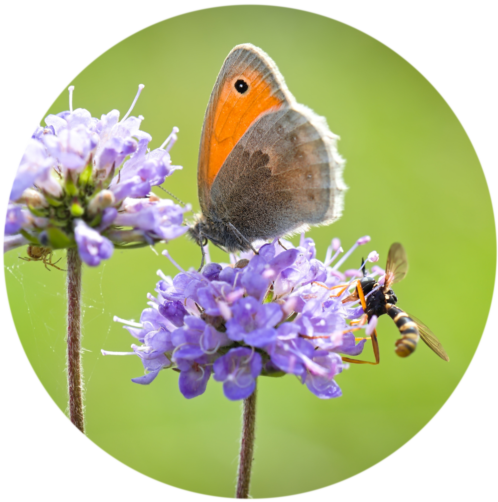{fig-align="center" width="630"}

::: notes
Butterflies on *Succisa pratensis*.
Sharing is the norm: plants share their visitors, losing pollen to other species and receiving foreign pollen on their stigmas.
:::

## What is pollination?

<span class="timing">≈ 1 min</span>

<div style="display: flex; align-items: center; gap: 10px; margin-top: 30px;">
<div class="fragment" data-fragment-index="1" style="flex: 1; text-align: center;">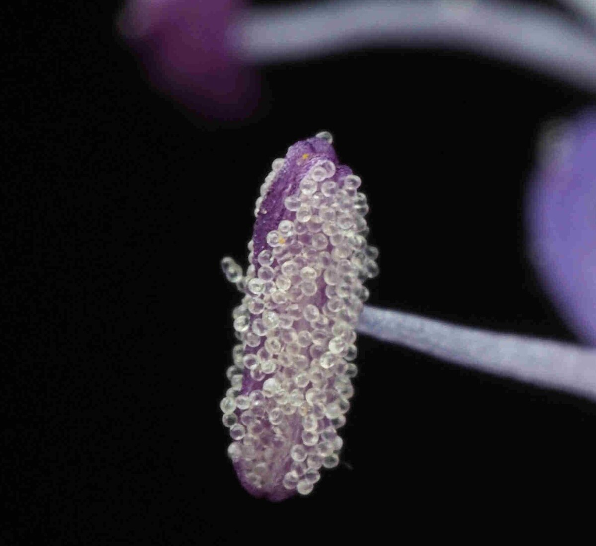<div style="font-size: 22px; margin-top: 8px;"><b>Pollen</b> is produced<br>in the anthers</div></div>
<div class="fragment" data-fragment-index="2" style="font-size: 80px; line-height: 1; color: #40695B;">›</div>
<div class="fragment" data-fragment-index="2" style="flex: 1; text-align: center;"><div style="font-size: 22px; margin-top: 8px;">An <b>animal</b> carries it<br>to another flower</div></div>
<div class="fragment" data-fragment-index="3" style="font-size: 80px; line-height: 1; color: #40695B;">›</div>
<div class="fragment" data-fragment-index="3" style="flex: 1; text-align: center;">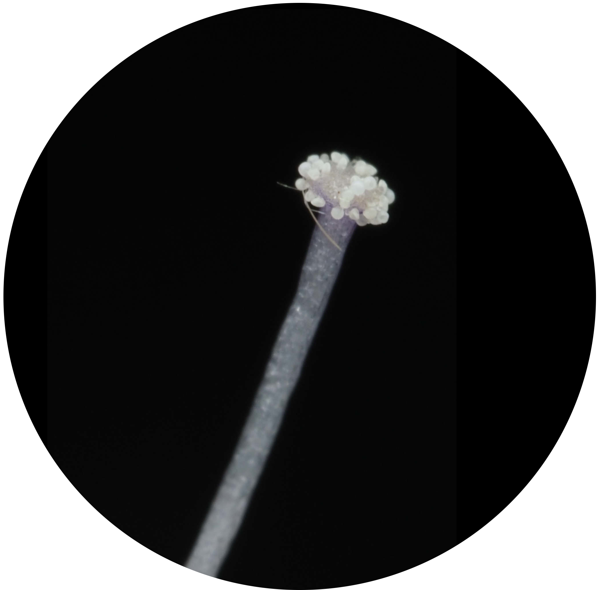<div style="font-size: 22px; margin-top: 8px;">It must land on a <b>stigma</b><br>of the <b>same species</b></div></div>
</div>

::: {.fragment fragment-index=4 style="text-align: center; font-size: 28px; font-weight: 600; color: #40695B; margin-top: 30px;"}
→ fertilisation → seeds
:::

::: notes
For the non-specialists: plants cannot move, so to mate they need a courier. Pollen from one flower has to reach the stigma of another flower of the same species. Pollen landing on the wrong species is lost, and can even block the stigma.
The three photos are from our meadow: Succisa anther, a hoverfly (Eristalis interruptus) covered in pollen, a Succisa stigma.
:::

## Not in a vacuum

<span class="timing">≈ 1 min</span>

<div style="text-align: center; margin-top: 10px;">
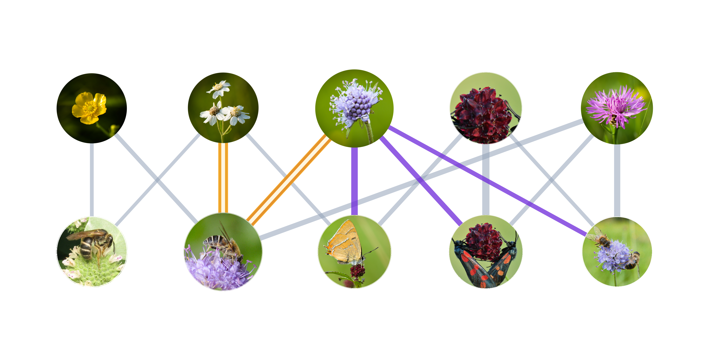{fig-align="center" width="96%"}
</div>

::: notes
Pollination does not happen as an isolated interaction between one flower and one dedicated visitor. In species-rich meadows, dozens of plants co-flower and share the same pollinator guild. Every visit is embedded in a complex web of direct and indirect interactions.
:::

## Why does it matter?

<span class="timing">≈ 1.5 min</span>

<div style="display: flex; gap: 16px; margin-top: 30px;">
<div style="flex: 1; background: #F8FAFC; border-top: 6px solid #3B0F70; border-radius: 10px; padding: 16px 12px; text-align: center;">
<div style="font-size: 54px; font-weight: 800; color: #3B0F70; line-height: 1;">≈ 88 %</div>
<div style="font-size: 20px; margin-top: 10px;">of flowering plants are pollinated by animals</div>
<div style="font-size: 14px; color: #64748B; margin-top: 8px;">@Ollerton2011</div>
</div>
<div class="fragment" style="flex: 1; background: #F8FAFC; border-top: 6px solid #B63679; border-radius: 10px; padding: 16px 12px; text-align: center;">
<div style="font-size: 54px; font-weight: 800; color: #B63679; line-height: 1;">75 %</div>
<div style="font-size: 20px; margin-top: 10px;">of leading crop types benefit from animal pollination</div>
<div style="font-size: 14px; color: #64748B; margin-top: 8px;">@Klein2007</div>
</div>
<div class="fragment" style="flex: 1; background: #F8FAFC; border-top: 6px solid #F8765C; border-radius: 10px; padding: 16px 12px; text-align: center;">
<div style="font-size: 54px; font-weight: 800; color: #F8765C; line-height: 1;">5–8 %</div>
<div style="font-size: 20px; margin-top: 10px;">of global crop production, US$ 235–577 billion per year</div>
<div style="font-size: 14px; color: #64748B; margin-top: 8px;">@Potts2016</div>
</div>
</div>

::: {.fragment style="margin-top: 34px;"}
::: bigmsg
Pollinators are declining, and most pollination happens<br>in diverse communities where <span style="color: #FEB47B;">plants share their pollinators</span>.
:::
:::

::: notes
Ollerton et al. 2011: about 87.5 % of flowering plant species are animal-pollinated (higher in the tropics, about 78 % in temperate communities).
Klein et al. 2007: 87 of 115 leading global food crops (75 %) benefit from animal pollination.
Potts et al. 2016 (IPBES assessment): 5–8 % of global crop production is directly attributable to animal pollination, worth US$ 235–577 billion per year.
Decline: e.g. Hallmann et al. 2017 found a more than 75 % drop in flying insect biomass over 27 years in German protected areas.
Bridge: pollination is not one plant and one bee. In a meadow like ours, dozens of plants share the same insects. That is the starting point of our work.
:::

## The journey of a pollen grain

<span class="timing">≈ 1 min</span>

<div style="display: flex; justify-content: center; align-items: stretch; gap: 10px; margin: 25px auto 16px auto; max-width: 960px;">

<div class="fragment" data-fragment-index="1" style="flex: 1; text-align: center; background: #FFFFFF; border-radius: 10px; padding: 12px 8px; box-shadow: 0 4px 14px rgba(0,0,0,0.06); border-top: 4px solid #40695B;">
<div style="height: 100px; display: flex; align-items: center; justify-content: center;">
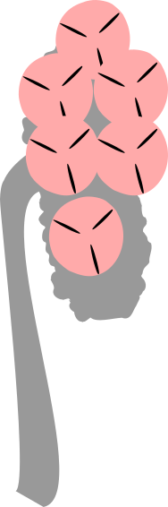
</div>
<div style="font-size: 16px; font-weight: 700; color: #1E293B; margin-top: 8px;">1&#46; Anther</div>
<div style="font-size: 13px; color: #64748B;">Presentation &amp; dosing</div>
<div style="font-size: 11px; font-weight: 700; color: #40695B; margin-top: 4px; text-transform: uppercase;">Part 2</div>
</div>

<div class="fragment" data-fragment-index="2" style="display: flex; align-items: center; justify-content: center;">
<svg width="42" height="30" viewBox="0 0 42 30" fill="none" style="display: block;">
<path d="M4 15h32M24 6l10 9-10 9" stroke="#40695B" stroke-width="4" stroke-linecap="round" stroke-linejoin="round"/>
</svg>
</div>

<div class="fragment" data-fragment-index="2" style="flex: 1.1; text-align: center; background: #FFFFFF; border-radius: 10px; padding: 12px 8px; box-shadow: 0 4px 14px rgba(0,0,0,0.06); border-top: 4px solid #40695B;">
<div style="height: 100px; display: flex; align-items: center; justify-content: center;">
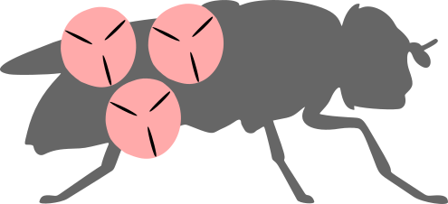
</div>
<div style="font-size: 16px; font-weight: 700; color: #1E293B; margin-top: 8px;">2&#46; Pollinator Body</div>
<div style="font-size: 13px; color: #64748B;">Capacity &amp; shared loads</div>
<div style="font-size: 11px; font-weight: 700; color: #40695B; margin-top: 4px; text-transform: uppercase;">Part 2–3</div>
</div>

<div class="fragment" data-fragment-index="3" style="display: flex; align-items: center; justify-content: center;">
<svg width="42" height="30" viewBox="0 0 42 30" fill="none" style="display: block;">
<path d="M4 15h32M24 6l10 9-10 9" stroke="#40695B" stroke-width="4" stroke-linecap="round" stroke-linejoin="round"/>
</svg>
</div>

<div class="fragment" data-fragment-index="3" style="flex: 1; text-align: center; background: #FFFFFF; border-radius: 10px; padding: 12px 8px; box-shadow: 0 4px 14px rgba(0,0,0,0.06); border-top: 4px solid #40695B;">
<div style="height: 100px; display: flex; align-items: center; justify-content: center;">
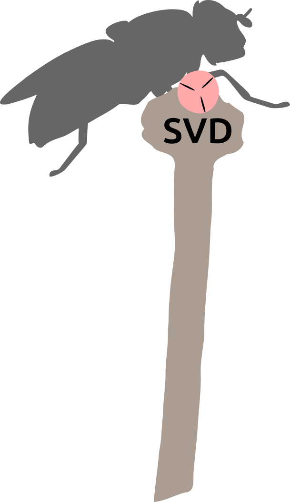
</div>
<div style="font-size: 16px; font-weight: 700; color: #1E293B; margin-top: 8px;">3&#46; Stigma</div>
<div style="font-size: 13px; color: #64748B;">Deposition: SVD → TPD</div>
<div style="font-size: 11px; font-weight: 700; color: #40695B; margin-top: 4px; text-transform: uppercase;">Part 3</div>
</div>

<div class="fragment" data-fragment-index="4" style="display: flex; align-items: center; justify-content: center;">
<svg width="42" height="30" viewBox="0 0 42 30" fill="none" style="display: block;">
<path d="M4 15h32M24 6l10 9-10 9" stroke="#40695B" stroke-width="4" stroke-linecap="round" stroke-linejoin="round"/>
</svg>
</div>

<div class="fragment" data-fragment-index="4" style="flex: 1; text-align: center; background: #FFFFFF; border-radius: 10px; padding: 12px 8px; box-shadow: 0 4px 14px rgba(0,0,0,0.06); border-top: 4px solid #40695B;">
<div style="height: 100px; display: flex; align-items: center; justify-content: center;">
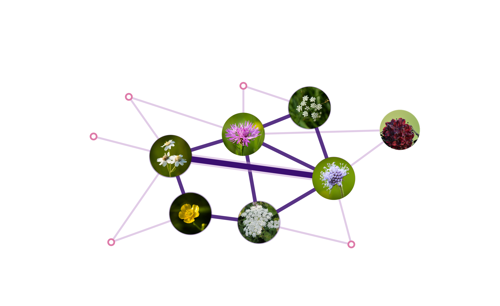
</div>
<div style="font-size: 16px; font-weight: 700; color: #1E293B; margin-top: 8px;">4&#46; Community</div>
<div style="font-size: 13px; color: #64748B;">Sharing network</div>
<div style="font-size: 11px; font-weight: 700; color: #40695B; margin-top: 4px; text-transform: uppercase;">Part 4–5</div>
</div>

</div>

<div class="fragment" data-fragment-index="5" style="display: flex; align-items: center; justify-content: center; gap: 14px; margin-top: 30px; margin-bottom: 12px;">
  <div style="height: 1px; flex: 1; max-width: 140px; background: linear-gradient(to right, transparent, #CBD5E1);"></div>
  <span style="font-size: 14px; font-weight: 800; text-transform: uppercase; letter-spacing: 2.5px; color: #40695B; background: #E6F0EC; border: 1px solid #C2DDD4; padding: 5px 20px; border-radius: 20px;">Outline of the talk</span>
  <div style="height: 1px; flex: 1; max-width: 140px; background: linear-gradient(to left, transparent, #CBD5E1);"></div>
</div>

<div class="roadmap" style="margin-top: 0;">
<div class="fragment" data-fragment-index="5"><span class="n">1</span>The meadow</div>
<div class="fragment" data-fragment-index="6"><span class="n">2</span>Pollen presentation<br><small>anther → pollinator</small></div>
<div class="fragment" data-fragment-index="7"><span class="n">3</span>Pollen deposition<br><small>pollinator → stigma</small></div>
<div class="fragment" data-fragment-index="8"><span class="n">4</span>The community<br><small>sharing network</small></div>
<div class="fragment" data-fragment-index="9"><span class="n">5</span>What's next</div>
</div>

::: notes
Guiding idea: plants cannot choose their visitors, but they can control WHEN they offer pollen, and they profit from HOW MANY visits they get and WHERE they grow. Each part shows one of these levers.
:::

# The system: K Handrkovu

::: {.r-stack style="margin-top: 15px;"}
{style="height: 520px; border-radius: 10px; box-shadow: 0 8px 25px rgba(0,0,0,0.3);"}

{.fragment style="height: 520px; border-radius: 10px; box-shadow: 0 8px 25px rgba(0,0,0,0.3);"}
:::

## The locality

<span class="timing">≈ 1 min</span>

::::: {style="display: flex; justify-content: center; align-items: flex-end; gap: 50px; margin-top: 30px;"}
::: {.fragment style="text-align: center; flex: 1;"}

<div style="font-size: 30px; margin-top: 10px;">Czech Republic</div>
:::

::: {.fragment style="text-align: center; flex: 1.3;"}
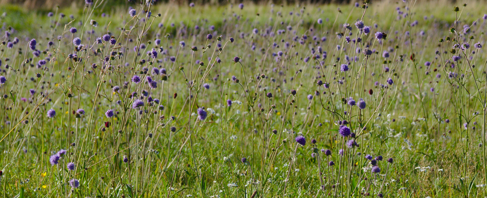
<div style="font-size: 30px; margin-top: 10px;">&gt; 50 entomophilous plant species</div>
:::
:::::

::: {.fragment style="text-align: center; font-size: 34px; font-weight: 600; margin-top: 40px;"}
15 years of data collection (2011–2025)
:::

::: src
Study design: @Janovsky2013
:::

::: notes
K Handrkovu near Vernýřov, Central Bohemia (49.8466 N, 15.1498 E). Moist to mesophilous grassland mosaic, two flowering peaks (May, August), mown twice a year. Sampling at the August peak.
Where it started: Janovský et al. 2013 (PLoS ONE) set up the plot design and showed that conspecific and heterospecific flower densities at a scale of a few metres drive which pollinators visit a plant. This small-scale density effect comes back twice in this talk: dilution of foreign pollen on Succisa stigmas (Part 3) and the pull of the core species (Part 4).
:::

## Permanent plots

<span class="timing">≈ 1 min</span>

::::: {style="display: flex; justify-content: center; align-items: flex-start; gap: 28px; margin-top: 30px;"}
::: {.fragment style="text-align: center; flex: 1;"}
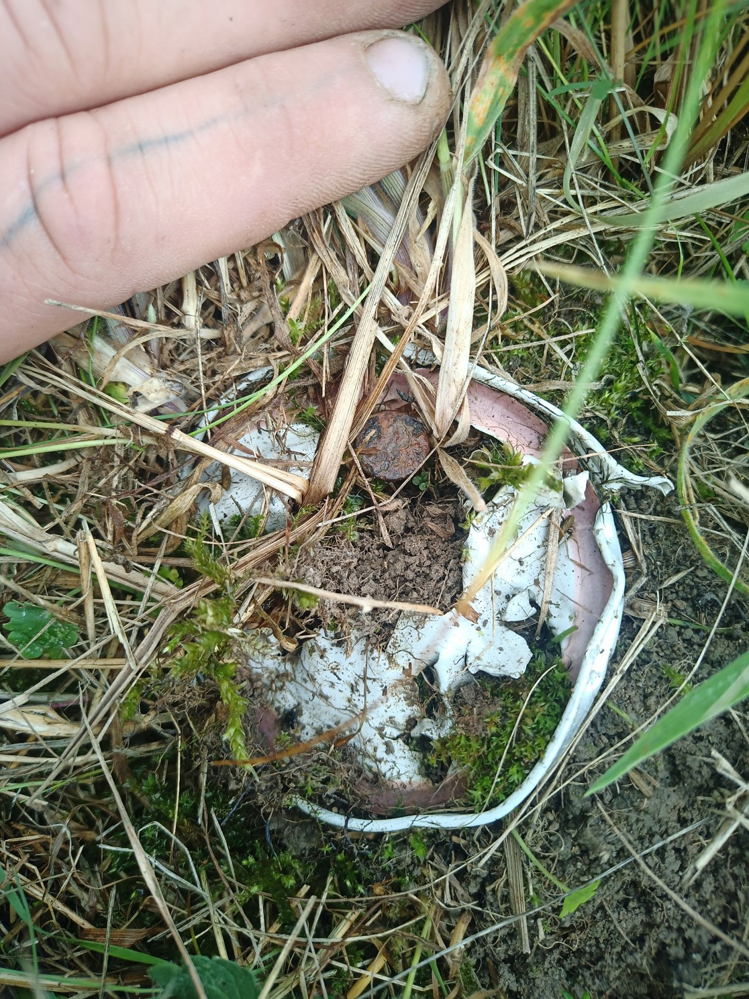
<div style="font-size: 30px; margin-top: 12px;">plots are marked</div>
:::

::: {.fragment style="text-align: center; flex: 1;"}
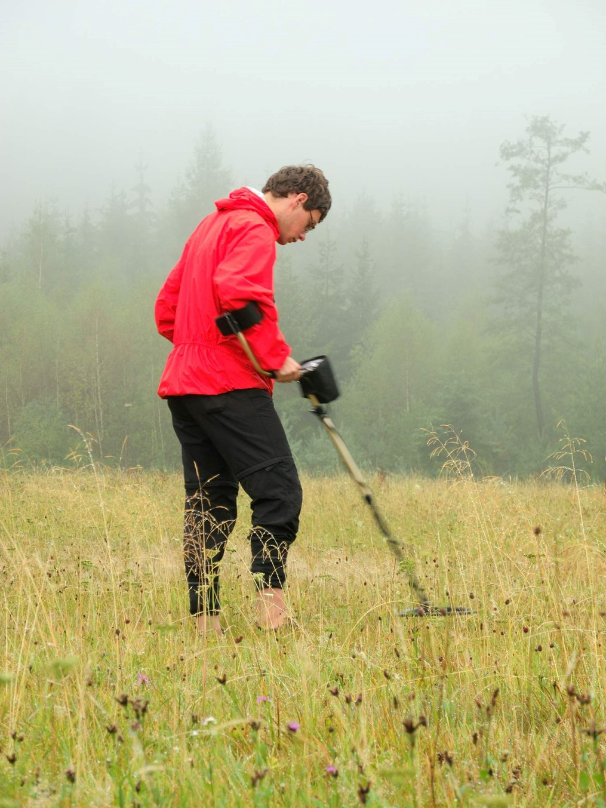
<div style="font-size: 30px; margin-top: 12px;">recovered every year</div>
:::

::: {.fragment style="text-align: center; flex: 1.25;"}

<div style="font-size: 30px; margin-top: 12px;">93 plots in total</div>
:::
:::::

## Plant and pollinator survey

<span class="timing">≈ 1.5 min</span>

::::: {style="display: flex; justify-content: center; align-items: flex-start; gap: 28px; margin-top: 20px;"}
::: {style="text-align: center; flex: 1;"}
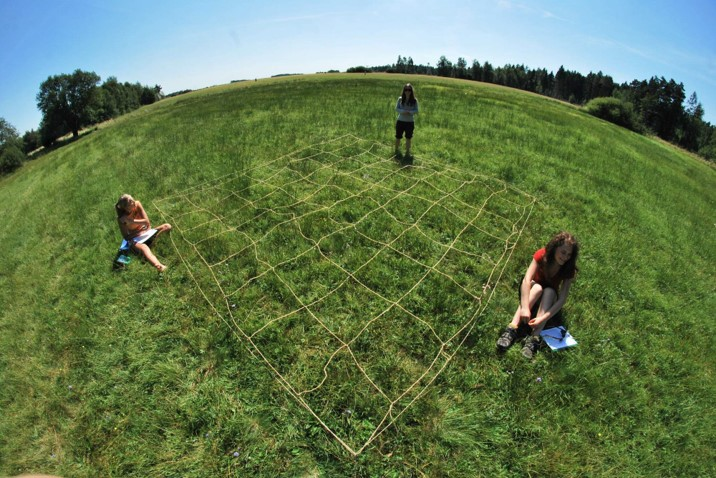
<div style="font-size: 24px; margin-top: 8px;">Flowering stalks in 64 cells per plot, twice per season</div>
:::

::: {.fragment style="text-align: center; flex: 1;"}

<div style="font-size: 24px; margin-top: 8px;">"Snapshot" surveys: insects touching reproductive organs</div>
:::
:::::

::: {.fragment style="text-align: center; font-size: 24px; margin-top: 14px;"}
42 378 plot surveys · 68 460 interactions · 176 pollinator taxa × 55 plant species
:::

::: notes
Numbers from the SCAPE 2026 dataset (2011–2025). Note: the DiuHanPolNet summary reports 58 451 interactions, 53 plants and 174 pollinators (different filtering). Use one consistent set in the talk.
:::

## 15 years of networks

<span class="timing">≈ 1 min</span>

{fig-align="center" height="560"}

::: notes
One plant-pollinator network per year. Same meadow, same method, very different networks: this year-to-year turnover will come back in Part 4.
Transition: before networks, start with the smallest unit, the pollen grain leaving the anther.
:::

# Pollen presentation {background-color="#40695B"}

<div class="roadmap">
<div><span class="n">1</span>The meadow</div>
<div class="on"><span class="n">2</span>Presentation<br><small>anther → pollinator</small></div>
<div><span class="n">3</span>Deposition</div>
<div><span class="n">4</span>Community</div>
<div><span class="n">5</span>Next</div>
</div>

## Why should timing matter?

<span class="timing">≈ 1 min</span>

<div style="display: flex; justify-content: space-around; align-items: flex-start; margin-top: 40px; text-align: center;">
<div style="flex: 1;">

<div style="font-size: 44px; font-weight: 800; color: #B63679; margin-top: 14px; line-height: 1;">&lt; 1 %</div>
<div style="font-size: 22px; margin-top: 8px;">of pollen reaches<br>a conspecific stigma</div>
</div>
<div class="fragment" style="flex: 1;">

<div style="font-size: 44px; font-weight: 800; color: #3B0F70; margin-top: 14px; line-height: 1;">Dose, don't dump</div>
<div style="font-size: 22px; margin-top: 8px;">small packages,<br>many couriers</div>
<div style="font-size: 15px; color: #64748B; margin-top: 6px; font-weight: 600;">Pollen presentation theory</div>
</div>
<div class="fragment" style="flex: 1;">
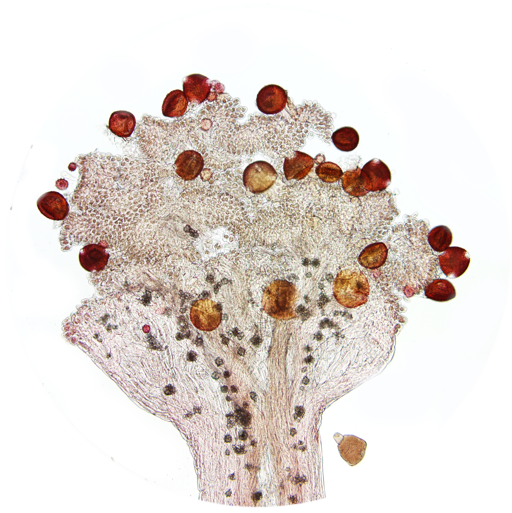
<div style="font-size: 44px; font-weight: 800; color: #40695B; margin-top: 14px; line-height: 1;">When = Who</div>
<div style="font-size: 22px; margin-top: 8px;">timing selects<br>the courier</div>
</div>
</div>

::: {.fragment style="text-align: center; font-size: 28px; font-weight: 600; color: #40695B; margin-top: 40px;"}
Plants can't choose visitors, but they can choose *when*
:::

::: notes
Transition to Part 2: we move from meadow-wide networks down to the scale of the pollen grain.
1. The dilemma: anthers produce millions of grains, but < 1% ever reaches a conspecific stigma. Over 99% is eaten by hoverflies and bees, groomed away, or dropped on foreign stigmas.
2. Harder & Thomson 1989: because visits have diminishing returns, dumping all pollen at once causes massive wastage. Dosing pollen gradually across visits maximizes the number of carriers and recipient mates.
3. In a shared meadow, pollinators have distinct daily activity curves. When a plant releases its pollen determines which pollinator guild it attracts and how much foreign pollen it avoids.
:::


## Three species, three strategies

<span class="timing">≈ 1 min</span>

<div style="display: flex; gap: 18px; margin-top: 10px;">
<div style="flex: 1; text-align: center;">
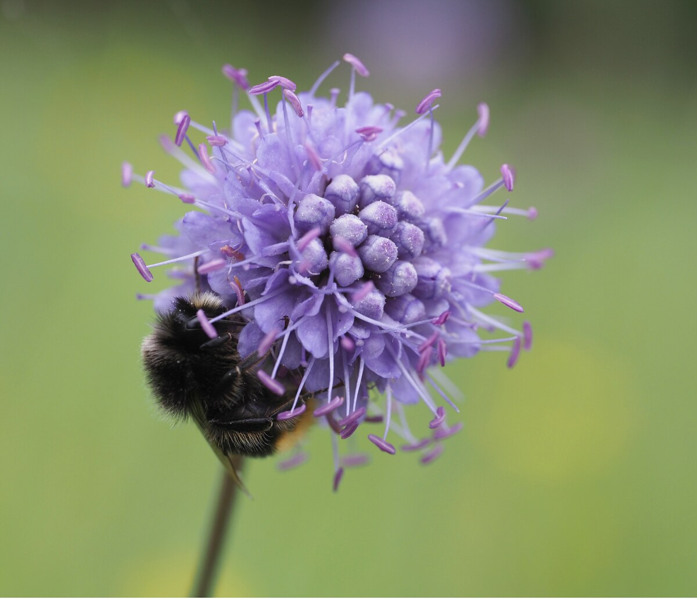

<div style="font-size: 21px; font-weight: 700; font-style: italic; color: #5B3F9A; margin-top: 6px;">Succisa pratensis</div>
<div style="font-size: 16px; color: #334155; line-height: 1.3;">Open flowers, pollen freely exposed<br>Mainly pollen-feeding hoverflies</div>
</div>
<div style="flex: 1; text-align: center;">
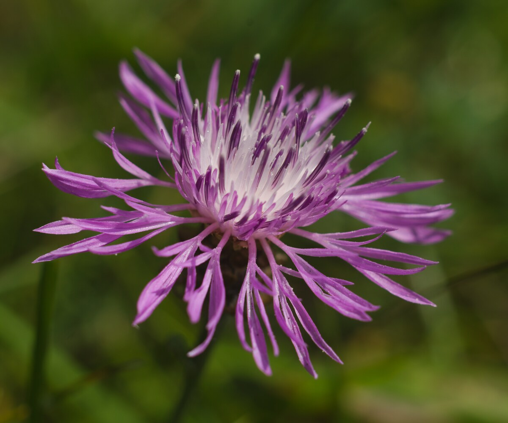
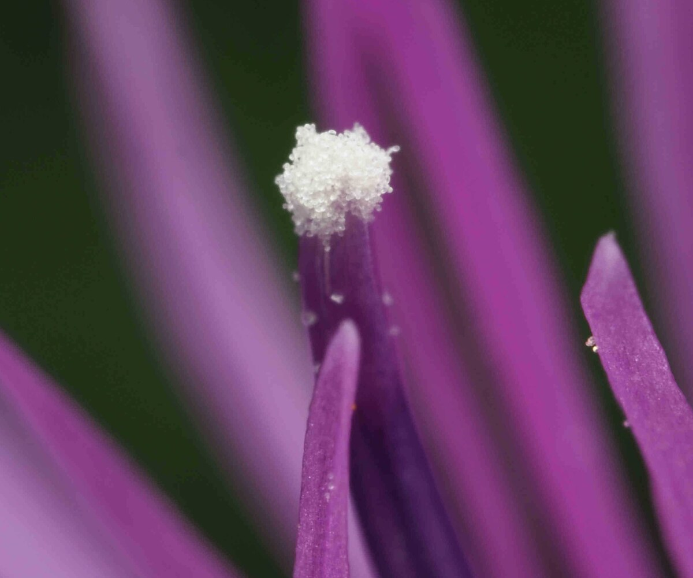
<div style="font-size: 21px; font-weight: 700; font-style: italic; color: #B0207F; margin-top: 6px;">Centaurea jacea</div>
<div style="font-size: 16px; color: #334155; line-height: 1.3;">Pollen pumped out of the anther tube<br>Mainly bees</div>
</div>
<div style="flex: 1; text-align: center;">
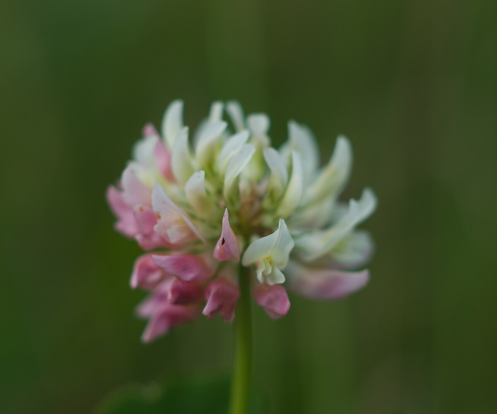
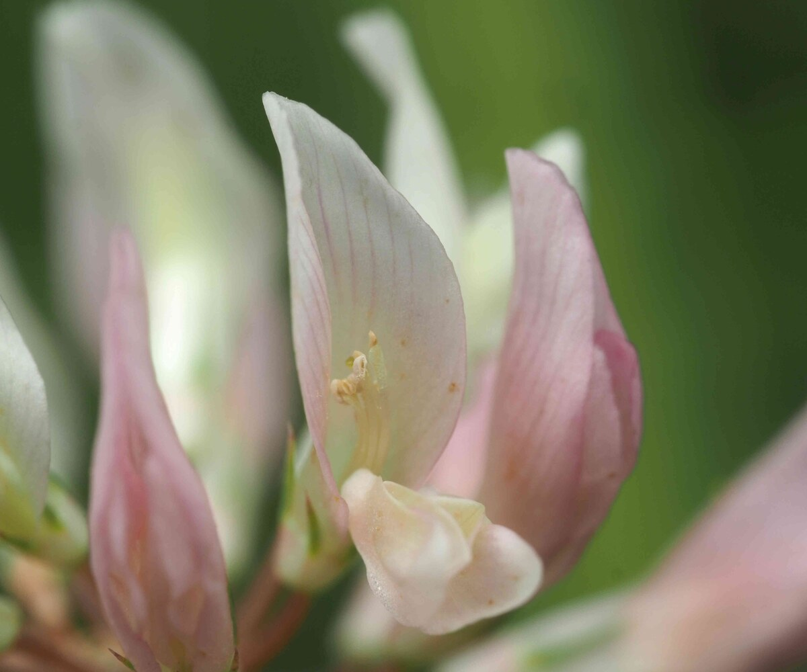
<div style="font-size: 21px; font-weight: 700; font-style: italic; color: #2E9A50; margin-top: 6px;">Trifolium hybridum</div>
<div style="font-size: 16px; color: #334155; line-height: 1.3;">Closed flowers, pollen released when a bee opens them<br>Bees only</div>
</div>
</div>

::: src
Photos: Lukáš Janošík · @Stenc2023
:::

::: notes
Three co-flowering species at Handrkov that share part of their pollinators but differ in how pollen is presented.
Click: close-ups of pollen presentation. Succisa: anthers fully exposed, pollen easy to take. Centaurea: Asteraceae pump mechanism, the style pushes pollen out of the anther tube gradually. Trifolium: pollen hidden in the keel, released only when a bee forces the flower open.
Colours of the species names match the curves on the next slides.
:::

## How we measured pollen release

<span class="timing">≈ 0.5 min</span>

::::: columns
::: {.column width="45%"}
::: {.r-stack style="margin-top: 10px; width: 100%; height: 470px;"}
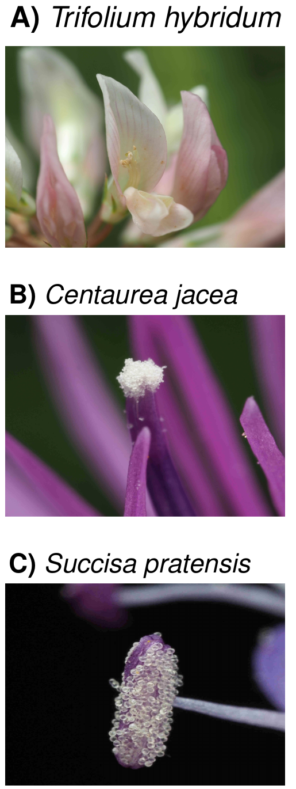{.fragment .fade-out data-fragment-index="1" style="height: 470px; max-width: 100%; object-fit: contain; border-radius: 8px; box-shadow: 0 4px 16px rgba(0,0,0,0.12);"}

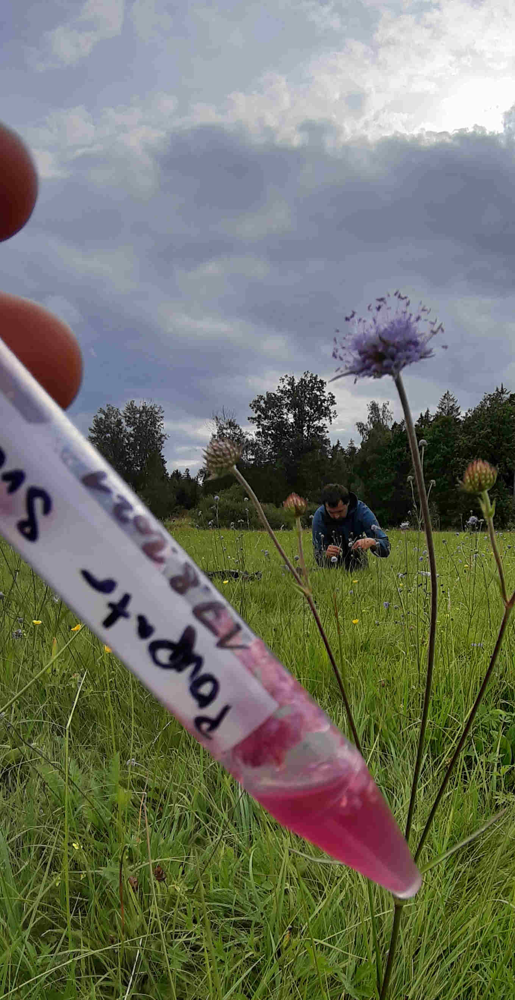{.fragment .fade-in-then-out data-fragment-index="1" style="height: 470px; max-width: 100%; object-fit: contain; border-radius: 8px; box-shadow: 0 4px 16px rgba(0,0,0,0.15);"}

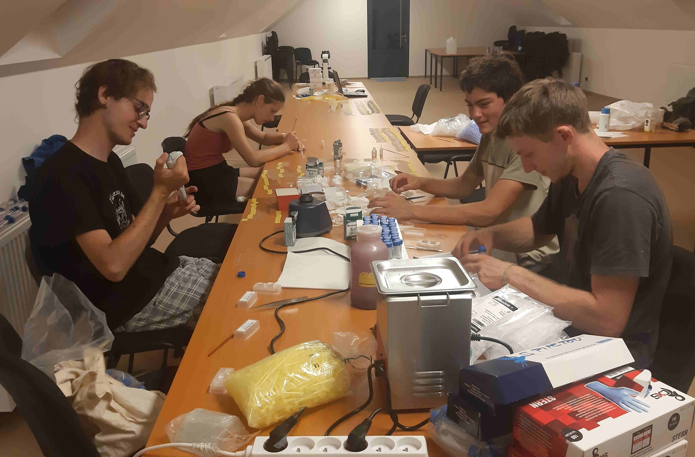{.fragment .fade-in-then-out data-fragment-index="2" style="height: 470px; max-width: 100%; object-fit: contain; border-radius: 8px; box-shadow: 0 4px 16px rgba(0,0,0,0.15);"}

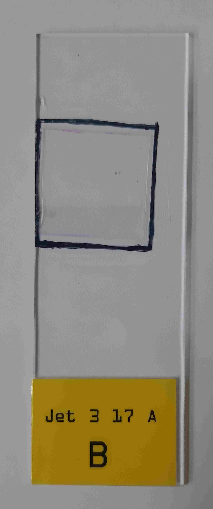{.fragment data-fragment-index="3" style="height: 470px; max-width: 100%; object-fit: contain; border-radius: 8px; box-shadow: 0 4px 16px rgba(0,0,0,0.15);"}
:::
:::

::: {.column width="55%"}
::: {style="font-size: 24px; margin-top: 25px; line-height: 1.45;"}
1.  Every hour, 8:00–17:00, two days
2.  Flowers offering pollen from 5 inflorescences per species → vial with stained detergent solution
3.  Pollen grains in each vial counted
4.  Flowers offering pollen counted on 20 inflorescences
:::

::: {.fragment data-fragment-index="4" style="font-size: 23px; margin-top: 24px; color: #40695B; font-weight: 600;"}
→ pollen available per inflorescence, hour by hour
:::
:::
:::::

::: src
Photos: Handrkov team & Lukáš Janošík · @Stenc2023
:::

::: notes
START I methods (Štenc et al. 2023, AJB): 15 and 16 August 2021, hourly sampling, 5 vials per species per hour, each vial = flowers from 5 random inflorescences (3 flowers for Trifolium and Centaurea, 5 for Succisa) in 2 ml of detergent with basic fuchsin. Only flowers actively presenting pollen and visited by pollinators were taken.
Pollinator visitation was recorded in parallel, so pollen supply and visits can be compared hour by hour.
:::

## When is pollen available?

<span class="timing">≈ 1.5 min</span>

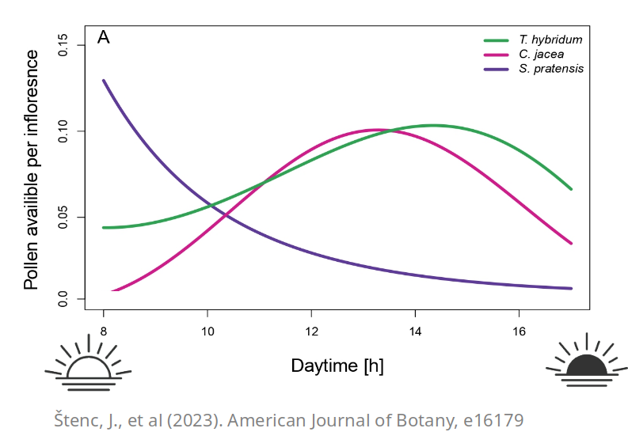{fig-align="center" height="480"}

::: src
@Stenc2023
:::

::: {.fragment .absolute top="30%" left="15%" width="70%"}
::: bigmsg
*Succisa* releases its pollen in the morning.<br><span style="color: #FEB47B;">*Centaurea* and *Trifolium* peak in the early afternoon.</span>
:::
:::

::: notes
Štenc et al. 2023, American Journal of Botany. Pollen available per inflorescence over the day.
:::

## Pollinators track pollen

<span class="timing">≈ 1 min</span>

::::: columns
::: {.column width="52%"}
::: {.r-stack}
::: {.fragment .fade-out data-fragment-index="1"}
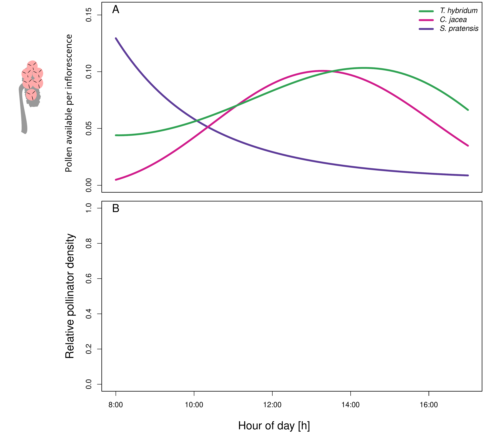
:::
::: {.fragment data-fragment-index="1"}
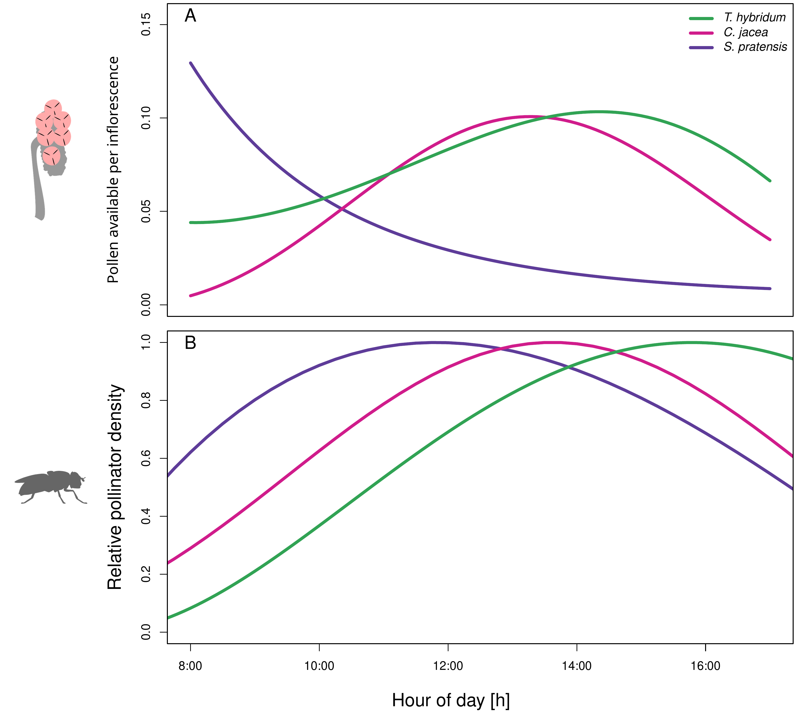
:::
::: {.fragment data-fragment-index="2" style="align-self: end; justify-self: end; margin-bottom: 36px; margin-right: 22px; width: 70%; background: rgba(0, 0, 0, 0.78); backdrop-filter: blur(8px); -webkit-backdrop-filter: blur(8px); color: #FFFFFF; border: 1px solid rgba(255, 255, 255, 0.22); border-radius: 10px; box-shadow: 0 8px 32px rgba(0, 0, 0, 0.45); padding: 14px 18px; font-size: 18px; font-weight: 600; line-height: 1.35; text-align: center; z-index: 10;"}
→ Pollinator activity closely tracks the temporal window of pollen availability!
:::
:::
:::

::: {.column width="48%"}
::: {style="margin-top: 18px; display: flex; flex-direction: column; gap: 16px;"}
::: {style="display: flex; align-items: center; gap: 14px; padding: 12px 14px; border-left: 5px solid #5E3C99; background: rgba(94,60,153,0.06); border-radius: 0 10px 10px 0;"}

<div>
<div style="font-weight: 700; color: #5E3C99; font-size: 20px; line-height: 1.2;">*Succisa pratensis*</div>
<div style="font-size: 15px; color: #334155; line-height: 1.35; margin-top: 3px;">Morning pollen release → visits peak at **11:45**</div>
</div>
:::

::: {style="display: flex; align-items: center; gap: 14px; padding: 12px 14px; border-left: 5px solid #D01C8B; background: rgba(208,28,139,0.06); border-radius: 0 10px 10px 0;"}

<div>
<div style="font-weight: 700; color: #D01C8B; font-size: 20px; line-height: 1.2;">*Centaurea jacea*</div>
<div style="font-size: 15px; color: #334155; line-height: 1.35; margin-top: 3px;">Midday presentation → visits peak at **13:30**</div>
</div>
:::

::: {style="display: flex; align-items: center; gap: 14px; padding: 12px 14px; border-left: 5px solid #31A354; background: rgba(49,163,84,0.06); border-radius: 0 10px 10px 0;"}

<div>
<div style="font-weight: 700; color: #31A354; font-size: 20px; line-height: 1.2;">*Trifolium hybridum*</div>
<div style="font-size: 15px; color: #334155; line-height: 1.35; margin-top: 3px;">Afternoon presentation → visits peak at **15:45**</div>
</div>
:::
:::
:::
:::::

::: src
@Stenc2023
:::

::: notes
Key result of START I (Štenc et al. 2023 AJB):
Panel A: Diurnal schedule of pollen available per inflorescence.
Panel B: Diurnal relative pollinator visitation density.
Pollinators of all three species showed a unimodal diurnal visitation pattern, but differed in their peak timing:
- Succisa pratensis (purple): pollen released in the morning; visitation peaks at ca 11:45 (hoverflies and small solitary bees).
- Centaurea jacea (pink): pollen presented around midday; visitation peaks at ca 13:30.
- Trifolium hybridum (green): pollen presented in the afternoon; visitation peaks at ca 15:45 (bumblebees).
Pollinator activity closely tracks the diurnal pollen supply!
:::

## But does it reflect pollen transfer?

<span class="timing">≈ 0.5 min</span>

::: {style="display: flex; align-items: center; justify-content: center; height: 420px; text-align: center;"}
[But does visitation reflect actual pollen transfer?]{style="font-size: 46px; font-weight: 700; color: #40695B; line-height: 1.35; max-width: 850px;"}
:::

::: notes
We have seen that visitation matches diurnal pollen availability (START I, Štenc et al. 2023).
But does a visit equal pollination?
Observing visits only tells us who lands on flowers. It doesn't tell us:
1. Whether pollen is actually picked up.
2. How many grains the insect carries (load).
3. How pure that pollen load is (conspecific vs heterospecific).
To bridge the gap between flower visitation and actual pollen flow, we captured foraging insects and swabbed their bodies.
This brings us to START II (Štenc et al. 2025, PPEES).
:::

## Swabbing pollinators

<span class="timing">≈ 1 min</span>

::::: columns
::: {.column width="52%"}
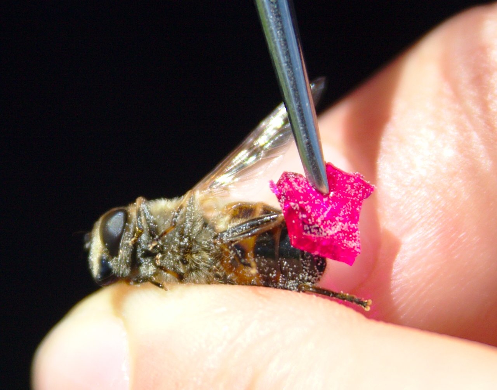{fig-align="center" height="430"}
:::

::: {.column width="48%"}
::: {style="font-size: 21px; margin-top: 15px;"}
1. Catch insect on the flower, swab **one half** of the body
2. Cube of glycerine jelly with fuchsin picks up the pollen
3. Melt the jelly on a slide
4. Count every second square, identify 200 grains
:::

::: {style="display: flex; align-items: center; justify-content: space-between; margin-top: 22px; background: rgba(64,105,91,0.08); padding: 14px 18px; border-radius: 12px; border-left: 5px solid #40695B;"}
::: {style="font-size: 20px; color: #40695B; font-weight: 600; line-height: 1.35;"}
Per insect:

- **Load** (grains)
- **Purity** (share of own pollen)
:::

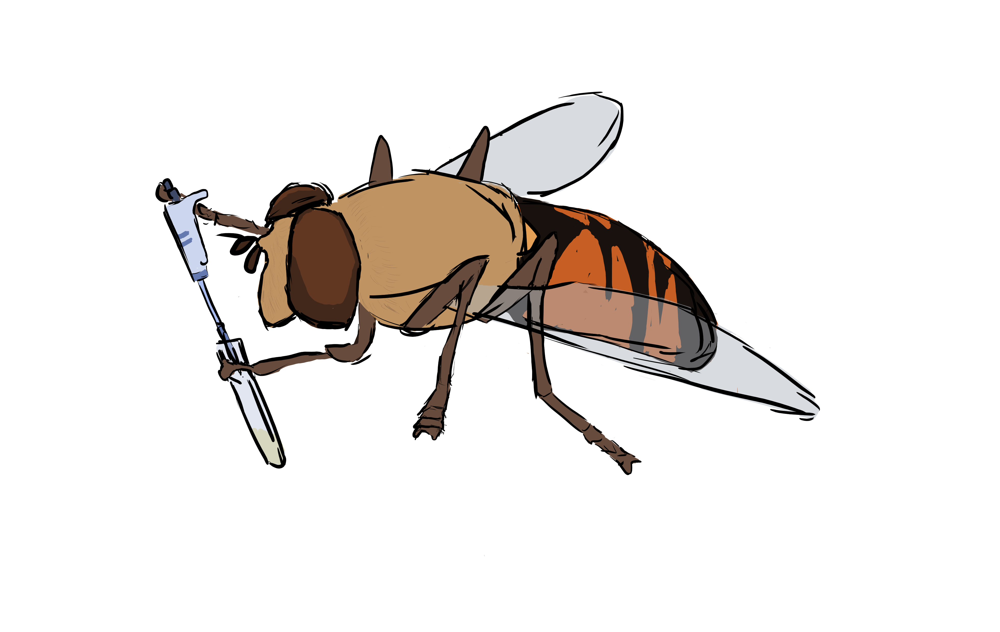{height="130" style="margin-left: 10px;"}
:::
:::
:::::

::: src
@beattie1971technique
:::

::: notes
Same protocol in START II, in Freudenfeld et al. 2025 and in the deposition paper (body loads on Succisa visitors).
Bees: pollen packed in the corbiculae is not swabbed, because it no longer takes part in pollination.
Counts therefore refer to one quarter of the body (half the body swabbed, half of the squares counted).
Conspecific = pollen of the plant on which the insect was caught. Heterospecific = everything else.
Pipestřenka mascot: custom laboratory hoverfly illustration.
:::

## What do pollinators carry?

<span class="timing">≈ 1.5 min</span>

::::: columns
::: {.column width="22%"}
::: {style="display: flex; flex-direction: column; justify-content: space-between; height: 500px; padding: 10px 0;"}
<div style="display: flex; align-items: center; gap: 10px; padding: 8px 10px; border-left: 4px solid #31A354; background: rgba(49,163,84,0.07); border-radius: 0 10px 10px 0;"><div style="font-weight: 700; color: #31A354; font-size: 15px; line-height: 1.2;">*Trifolium hybridum*</div></div>

<div style="display: flex; align-items: center; gap: 10px; padding: 8px 10px; border-left: 4px solid #D01C8B; background: rgba(208,28,139,0.07); border-radius: 0 10px 10px 0;"><div style="font-weight: 700; color: #D01C8B; font-size: 15px; line-height: 1.2;">*Centaurea jacea*</div></div>

<div style="display: flex; align-items: center; gap: 10px; padding: 8px 10px; border-left: 4px solid #5E3C99; background: rgba(94,60,153,0.07); border-radius: 0 10px 10px 0;"><div style="font-weight: 700; color: #5E3C99; font-size: 15px; line-height: 1.2;">*Succisa pratensis*</div></div>
:::
:::

::: {.column width="38%"}
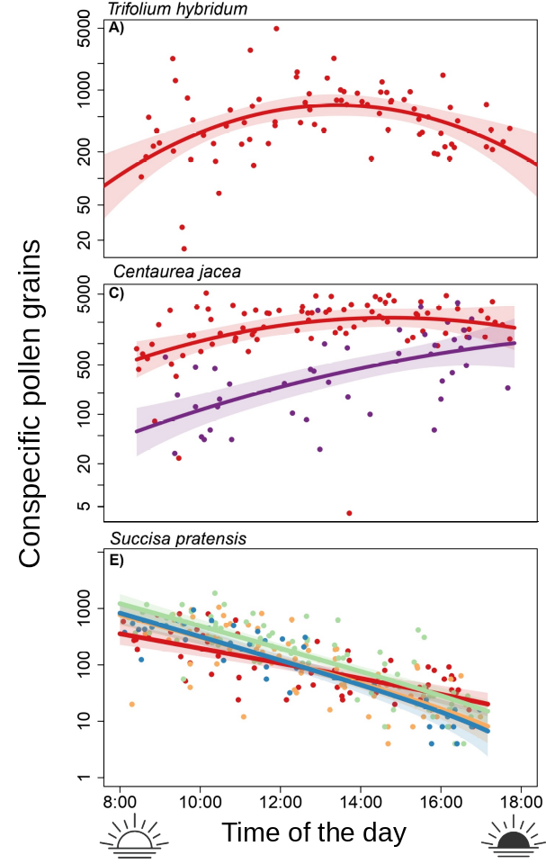{fig-align="center" height="515"}

::: src
@stenc2025pollen
:::
:::

::: {.column width="40%"}
::: {style="margin-top: 10px;"}
::: {style="background: #F8FAFC; border-radius: 10px; padding: 12px 14px; border: 1px solid #E2E8F0; margin-bottom: 14px;"}
::: {style="font-size: 14px; font-weight: 700; text-transform: uppercase; letter-spacing: 0.5px; color: #64748B; margin-bottom: 8px;"}
Focal Pollinators (Curves)
:::
<div style="display: grid; grid-template-columns: 1fr 1fr; gap: 6px; font-size: 15px;"><div><span style="color: #D73027; font-weight: bold; font-size: 18px;">●</span> <em>Apis mellifera</em></div><div><span style="color: #762A83; font-weight: bold; font-size: 18px;">●</span> <em>Bombus</em> spp.</div><div><span style="color: #2166AC; font-weight: bold; font-size: 18px;">●</span> <em>Helophilus</em> spp.</div><div><span style="color: #A6DBA0; font-weight: bold; font-size: 18px;">●</span> <em>Eristalis tenax</em></div><div style="grid-column: span 2;"><span style="color: #FDB863; font-weight: bold; font-size: 18px;">●</span> <em>Eristalis nemorum</em></div></div>
:::

::: {style="font-size: 20px; line-height: 1.4;"}
- ***Succisa***: early hoverflies carry highest loads; pollen availability & purity drop by noon
- ***Centaurea*** & ***Trifolium***: honeybees provide sustained conspecific transport into afternoon
- Stratified timing lowers reproductive interference between plant species
:::
:::
:::
:::::

::: notes
Štenc et al. 2025, PPEES 67: 125868. Conspecific pollen on pollinator bodies over the day (log scale), by pollinator taxon.
Notice how the 3 plant species split the daily timeline:
- Succisa (purple, bottom) relies heavily on hoverflies (Eristalis, Helophilus) in the morning.
- Centaurea (pink, middle) and Trifolium (green, top) are primarily visited by Apis mellifera and Bombus later in the day.
:::

## Pollen quality on the body

<span class="timing">≈ 1 min</span>

::::: columns
::: {.column width="22%"}
::: {style="display: flex; flex-direction: column; justify-content: space-between; height: 500px; padding: 10px 0;"}
<div style="display: flex; align-items: center; gap: 10px; padding: 8px 10px; border-left: 4px solid #31A354; background: rgba(49,163,84,0.07); border-radius: 0 10px 10px 0;"><div style="font-weight: 700; color: #31A354; font-size: 15px; line-height: 1.2;">*Trifolium hybridum*</div></div>

<div style="display: flex; align-items: center; gap: 10px; padding: 8px 10px; border-left: 4px solid #D01C8B; background: rgba(208,28,139,0.07); border-radius: 0 10px 10px 0;"><div style="font-weight: 700; color: #D01C8B; font-size: 15px; line-height: 1.2;">*Centaurea jacea*</div></div>

<div style="display: flex; align-items: center; gap: 10px; padding: 8px 10px; border-left: 4px solid #5E3C99; background: rgba(94,60,153,0.07); border-radius: 0 10px 10px 0;"><div style="font-weight: 700; color: #5E3C99; font-size: 15px; line-height: 1.2;">*Succisa pratensis*</div></div>
:::
:::

::: {.column width="38%"}
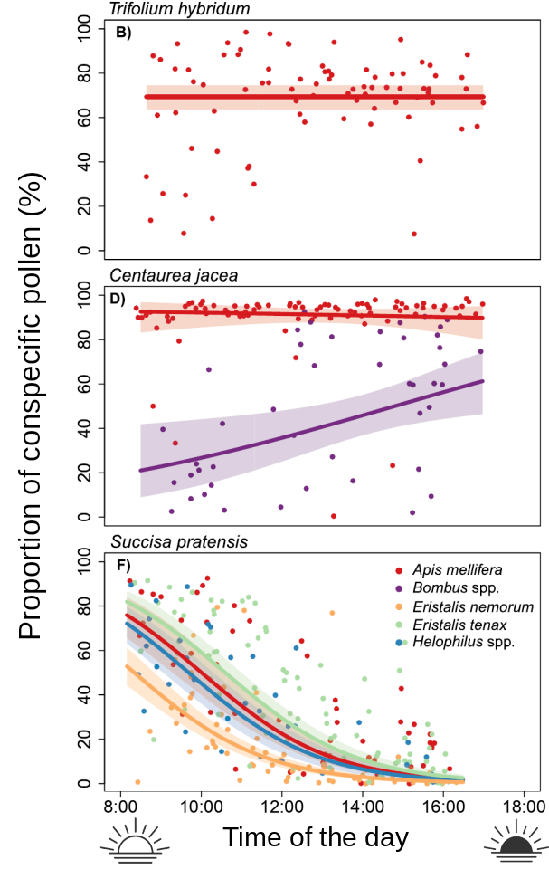{fig-align="center" height="515"}

::: src
@stenc2025pollen
:::
:::

::: {.column width="40%"}
::: {style="margin-top: 10px;"}
::: {style="background: #F8FAFC; border-radius: 10px; padding: 12px 14px; border: 1px solid #E2E8F0; margin-bottom: 14px;"}
::: {style="font-size: 14px; font-weight: 700; text-transform: uppercase; letter-spacing: 0.5px; color: #64748B; margin-bottom: 8px;"}
Focal Pollinators (Curves)
:::
<div style="display: grid; grid-template-columns: 1fr 1fr; gap: 6px; font-size: 15px;"><div><span style="color: #D73027; font-weight: bold; font-size: 18px;">●</span> <em>Apis mellifera</em></div><div><span style="color: #762A83; font-weight: bold; font-size: 18px;">●</span> <em>Bombus</em> spp.</div><div><span style="color: #2166AC; font-weight: bold; font-size: 18px;">●</span> <em>Helophilus</em> spp.</div><div><span style="color: #A6DBA0; font-weight: bold; font-size: 18px;">●</span> <em>Eristalis tenax</em></div><div style="grid-column: span 2;"><span style="color: #FDB863; font-weight: bold; font-size: 18px;">●</span> <em>Eristalis nemorum</em></div></div>
:::

::: {style="font-size: 20px; line-height: 1.4;"}
- ***Succisa***: purity crashes from **>80%** in the morning to **<20%** by afternoon across all visitors
- ***Centaurea***: honeybees maintain **>90%** purity; bumblebee constancy increases over time (20% → 70%)
- ***Trifolium***: honeybees sustain steady conspecific purity (**~70%**) all day
- Morning presentation protects pollen from dilution by heterospecific grains
:::
:::
:::
:::::

::: notes
Štenc et al. 2025, PPEES 67: 125868. Proportion of conspecific pollen (%) on pollinator bodies over the day.
- Succisa (purple, bottom): High initial purity (>80%) rapidly decays as the day progresses, falling under 20% in afternoon. Hoverflies and bees get contaminated with foreign pollen as meadow flowers open.
- Centaurea (pink, middle): Apis mellifera is remarkably constant (~90% pure), while bumblebees improve purity from morning to late afternoon.
- Trifolium (green, top): Steady ~70% purity across the day on honeybees.
- Key ecological takeaway: Presenting pollen early protects floral investment from heterospecific dilution and stigma clogging.
:::

## From 3 focal plants → Meadow-wide network

<span class="timing">≈ 1 min</span>

<div style="font-size: 20px; color: #40695B; font-weight: 600; margin-bottom: 14px; margin-top: -6px;">From 3 focal plants → Meadow-wide scan of body pollen loads across all flower visitors</div>

::::: columns
::: {.column width="32%"}
```{=html}
<div style="background: #F8FAFC; border: 1.5px solid #E2E8F0; border-radius: 14px; padding: 14px 12px; height: 490px; display: flex; flex-direction: column; justify-content: space-between; box-shadow: 0 4px 12px rgba(0,0,0,0.03);">
  <div>
    <div style="font-size: 13px; font-weight: 800; text-transform: uppercase; letter-spacing: 1px; color: #64748B; margin-bottom: 10px; display: flex; align-items: center; gap: 6px;">
      <span style="background: #40695B; color: white; width: 22px; height: 22px; border-radius: 50%; display: inline-flex; align-items: center; justify-content: center; font-size: 12px; font-weight: 700;">1</span>
      3 Focal Plant Species
    </div>
    <div style="display: flex; flex-direction: column; gap: 10px;">
      <div style="display: flex; align-items: center; gap: 10px; padding: 8px 10px; border-left: 4px solid #31A354; background: rgba(49,163,84,0.08); border-radius: 0 10px 10px 0;">
        
        <div>
          <div style="font-weight: 700; color: #31A354; font-size: 15px; line-height: 1.2;"><em>Trifolium hybridum</em></div>
          <div style="font-size: 12px; color: #64748B; margin-top: 2px;">Mid-day presentation · Honeybees</div>
        </div>
      </div>
      <div style="display: flex; align-items: center; gap: 10px; padding: 8px 10px; border-left: 4px solid #D01C8B; background: rgba(208,28,139,0.08); border-radius: 0 10px 10px 0;">
        
        <div>
          <div style="font-weight: 700; color: #D01C8B; font-size: 15px; line-height: 1.2;"><em>Centaurea jacea</em></div>
          <div style="font-size: 12px; color: #64748B; margin-top: 2px;">Afternoon pump · Bees &amp; Bumblebees</div>
        </div>
      </div>
      <div style="display: flex; align-items: center; gap: 10px; padding: 8px 10px; border-left: 4px solid #5E3C99; background: rgba(94,60,153,0.08); border-radius: 0 10px 10px 0;">
        
        <div>
          <div style="font-weight: 700; color: #5E3C99; font-size: 15px; line-height: 1.2;"><em>Succisa pratensis</em></div>
          <div style="font-size: 12px; color: #64748B; margin-top: 2px;">Morning release · Early hoverflies</div>
        </div>
      </div>
    </div>
  </div>
  <div style="background: #FFFFFF; border: 1px solid #E2E8F0; border-radius: 8px; padding: 8px 10px; font-size: 13px; color: #475569; line-height: 1.35;">
    <strong>Detailed focal species:</strong> diurnal timing, pollen availability, and purity dynamics
  </div>
</div>
```
:::

::: {.column width="8%"}
```{=html}
<div style="height: 490px; display: flex; flex-direction: column; align-items: center; justify-content: center; gap: 8px;">
  <div style="font-size: 11px; font-weight: 800; text-transform: uppercase; letter-spacing: 1.5px; color: #40695B;">Scale Up</div>
  <svg width="40" height="40" viewBox="0 0 24 24" fill="none" stroke="#40695B" stroke-width="2.8" stroke-linecap="round" stroke-linejoin="round">
    <line x1="4" y1="12" x2="20" y2="12"></line>
    <polyline points="13 5 20 12 13 19"></polyline>
  </svg>
  <div style="font-size: 10px; font-weight: 700; color: #64748B; text-align: center; line-height: 1.2;">Entire<br>Meadow</div>
</div>
```
:::

::: {.column width="60%"}
```{=html}
<div style="background: #F8FAFC; border: 1.5px solid #E2E8F0; border-radius: 14px; padding: 14px 16px; height: 490px; display: flex; flex-direction: column; justify-content: space-between; box-shadow: 0 4px 12px rgba(0,0,0,0.03);">
  <div>
    <div style="font-size: 13px; font-weight: 800; text-transform: uppercase; letter-spacing: 1px; color: #3B0F70; margin-bottom: 8px; display: flex; align-items: center; gap: 6px;">
      <span style="background: #3B0F70; color: white; width: 22px; height: 22px; border-radius: 50%; display: inline-flex; align-items: center; justify-content: center; font-size: 12px; font-weight: 700;">2</span>
      Meadow-wide Plant Network (Pollen Sharing)
    </div>
    <div style="background: #FFFFFF; border-radius: 10px; padding: 8px; border: 1px solid #E2E8F0; text-align: center;">
      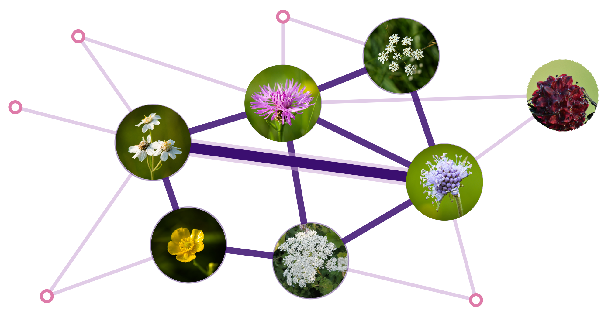
    </div>
  </div>
  <div style="display: grid; grid-template-columns: 1fr 1fr; gap: 10px; margin-top: 6px;">
    <div style="background: #FFFFFF; border: 1px solid #E2E8F0; border-radius: 8px; padding: 8px 10px; font-size: 13px; color: #334155; line-height: 1.3;">
      <strong style="color: #40695B;">Community context:</strong> Dozens of co-flowering plant species connected by shared flower visitors
    </div>
    <div style="background: #FFFFFF; border: 1px solid #E2E8F0; border-radius: 8px; padding: 8px 10px; font-size: 13px; color: #334155; line-height: 1.3;">
      <strong style="color: #3B0F70;">The next question:</strong> Across all 618 flower visitors, who actually carries the bulk of pollen?
    </div>
  </div>
</div>
```
:::
:::::

::: notes
Transition slide from START II to Martin Freudenfeld's meadow-wide work.
- So far, we focused on 3 focal plant species (Trifolium, Centaurea, Succisa) and their diurnal pollen dynamics.
- But in real meadows, co-flowering plants are embedded in dense interaction networks linked by generalist flower visitors.
- Next step: we scale up to the entire meadow community, swabbing body pollen loads across all flower visitors to ask: who really carries the pollen?
:::

## Who carries the pollen?

<span class="timing">≈ 1 min</span>

<div style="font-size: 20px; color: #40695B; font-weight: 600; margin-bottom: 10px; margin-top: -6px;">Individual body pollen loads across all flower visitors (618 individuals, 2 seasons)</div>

::: {.absolute .person top="-6" right="150" width="330" style="z-index: 10;"}
{style="width: 72px; height: 72px; flex: 0 0 72px;"}
[**Martin Freudenfeld**<br><small>PhD student, Charles University</small>]{.who style="font-size: 20px;"}
:::

::: r-stack
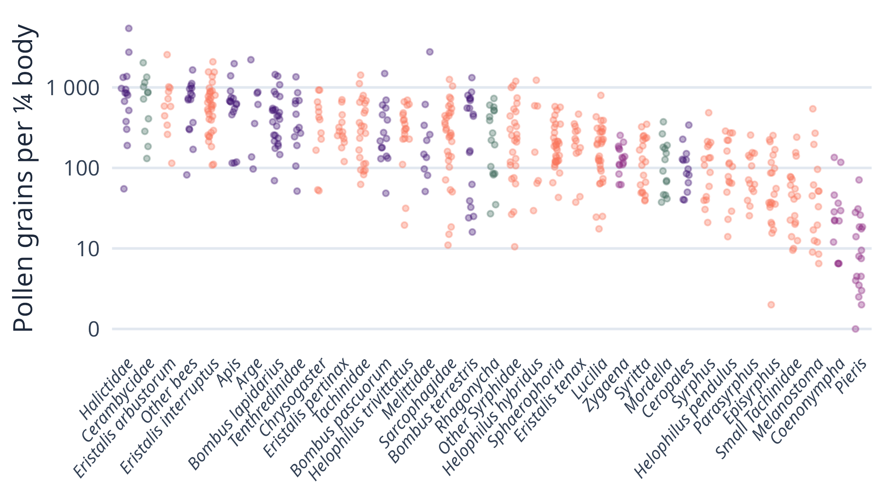{.fragment .fade-out fragment-index=1 fig-align="center" height="490"}

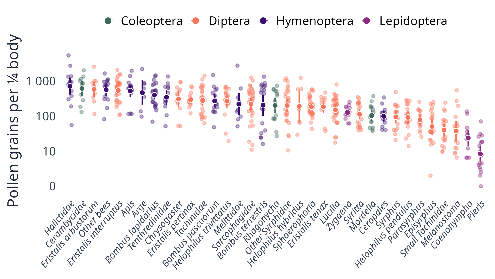{.fragment .fade-in-then-out fragment-index=1 fig-align="center" height="490"}

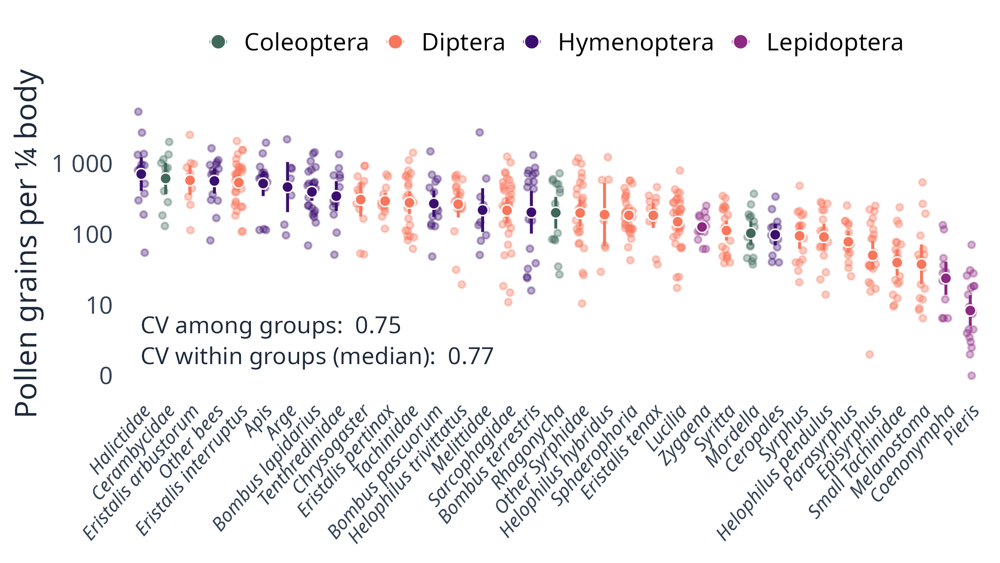{.fragment .fade-in fragment-index=2 fig-align="center" height="490"}
:::

::: src
618 pollinators, 2020–2021, Handrkov · @freudenfeld2025interannual
:::

::: notes
Transition: In START II we examined 3 focal plant species. To test whether these dynamics hold across the whole community, Martin Freudenfeld conducted a comprehensive, meadow-wide scan of pollen loads across all flower visitors (618 pollinators across 35 insect groups).
Pollen swabbed with fuchsin jelly from one half of the body; counts are per quarter of the body.
Step 1: every dot is one insect. Loads range from a few grains to thousands within the same group.
Step 2 (click): group means with 95 % CI. Groups do differ (ANOVA F(30, 531) = 21.3, p < 0.001, 54.6 % of variance), bees and large Eristalis carry most, Pieris and Coenonympha least. But most groups overlap broadly: the spread among individuals is as large as the spread among groups.
Step 3 (click): coefficients of variation. CV among group means 0.75, median CV among individuals within a group 0.77. Knowing the group tells you little more than knowing the individual.
Figure redrawn from raw data (35 groups); the paper's model used 31 groups.
:::

## Who visits changes every year

<span class="timing">≈ 1 min</span>

::: r-stack
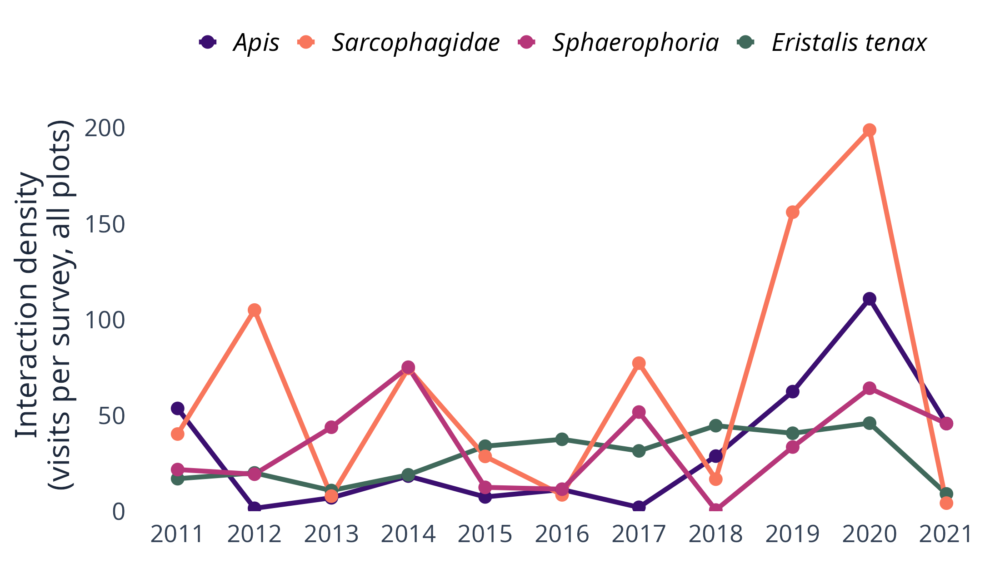{.fragment .fade-out fragment-index=1 fig-align="center" height="500"}

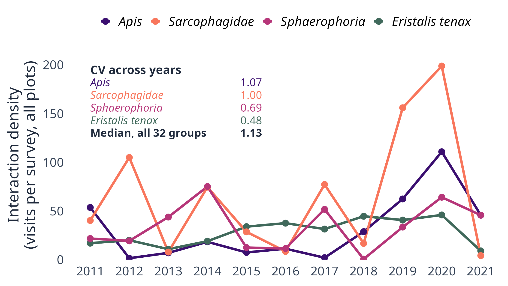{.fragment .fade-in fragment-index=1 fig-align="center" height="500"}
:::

::: src
45 472 visits, 2011–2021 · @freudenfeld2025interannual
:::

::: notes
Step 1: interaction density of dominant pollinator groups across years (2011–2021). Sarcophagidae, Apis and Sphaerophoria jump several-fold between consecutive years. Eristalis tenax is the most constant of the dominant groups.
Step 2 (click): CV across years. Apis 1.07, Sarcophagidae 1.00, Sphaerophoria 0.69, Eristalis tenax 0.48; median over all 32 groups 1.13, higher than both pollen-load CVs (0.75, 0.77).
:::

## Abundance, not identity

<span class="timing">≈ 0.5 min</span>

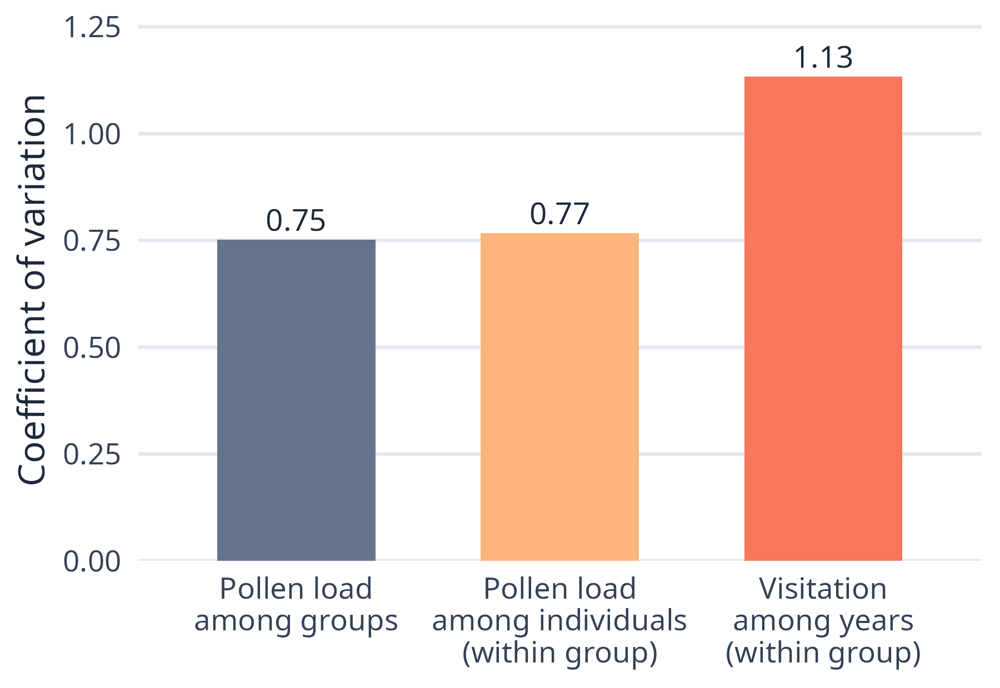{fig-align="center" height="430"}

<div style="text-align: center; font-size: 18px; color: #64748B;">Coefficient of variation = SD / mean, i.e. spread relative to the average</div>

::: src
Data: @freudenfeld2025interannual
:::

::: {.fragment .absolute top="22%" left="12%" width="76%"}
::: bigmsg
Pollinators differ little in how much pollen they carry.<br><span style="color: #FEB47B;">Their contribution is set by how abundant they are that year.</span>
:::
:::

::: notes
Coefficients of variation: among group means of pollen load (0.75), median within-group CV of pollen load among individuals (0.77), median CV of visitation density among years within a group (1.13). Values computed for this slide from the paper's data (scripts/fig_freudenfeld_2025.R).
Conclusion of Freudenfeld et al. 2025: a pollinator's contribution to pollen transfer depends more on its abundance than on its capacity to carry pollen. A diverse pollinator community buffers the decline of any single taxon.
Bridge to Part 3: if many different, variable carriers deliver pollen, what finally arrives on the stigma?
:::


## Visits are not pollen

<span class="timing">≈ 1 min</span>

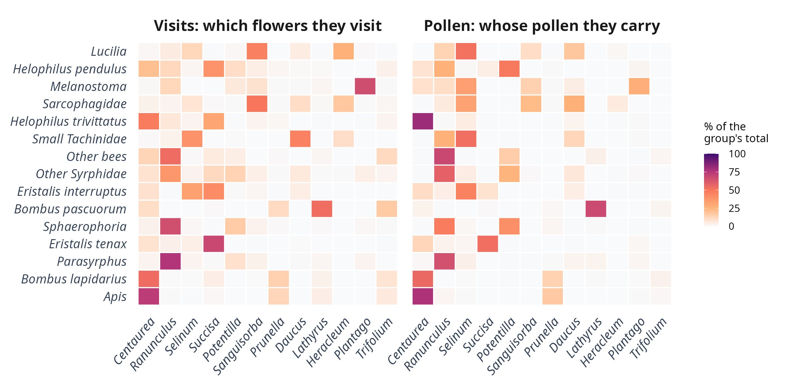{fig-align="center" height="490"}

::: src
Visits: Handrkov transects 2020–2021 (6 978 visits) · pollen: 531 swabbed insects · data @freudenfeld2025interannual
:::

::: notes
For the 15 best-sampled pollinator groups, compare the share of their visits to each plant (left) with the share of each plant's pollen in their loads (right).
Groups are ordered by how well the two profiles agree (top = least agreement):
- Top: Lucilia and Sarcophagidae visit Sanguisorba frequently, yet carry primarily Selinum and Daucus pollen. Helophilus pendulus visits Succisa but carries Potentilla.
- Bottom: Apis and Bombus lapidarius match closely (overlap 0.88 and 0.85).
Takeaway: What an insect visits does not dictate what it carries.
:::

## Community transport vs visits

<span class="timing">≈ 1 min</span>

::: {style="text-align: center; margin-top: 10px;"}
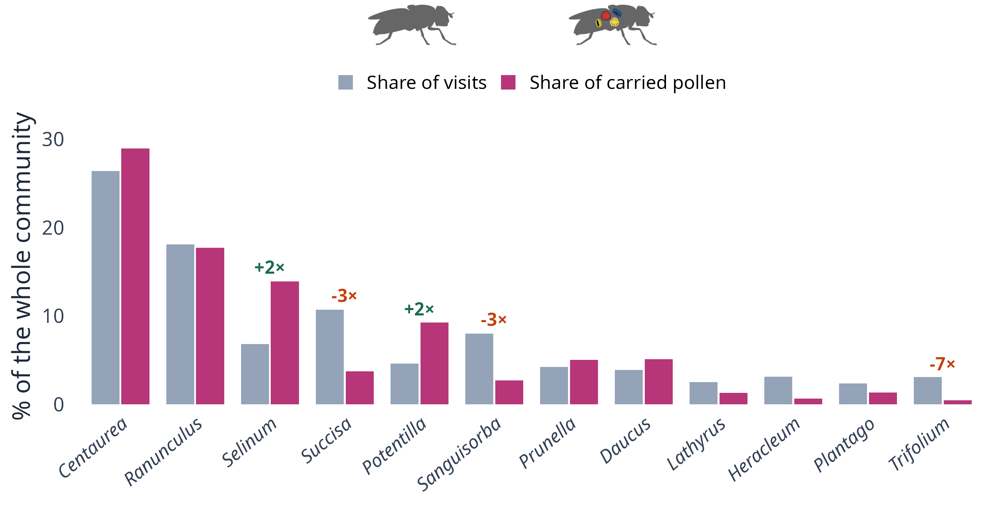{fig-align="center" width="88%"}
:::

::: {.fragment style="text-align: center; margin-top: 6px;"}
::: {style="display: inline-block; background: rgba(64,105,91,0.10); border: 1.5px solid #40695B; border-radius: 20px; padding: 6px 24px; font-size: 19px; color: #1E293B; font-weight: 600;"}
<span style="color: #1B6B4A; font-weight: 700;">Visits ≠ Pollen flow</span> — flower visits drastically overestimate transport for *Succisa* & *Sanguisorba*, but double-underestimate *Selinum* & *Potentilla*.
:::
:::

::: src
Pollen loads reweighted to each group's visit distribution · Handrkov 2020–2021 · @freudenfeld2025interannual
:::

::: notes
Here we compare each plant species' share of community flower visits (grey) against its share of all carried pollen (rose).

1. The discrepancies:
- Centaurea and Ranunculus are balanced (they get ~26% and ~18% of visits and move ~29% and ~18% of pollen).
- Selinum and Potentilla are massively over-represented: they get only 7% and 5% of visits, but account for 14% and 9% of all transported pollen (+2×).
- Conversely, Succisa, Sanguisorba, and Trifolium are severely under-represented: Succisa gets 11% of visits but only 4% of transported pollen (3× less); Sanguisorba gets 8% visits but 3% pollen; Trifolium gets 3% visits but under 0.5% pollen (7× less).

2. What does this mean?
- Traditional plant-pollinator networks based solely on visits assume that every visit moves pollen equally. This assumption fails: visit networks overestimate transport for plants like Succisa, while drastically underestimating transport for plants like Selinum.
- Visit frequency does not equal functional pollen transport.

3. The effect of pollen production (Future testing):
- A crucial open question is pollen production: Does an umbel of Selinum dominate the pollen pool simply because it produces orders of magnitude more pollen grains than a Succisa head?
- In future work, we are directly measuring pollen production per flower/inflorescence across all species to disentangle the effect of sheer grain abundance from flower morphology and insect grooming.
:::

## Part 2 summary

<span class="timing">≈ 0.5 min</span>

::: {style="margin-top: 120px;"}
::: bigmsg
Plants cannot choose their pollinators,<br>but they can choose **when** to offer pollen.<br><span style="color: #FEB47B;">Who carries it, and how faithfully, changes with the year and with experience.</span>
:::
:::

# Pollen deposition {background-color="#40695B"}

<div class="roadmap">
<div><span class="n">1</span>The meadow</div>
<div><span class="n">2</span>Presentation</div>
<div class="on"><span class="n">3</span>Deposition<br><small>pollinator → stigma</small></div>
<div><span class="n">4</span>Community</div>
<div><span class="n">5</span>Next</div>
</div>

## From body to stigma

<span class="timing">≈ 1 min</span>

::::: {style="display: flex; justify-content: center; align-items: center; gap: 35px; margin-top: 25px;"}
::: {style="text-align: center; flex: 1; max-width: 410px;"}
{height="400px" style="object-fit: contain; display: block; margin: 0 auto;"}
<div style="font-size: 22px; font-weight: 600; color: #1E293B; margin-top: 12px;">Pollen on the body</div>
:::

::: {.fragment data-fragment-index="1" style="display: flex; align-items: center; justify-content: center; font-size: 80px; font-weight: 700; color: #40695B; line-height: 1; padding: 0 10px; margin-top: -32px; user-select: none;"}
&gt;
:::

::: {.fragment data-fragment-index="1" style="text-align: center; flex: 1; max-width: 410px;"}
{height="400px" style="object-fit: contain; display: block; margin: 0 auto;"}
<div style="font-size: 22px; font-weight: 600; color: #1E293B; margin-top: 12px;">Pollen on the stigma</div>
:::
:::::

::: notes
Define terms once: conspecific pollen (CP) = own species; heterospecific pollen (HP) = other species. Single-visit deposition (SVD) = what one visit leaves. Terminal pollen deposition (TPD) = the final load on an old stigma.
Focal species from now on: Succisa pratensis, a core species of the meadow network (Part 4).
:::

## Defining the deposition steps

<span class="timing">≈ 1 min</span>

<div style="display: flex; justify-content: center; align-items: stretch; gap: 20px; margin-top: 30px;">

<div style="flex: 1; background: #FFFFFF; border-radius: 12px; padding: 18px 14px; box-shadow: 0 4px 14px rgba(0,0,0,0.06); border-top: 5px solid #3B0F70; text-align: center;">
<div style="font-size: 20px; font-weight: 700; color: #3B0F70; margin-bottom: 8px;">1&#46; Pollinator Body Load</div>
<div style="display: flex; justify-content: center; align-items: center; gap: 8px; height: 130px;">
<div style="text-align: center;">

<div style="font-size: 13px; font-weight: 700; color: #1E293B; margin-top: 2px;">CP (Conspecific)</div>
</div>
<div style="text-align: center;">
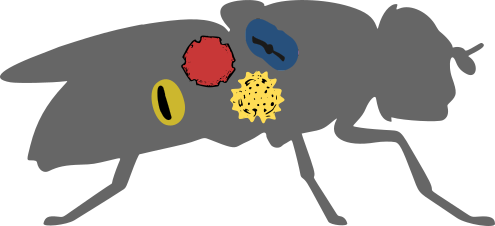
<div style="font-size: 13px; font-weight: 700; color: #888888; margin-top: 2px;">HP (Heterospecific)</div>
</div>
</div>
<div style="font-size: 15px; color: #475569; margin-top: 12px; line-height: 1.4;">
Pollen carried by visitor.<br>Can be own species (<strong>CP</strong>) or foreign (<strong>HP</strong>).
</div>
</div>

<div class="fragment" style="flex: 1; background: #FFFFFF; border-radius: 12px; padding: 18px 14px; box-shadow: 0 4px 14px rgba(0,0,0,0.06); border-top: 5px solid #8C2981; text-align: center;">
<div style="font-size: 20px; font-weight: 700; color: #8C2981; margin-bottom: 8px;">2&#46; Single Visit (SVD)</div>
<div style="display: flex; justify-content: center; align-items: center; height: 130px;">

</div>
<div style="font-size: 15px; color: #475569; margin-top: 12px; line-height: 1.4;">
Pollen left by <strong>one visit</strong> on virgin stigma.<br><span style="color: #F8765C; font-weight: 600;">Mechanically inefficient &amp; noisy (high CV).</span>
</div>
</div>

<div class="fragment" style="flex: 1; background: #FFFFFF; border-radius: 12px; padding: 18px 14px; box-shadow: 0 4px 14px rgba(0,0,0,0.06); border-top: 5px solid #FE6100; text-align: center;">
<div style="font-size: 20px; font-weight: 700; color: #FE6100; margin-bottom: 8px;">3&#46; Terminal Load (TPD)</div>
<div style="display: flex; justify-content: center; align-items: center; height: 130px;">
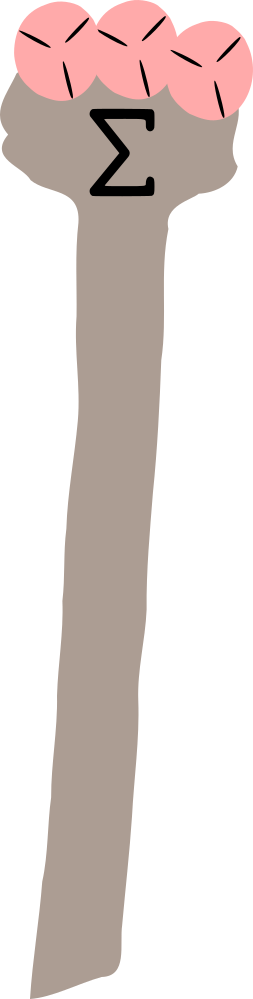
</div>
<div style="font-size: 15px; color: #475569; margin-top: 12px; line-height: 1.4;">
Final cumulative load on old stigma.<br><span style="color: #40695B; font-weight: 600;">Accumulated visits buffer noise (low CV).</span>
</div>
</div>

</div>

::: notes
Define terms explicitly:
- CP = Conspecific Pollen (own species)
- HP = Heterospecific Pollen (foreign pollen from neighbours)
- SVD = Single-Visit Deposition: measured experimentally with virgin bagged stigmas exposed to exactly 1 visit.
- TPD = Terminal Pollen Deposition: the final load on naturally pollinated stigmas.
:::

## Measuring deposition

<span class="timing">≈ 1 min</span>

::: {.absolute .person top="-6" right="130" width="340" style="z-index: 10;"}
{style="width: 72px; height: 72px; flex: 0 0 72px;"}
[**Petr Švanda**<br><small>MSc graduate, Charles University</small>]{.who style="font-size: 19px;"}
:::

<div style="display: flex; gap: 22px; margin-top: 10px;">
<div style="flex: 1; border-top: 5px solid #8C2981; background: #F8FAFC; border-radius: 10px; padding: 10px 14px;">
<div style="font-size: 22px; font-weight: 700; color: #8C2981;">Single visit (SVD)</div>
<div style="font-size: 17px; line-height: 1.4; margin-top: 6px;">
1. Bag the inflorescence in tulle before anthers open<br>
2. Unbag when stigmas are receptive<br>
3. Wait for <b>one</b> visit, note the visitor
</div>
<div style="text-align: center; margin-top: 8px;"></div>
</div>
<div class="fragment" style="flex: 1; border-top: 5px solid #FE6100; background: #F8FAFC; border-radius: 10px; padding: 10px 14px;">
<div style="font-size: 22px; font-weight: 700; color: #FE6100;">Terminal load (TPD)</div>
<div style="font-size: 17px; line-height: 1.4; margin-top: 6px;">
1. Flowers with withered corolla = end of stigma life<br>
2. 3 stigmas per head, 30 plants per day<br>
3. Clear, stain with safranin, squash
</div>
<div style="display: flex; justify-content: center; align-items: center; gap: 10px; margin-top: 8px;">

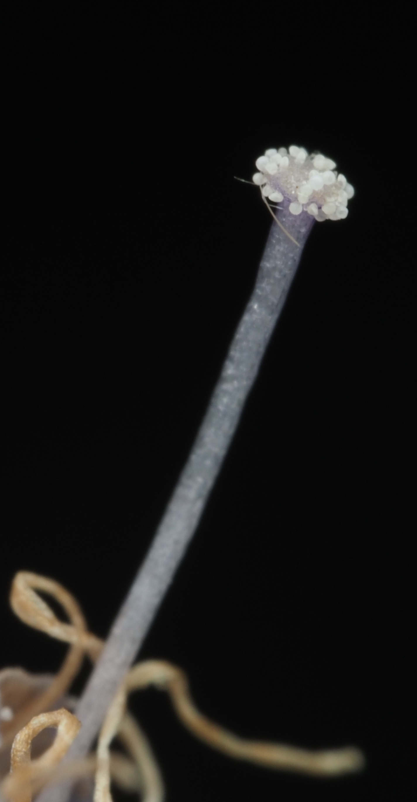
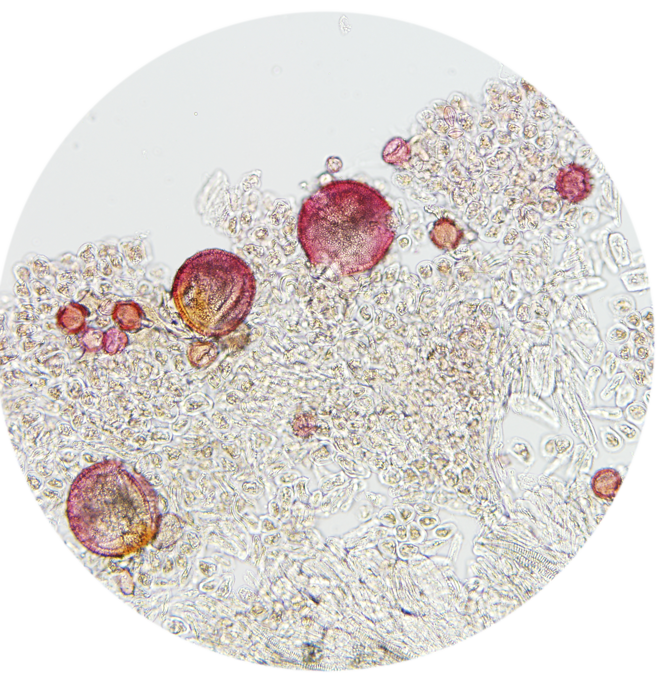
</div>
</div>
</div>

::: notes
SVD: 124 controlled single visits on virgin stigmas, 2022–2024. If the insect visited more than one flower, only the first stigma was kept.
TPD: 693 terminal-stage stigmas from 273 plants, 2022–2024. Slide preparation: 10 % KOH, 3 % H2O2, 8 % acetic acid, then safranin–glycerol, squash under a coverslip, seal with nail polish.
Micrograph: Succisa stigma with large own pollen grains and smaller foreign grains. Own and foreign grains are told apart by size, shape and surface ornamentation.
The Slavkovský les stigmas were processed the same way.
:::

## One visit is a lottery

<span class="timing">≈ 1.5 min</span>

::: r-stack
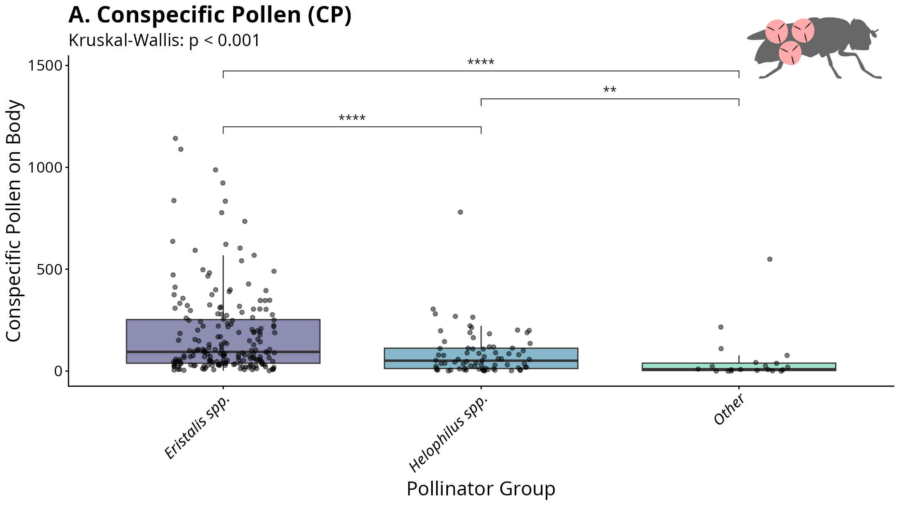{.fragment .fade-out fragment-index=1 fig-align="center" height="470"}

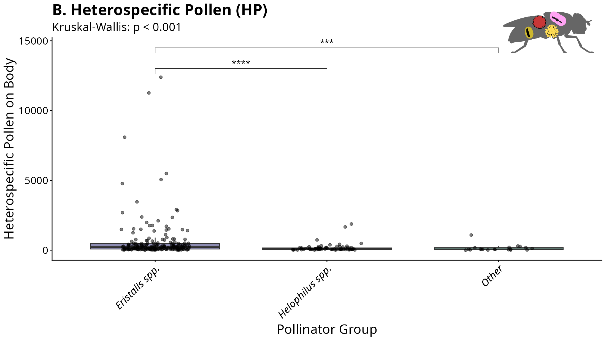{.fragment .fade-in-then-out fragment-index=1 fig-align="center" height="470"}

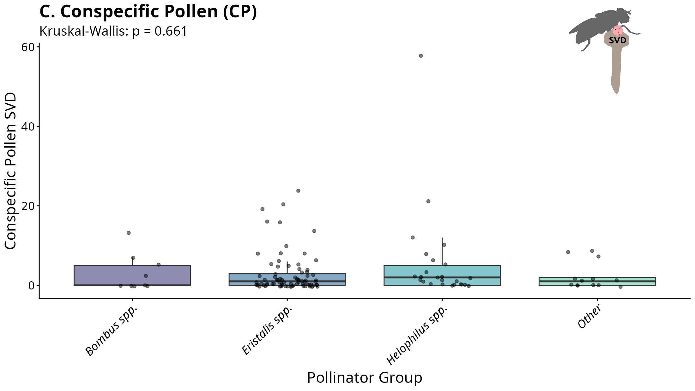{.fragment .fade-in-then-out fragment-index=2 fig-align="center" height="470"}

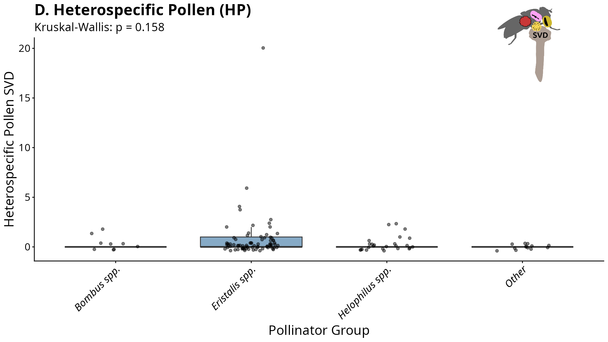{.fragment .fade-in-then-out fragment-index=3 fig-align="center" height="470"}

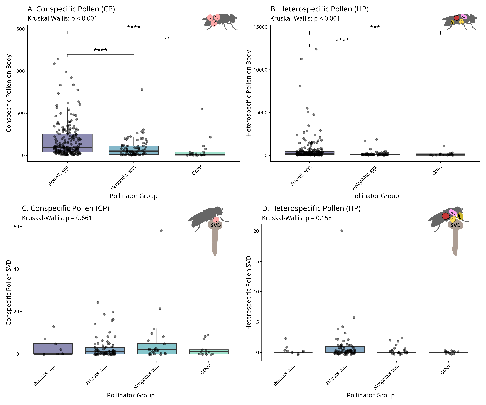{.fragment .fade-in fragment-index=4 fig-align="center" height="470"}
:::

::: {.fragment fragment-index=4 style="font-size: 23px; text-align: center;"}
One visit leaves only **≈ 2 %** of the body's own pollen on the stigma · no difference among *Eristalis*, *Helophilus* and *Bombus*
:::

::: notes
SVD experiments 2022–2024 on bagged Succisa inflorescences (124 single visits; 300 pollinators swabbed for body loads).
Mean body load: CP 148 grains (SD 394), HP 479 (SD 1 102). Only about 2.3 % of body CP and 0.1 % of body HP end up on the stigma in one visit.
Kruskal–Wallis among dominant morphogroups: CP H3 = 1.59, p = 0.66; HP H3 = 5.20, p = 0.16. Per visit, the pollinators are functionally equivalent, which fits the Freudenfeld result: what matters is how many visits, not who makes them.
:::

## But the final load is stable

<span class="timing">≈ 1.5 min</span>

::: r-stack
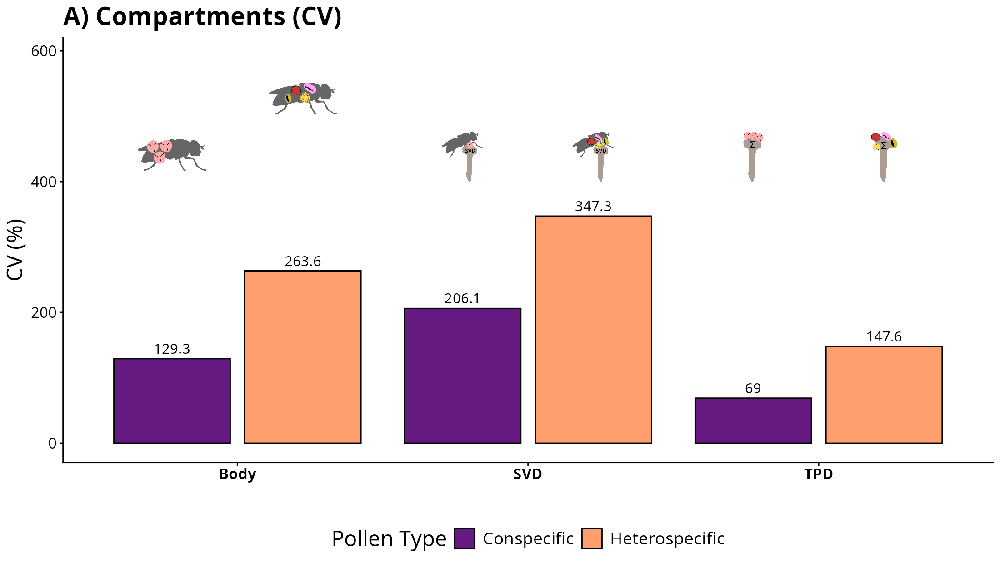{.fragment .fade-out fragment-index=1 fig-align="center" height="520"}

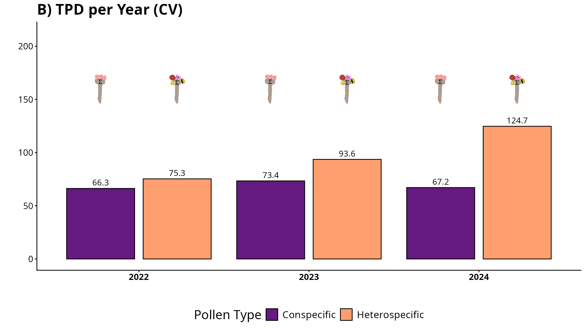{.fragment .fade-in-then-out fragment-index=1 fig-align="center" height="520"}

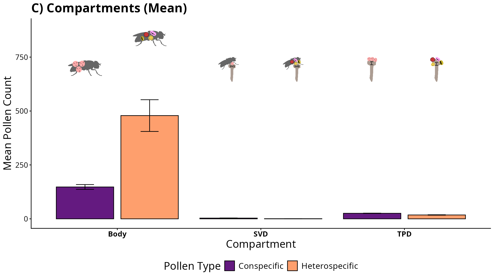{.fragment .fade-in-then-out fragment-index=2 fig-align="center" height="520"}

{.fragment .fade-in-then-out fragment-index=3 fig-align="center" height="520"}

{.fragment .fade-in-then-out fragment-index=4 fig-align="center" height="520"}

{.fragment .fade-in-then-out fragment-index=5 fig-align="center" height="520"}

{.fragment .fade-in-then-out fragment-index=6 fig-align="center" height="520"}

{.fragment .fade-in fragment-index=7 fig-align="center" height="520"}
:::

::: notes
CV of conspecific pollen: body 129 % → single visit 206 % → terminal load 69 %. Heterospecific pollen stays variable: body 264 % → terminal 147 %.
Variance partitioning of TPD (693 stigmas, 273 plants, 2022–2024): years and days explain little CP variance; plants 15 %, stigmas 82 %. Within 2024, days were not significant (CP χ² = 1.32, p = 0.52). HP is different: year (χ² = 32.4, p < 0.001) and plant (χ² = 104.7, p < 0.001) both matter.
:::

## The law of large numbers

<span class="timing">≈ 1.5 min</span>

::: r-stack
{.fragment .fade-out fragment-index=1 fig-align="center" height="520"}

{.fragment .fade-in fragment-index=1 fig-align="center" height="520"}
:::

::: notes
Monte Carlo simulation parameterised by empirical SVD and visitation rates: accumulation of many independent, noisy visits is sufficient to reproduce the stable terminal CP loads observed in the field.
HP is different: not predicted by the null model, depends on the floral neighbourhood, and is diluted by high conspecific floral density.
Štenc et al., submitted to New Phytologist.
:::

## From one meadow to a landscape

<span class="timing">≈ 1 min</span>

{fig-align="center" height="520"}

<p class="src">Slavkovský les Protected Landscape Area, W Bohemia · land cover ESA WorldCover 2021 · relief AWS Terrain Tiles · boundary © OpenStreetMap</p>

::: notes
Handrkov is one meadow followed for three years. Slavkovský les asks the same question across a landscape: 60 Succisa meadows in a mosaic of forest, pasture, wetland margins and ponds.
Each meadow sampled once: 37 in 2022, 23 in 2023.
Field work: MSc thesis of Natálie Hanusová (2024), supervised by J. Štenc.
:::

## Same question, 60 meadows

<span class="timing">≈ 1 min</span>

:::: {style="display: flex; gap: 30px; align-items: center; margin-top: 20px;"}
::: {style="flex: 0 0 34%; font-size: 24px;"}
::: {.person}

[**Natálie Hanusová**<br><small>MSc thesis 2024 · field work, pollen counts</small>]{.who}
:::

<div style="font-size: 18px; color: #40695B; font-weight: 700; margin-bottom: 14px;">Slavkovský les · <i>Succisa pratensis</i></div>

<div style="border-left: 6px solid #3B0F70; padding: 6px 14px; margin-bottom: 18px;"><b>60</b> meadows, one sampling day each</div>
<div style="border-left: 6px solid #8C2981; padding: 6px 14px; margin-bottom: 18px;"><b>1 035</b> plants · <b>3 065</b> stigmas<br><span style="font-size: 18px; color: #555;">3 stigmas per plant, ≈ 20 plants per meadow</span></div>
<div style="border-left: 6px solid #DE4968; padding: 6px 14px; margin-bottom: 18px;"><b>4 595</b> visitors, <b>81</b> taxa<br><span style="font-size: 18px; color: #555;">20-min transects, morning and afternoon</span></div>
<div style="border-left: 6px solid #FE9F6D; padding: 6px 14px;">Landscape within <b>50 m</b><br><span style="font-size: 18px; color: #555;">meadow, forest, marsh, water</span></div>
:::

::: {.fragment style="flex: 1; text-align: center;"}
{height="390"}

<span style="font-size: 22px;">Meadow means: **HP varies 8-fold, CP only 2-fold**</span>
:::
::::

::: notes
Same protocol as Handrkov: male-phase flowers, three stigmas per plant, conspecific (CP) and heterospecific (HP) grains counted.
Plants per meadow: median 20 (range 7–21).
Spread of meadow means (10th–90th percentile): CP 2.2×, HP 8.0×; CV 0.33 vs 0.85.
:::

## Buffered in time and in space

<span class="timing">≈ 2 min</span>

{fig-align="center" height="470"}

::: {.fragment style="font-size: 24px; text-align: center;"}
Own pollen: little variance between years (**3 %**) or meadows (**11 %**). Foreign pollen: about a third (**34 %** and **30 %**).
:::

::: notes
The same model on both datasets: linear mixed model on sqrt counts, plant nested in year (Handrkov) or in meadow (Slavkovský les), stigma = residual.
CP: the big share is plant and stigma, i.e. local and chance. Neither years nor meadows matter much. That is what the law of large numbers predicts.
HP: about a third sits at the year or meadow level. Foreign pollen depends on context.
The Bayesian Poisson model in the manuscript gives the same picture (CP meadow 13 %, HP 43 %).
:::

## Foreign pollen follows the neighbours

<span class="timing">≈ 1.5 min</span>

{fig-align="center" height="310"}

::: {.fragment style="font-size: 19px; line-height: 1.35; margin-top: 4px;"}
- More *Succisa* flowerheads → **less** HP (dilution, as at Handrkov)
- Wetter surroundings (marsh, close to water) → more HP
- Landscape explains **35 %** of HP between meadows, only **12 %** of CP
- Visitor composition explains neither
:::

::: notes
Meadow-level RDA on mean HP: flowerheads F = 21.5, p = 0.001; distance to water F = 7.9, p = 0.008; marsh area F = 5.1, p = 0.023; adj. R² = 0.35.
CP: only meadow area (positive), adj. R² = 0.12.
Dilution: Spearman ρ = −0.50 between flowerhead number and HP. Large Succisa populations keep visitors on Succisa.
Visitor community (dbRDA, n = 58 meadows): CP adj. R² 0.007, p = 0.38; HP 0.022, p = 0.30.
:::

## Taller plants get more pollen

<span class="timing">≈ 1 min</span>

{fig-align="center" height="380"}

::: {.fragment style="font-size: 22px; text-align: center;"}
But traits leave plant-to-plant variance unchanged (ICC 0.793 → 0.794)
:::

::: notes
Within a meadow, plants taller than their neighbours get about 11 % more conspecific pollen per SD of height (RR 1.11, 1.04–1.19). Height does not affect HP. Larger flowerheads collect slightly more HP (RR 1.10).
Height shifts the mean. Most plant-to-plant variation remains position, microhabitat or chance.
Optional: photo of a tall Succisa above the grass.
:::

## Is taller better?

<span class="timing">≈ 1 min</span>

:::: {style="display: flex; gap: 30px; align-items: center; margin-top: 10px;"}
::: {style="flex: 0 0 34%; font-size: 22px;"}
::: {.person}
{style="object-position: center 25%;"}
[**Klára Hodánková**<br><small>student, Charles University</small>]{.who}
:::

::: {.person}

[**Javier Valverde**<br><small>researcher, University of Seville</small>]{.who}
:::

<div style="font-size: 18px; color: #40695B; font-weight: 700; margin-top: 8px;">Field work 2026 · <i>Succisa pratensis</i></div>
:::

::: {style="flex: 1; text-align: center;"}
{height="300"}

::: {.fragment style="font-size: 23px; margin-top: 6px;"}
Taller *Succisa* flowers stick out of the grass and **receive more own pollen** (Slavkovský les).<br>
<span style="color: #B63679; font-weight: 600;">But does more pollen also mean better pollen?</span>
:::
:::
::::

::: notes
Introduce the people first: this was the 2026 field season with Klára Hodánková and Javier Valverde.
Starting point: Slavkovský les showed that within a meadow, taller plants receive more own pollen. Height makes a flower more visible and easier to reach for flying insects. The new question: is all that extra pollen equally useful?
:::

## From pollen grain to pollen tube

<span class="timing">≈ 1 min</span>

::::: columns
::: {.column width="40%"}
::: r-stack
{height="430"}

{.fragment fragment-index=1 height="430"}
:::
:::

::: {.column width="60%"}
::: {style="font-size: 23px; margin-top: 20px;"}
-   Pollen lands on the stigma
:::

::: {.fragment fragment-index=1 style="font-size: 23px;"}
-   A compatible grain **germinates**: a tube grows down the style to the ovule
-   Only grains with a tube can fertilise
:::

::: {.fragment fragment-index=2 style="font-size: 21px; margin-top: 16px; background: #F1F5F9; border-radius: 10px; padding: 10px 14px;"}
**What we measured**<br>
Height of every flowering stalk (194 stalks, 100 plants)<br>
Pollen grains and pollen tubes on 61 stigmas from 32 plants
:::
:::
:::::

::: notes
Pollen tubes are the step between deposition and fertilisation. Counting tubes per stigma tells us how much of the deposited pollen actually germinated.
Two stigmas (flowers A and B) per plant; random effects for plant and flower in all models.
Staining method: aniline blue under fluorescence.
:::

## Height, pollen and pollen tubes

<span class="timing">≈ 2 min</span>

::: r-stack
{.fragment .fade-out fragment-index=1 height="440"}

{.fragment .fade-in-then-out fragment-index=1 height="440"}

{.fragment .fade-in-then-out fragment-index=2 height="440"}

{.fragment .fade-in fragment-index=3 height="440"}
:::

::: r-stack
::: {.fragment .fade-out fragment-index=1 style="font-size: 22px; text-align: center;"}
Most plants are 25–40 cm tall · only 3 % of stalks exceed 50 cm
:::

::: {.fragment .fade-in-then-out fragment-index=1 style="font-size: 22px; text-align: center;"}
Pollen per stigma rises with height and levels off at ≈ 50 cm · grey bars = plant heights in the meadow
:::

::: {.fragment .fade-in-then-out fragment-index=2 style="font-size: 22px; text-align: center;"}
Pollen tubes follow a flatter curve, peaking at ≈ 45 cm
:::

::: {.fragment .fade-in fragment-index=3 style="font-size: 22px; text-align: center;"}
The share of grains with a tube **falls**: ≈ 45 % at 15 cm → ≈ 24 % at 65 cm
:::
:::

::: src
2026 · with Klára Hodánková and Javier Valverde · unpublished
:::

::: notes
Step 1: context. Height of 194 flowering stalks on 100 plants, median 32 cm; about 60 % are 25–40 cm, only 3 % above 50 cm. So most plants sit on the rising part of the next curve.
Step 2: own pollen per stigma ~ quadratic height, negative binomial GLMM with plant/flower random effects: linear z = 4.2, p < 0.001; quadratic z = −3.6, p < 0.001; predicted peak at about 50 cm. The tall end rests on few plants.
Step 3: number of pollen tubes ~ quadratic height (Poisson GLMM): linear p = 0.32, quadratic p = 0.014, peak at about 45 cm. No confidence band shown for this curve; the model's interval is not informative.
Step 4: proportion of grains with a tube ~ height (binomial GLMM): β = −0.019 per cm, p = 0.041.
Take-home: taller plants get more pollen, but a smaller share of it germinates. Possible reasons: more self or related pollen from long visits on tall plants, competition among grains, or older stigmas. One season, one site: a lead to follow, not a result.
:::

## How it fits together

<span class="timing">≈ 1 min</span>

<div style="display: flex; gap: 10px; margin-top: 18px; align-items: stretch;">
<div style="flex: 1; border-radius: 10px; background: #F8FAFC; border-top: 6px solid #3B0F70; padding: 10px 10px; text-align: center;">
<div style="font-size: 15px; letter-spacing: 1px; color: #64748B; text-transform: uppercase;">Anther</div>
<div style="font-size: 26px; font-weight: 800; color: #3B0F70; margin: 4px 0;">Time</div>
<div style="font-size: 16px; color: #1E293B; line-height: 1.35;">Pollen release schedules split the day among co-flowering plants</div>
</div>
<div style="align-self: center; font-size: 28px; color: #94A3B8;">›</div>
<div class="fragment" style="flex: 1; border-radius: 10px; background: #F8FAFC; border-top: 6px solid #8C2981; padding: 10px 10px; text-align: center;">
<div style="font-size: 15px; letter-spacing: 1px; color: #64748B; text-transform: uppercase;">Pollinator</div>
<div style="font-size: 26px; font-weight: 800; color: #8C2981; margin: 4px 0;">Who & how</div>
<div style="font-size: 16px; color: #1E293B; line-height: 1.35;">Abundance sets who carries pollen; experience lowers constancy</div>
</div>
<div style="align-self: center; font-size: 28px; color: #94A3B8;">›</div>
<div class="fragment" style="flex: 1; border-radius: 10px; background: #F8FAFC; border-top: 6px solid #F8765C; padding: 10px 10px; text-align: center;">
<div style="font-size: 15px; letter-spacing: 1px; color: #64748B; text-transform: uppercase;">Stigma</div>
<div style="font-size: 26px; font-weight: 800; color: #F8765C; margin: 4px 0;">Numbers</div>
<div style="font-size: 16px; color: #1E293B; line-height: 1.35;">Many noisy visits give a stable dose of own pollen</div>
</div>
<div style="align-self: center; font-size: 28px; color: #94A3B8;">›</div>
<div class="fragment" style="flex: 1; border-radius: 10px; background: #F8FAFC; border-top: 6px solid #40695B; padding: 10px 10px; text-align: center;">
<div style="font-size: 15px; letter-spacing: 1px; color: #64748B; text-transform: uppercase;">Neighbourhood</div>
<div style="font-size: 26px; font-weight: 800; color: #40695B; margin: 4px 0;">Space</div>
<div style="font-size: 16px; color: #1E293B; line-height: 1.35;">Foreign pollen follows the neighbours and the landscape</div>
</div>
</div>

::: {.fragment style="margin-top: 40px;"}
::: bigmsg
Own pollen is secured by **many visits**.<br><span style="color: #FEB47B;">Foreign pollen is decided by the **community**.</span>
:::
:::

::: notes
One sentence per step, each backed by one study from Parts 2 and 3. The last step is the bridge: if foreign pollen depends on the neighbours, we need to understand the whole community of neighbours. That is the pollinator-sharing network.
:::

# Scaling up: the community {background-color="#40695B"}

<div class="roadmap">
<div><span class="n">1</span>The meadow</div>
<div><span class="n">2</span>Presentation</div>
<div><span class="n">3</span>Deposition</div>
<div class="on"><span class="n">4</span>Community<br><small>sharing network</small></div>
<div><span class="n">5</span>Next</div>
</div>

## Plants linked by shared pollinators

<span class="timing">≈ 1 min</span>

::: r-stack
{fig-align="center" height="540"}

{.fragment fig-align="center" height="540"}
:::

::: notes
From the bipartite plant-pollinator web to the plant-plant pollinator-sharing network. Every shared visitor is a potential route for HP.
Shortened version of the SCAPE 2026 story. If time allows, reuse the airport analogy slide from SCAPE.
:::

## The whole meadow splits the day

<span class="timing">≈ 1.5 min</span>

::::: columns
::: {.column width="30%"}
{width="100%"}

::: {style="font-size: 18px; text-align: center; color: #64748B;"}
Part 2: three species release pollen at different times
:::
:::

::: {.column width="70%"}
::: r-stack
{.fragment .fade-out fragment-index=1 height="430"}

{.fragment .fade-in fragment-index=1 height="430"}
:::
:::
:::::

::: {style="font-size: 21px; text-align: center;"}
When pollinators visit each plant species, 15 years of plot surveys
:::

::: notes
Bridge from Part 2: the three START species split the day by when they offer pollen. Is that a curiosity of three species, or how the whole meadow works?
Each ridge: distribution of all recorded visits to one plant species over the day, 2011–2025 (≈ 42 000 records, 15 most visited species plus the START species).
Click: the three START species keep their order in the community data. Mean visit time: Succisa 12.7 h, Centaurea 13.5 h, Trifolium hybridum 14.4 h. The community as a whole forms a succession from Plantago and Hypericum in the morning to Achillea and Trifolium in the afternoon.
Plant–insect pairs with matching activity times interact more (GLMM β = −0.05 per hour of mismatch, p < 0.001; ERGM on the meta-web β = −0.52, p < 0.001).
:::

## Global generalists, local specialists

<span class="timing">≈ 1 min</span>

{fig-align="center" width="95%"}

<div style="display: flex; gap: 16px; margin-top: 10px;">
<div class="fragment" style="flex: 1; background: #F8FAFC; border-top: 6px solid #3B0F70; border-radius: 10px; padding: 12px; text-align: center;">
<div style="font-size: 44px; font-weight: 800; color: #3B0F70; line-height: 1;">0.33 vs 0.20</div>
<div style="font-size: 19px; margin-top: 8px;">specialisation within an hour, observed vs random</div>
</div>
<div class="fragment" style="flex: 1; background: #F8FAFC; border-top: 6px solid #B63679; border-radius: 10px; padding: 12px; text-align: center;">
<div style="font-size: 44px; font-weight: 800; color: #B63679; line-height: 1;">34 %</div>
<div style="font-size: 19px; margin-top: 8px;">of interactions rewire from one hour to the next</div>
</div>
</div>

::: notes
A whole-day network makes everyone look like a generalist. Sliced by hour, species are more specialised: mean hourly Blüthgen d′ 0.33 vs 0.20 in null networks of the same size (p < 0.001); hourly d′ higher than daily d′ for 43 species (paired t = 7.1, p < 0.001).
Rewiring: 34 % of the change in interactions between consecutive hours is partner switching among species that are active in both hours, not species appearing or disappearing.
:::

## Splitting the day eases competition

<span class="timing">≈ 1 min</span>

<div style="display: flex; gap: 16px; margin-top: 30px;">
<div style="flex: 1; background: #F8FAFC; border-top: 6px solid #40695B; border-radius: 10px; padding: 16px; text-align: center;">
<div style="font-size: 60px; font-weight: 800; color: #40695B; line-height: 1;">−42 %</div>
<div style="font-size: 20px; margin-top: 10px;">potential competition for shared pollinators once timing is taken into account</div>
<div style="font-size: 16px; color: #64748B; margin-top: 6px;">every year 2011–2025, never less than −34 %</div>
</div>
<div class="fragment" style="flex: 1; background: #F8FAFC; border-top: 6px solid #F8765C; border-radius: 10px; padding: 16px; text-align: center;">
<div style="font-size: 30px; font-weight: 800; color: #F8765C; line-height: 1.2;">A see-saw in time</div>
<div style="font-size: 20px; margin-top: 10px;">In years with many honeybees, other pollinators forage <b>earlier</b>.<br>When small flies dominate, they forage <b>later</b>.</div>
</div>
</div>

::: {.fragment style="margin-top: 30px;"}
::: bigmsg
Time of day is a niche axis that hides in whole-day networks.
:::
:::

::: notes
Potential for apparent competition (plants sharing pollinators) from the whole-day network, multiplied by how much two species actually overlap in time, standardised for the midday activity peak. Mean reduction 41.8 % per year (SD 6.1 %, minimum 33.6 %).
See-saw: shift in mean activity hour of the rest of the community against the yearly relative abundance of the dominant visitors: Apis β = −1.59, p < 0.001 (earlier); dominant small Diptera and Sphaerophoria β > 1.6, p < 0.01 (later).
Manuscript draft (DiuHanPolNet); numbers may change.
:::

## Who wins from splitting the day?

<span class="timing">≈ 1 min</span>

{height="450"}

::: {.fragment style="margin-top: 10px;"}
::: bigmsg
The losers in space are the biggest winners in time.
:::
:::

::: src
Reduction in apparent competition from diurnal stratification · 15-year mean (2011–2025) · DiuHanPolNet
:::

::: notes
Who gains the most from splitting the day?
1. In plants, the biggest winners are the peripheral species: Lathyrus pratensis (−45%), Trifolium pratense (−37%), Lotus corniculatus (−36%), and Potentilla erecta (−33%). These are the exact species that were dominated in space! By foraging at temporal fringes (morning and afternoon), they escape the midday bully rush and cut their apparent competition by more than a third.
2. The core drivers (Centaurea jacea, Succisa pratensis) gain the least (−8%). They don't need to hide: they dominate the crowded midday hours.
3. In pollinators, subordinate foragers (Zygaena moths −45%, muscid flies −32%, small hoverflies −28%) escape dominant competitors (Apis, Bombus −12% to −13%) by using temporal refuges.
Space and time act as orthogonal escape routes for biodiversity.
:::

## From pollen on the stigma to seeds

<span class="timing">≈ 1 min</span>

<div style="display: flex; align-items: center; gap: 10px; margin-top: 20px;">
<div style="flex: 1; text-align: center; background: #F8FAFC; border-top: 6px solid #40695B; border-radius: 10px; padding: 12px;"><div style="font-size: 22px; font-weight: 700; color: #40695B;">Pollen deposited</div><div style="font-size: 17px; color: #64748B;">what we measure now</div></div>
<div style="font-size: 36px; color: #94A3B8;">›</div>
<div style="flex: 1; text-align: center; background: #F8FAFC; border-top: 6px solid #F8765C; border-radius: 10px; padding: 12px;"><div style="font-size: 22px; font-weight: 700; color: #F8765C;">Pollen tubes</div><div style="font-size: 17px; color: #64748B;">first data in 2026</div></div>
<div style="font-size: 36px; color: #94A3B8;">›</div>
<div style="flex: 1; text-align: center; background: #F8FAFC; border-top: 6px dashed #B63679; border-radius: 10px; padding: 12px;"><div style="font-size: 22px; font-weight: 700; color: #B63679;">Seeds</div><div style="font-size: 17px; color: #64748B;">next step</div></div>
</div>

::: {style="font-size: 22px; margin-top: 26px;"}
-   Does a stable dose of own pollen mean stable seed set?
-   Does foreign pollen reduce tube growth, especially in dry years?
-   Is quality, not quantity, the limit for tall, well-visited plants?
:::

::: fragment
::: bigmsg
<span style="font-size: 26px;">Do you have data on stigma pollen loads, pollen tubes or seed set?<br><span style="color: #FEB47B;">We would love to combine them.</span></span>
:::
:::

::: notes
Future direction: follow pollen one step further, from deposition to germination and seeds. Planned: pollen tubes and seed set on Succisa across years at Handrkov, linked to the yearly foreign-pollen loads and drought.
Call for data: datasets with stigma loads plus pollen tubes or seed set, from any species, would let us test whether the law-of-large-numbers buffering of deposition carries through to fertilisation. We are also collecting published time series of pollen deposition (the deposition-curve synthesis).
:::

## Visits are not pollen

<span class="timing">≈ 1.5 min</span>

::: r-stack
{fig-align="center" width="85%"}

{.fragment fig-align="center" width="85%"}
:::

::: notes
Concept, not data. Pollen-transfer networks built from stigma loads and body loads, compared to visitation networks. Does pollen actually flow along the same routes, in the same direction and strength?
:::

## Take-home messages

<span class="timing">≈ 2 min</span>

:::::: columns
::: {.column width="33%"}
::: {style="background: #FFFFFF; border: 1px solid #E2E8F0; border-top: 6px solid #3B0F70; border-radius: 10px; padding: 10px 8px 12px 8px; box-shadow: 0 4px 12px rgba(0,0,0,0.05); text-align: center;"}
<h3 style="font-size: 25px; color: #3B0F70; margin: 2px 0 6px 0;">01 Timing</h3>
<div style="font-size: 20px; font-weight: 600; line-height: 1.3; color: #1E293B; margin-bottom: 12px;">Pollen presentation schedules split the day among co-flowering plants</div>

:::
:::

::: {.column width="33%"}
::: fragment
::: {style="background: #FFFFFF; border: 1px solid #E2E8F0; border-top: 6px solid #F8765C; border-radius: 10px; padding: 10px 8px 12px 8px; box-shadow: 0 4px 12px rgba(0,0,0,0.05); text-align: center;"}
<h3 style="font-size: 25px; color: #F8765C; margin: 2px 0 6px 0;">02 Numbers</h3>
<div style="font-size: 20px; font-weight: 600; line-height: 1.3; color: #1E293B; margin-bottom: 12px;">Many noisy visits give a stable dose of own pollen. Foreign pollen follows the landscape</div>

:::
:::
:::

::: {.column width="33%"}
::: fragment
::: {style="background: #FFFFFF; border: 1px solid #E2E8F0; border-top: 6px solid #40695B; border-radius: 10px; padding: 10px 8px 12px 8px; box-shadow: 0 4px 12px rgba(0,0,0,0.05); text-align: center;"}
<h3 style="font-size: 25px; color: #40695B; margin: 2px 0 6px 0;">03 Community</h3>
<div style="font-size: 20px; font-weight: 600; line-height: 1.3; color: #1E293B; margin-bottom: 12px;">A stable core carries the network, and drought makes it ever more important</div>

:::
:::
:::
::::::

## Join us

{fig-align="center" width="950"}

<div style="position: absolute; bottom: 42px; left: 0; right: 0; text-align: center; font-size: 21px;">
  <a href="https://pollination-ecology-group.github.io/Handrkov/" target="_blank" style="color: #40695B; font-weight: 600; text-decoration: underline;">https://pollination-ecology-group.github.io/Handrkov/</a>
  <span style="color: #888; margin: 0 10px;">|</span>
  <a href="mailto:jakubstenc@gmail.com" style="color: #374151; text-decoration: none;">jakubstenc@gmail.com</a>
</div>

::: notes
Optional: Ecoflor 2027 in Prague invitation (logo2027.png and ecoflor_qr.png are in images/).
:::

##  {background-image="images/Fin.jpg"}

<br>

<div style="text-align: center; margin-bottom: 22px;">
<div style="display: inline-block; background-color: rgba(0, 0, 0, .65); backdrop-filter: blur(8px); box-shadow: 0 4px 20px rgba(0, 0, 0, .5); border-radius: 10px; border: 1px solid rgba(255, 255, 255, 0.18); padding: 18px 38px; color: white; font-size: 38px; font-weight: bold; text-shadow: 0 2px 4px rgba(0,0,0,0.8);">
Thank you for your attention!
</div>
</div>

<div style="background-color: rgba(0, 0, 0, .65); backdrop-filter: blur(8px); box-shadow: 0 4px 20px rgba(0, 0, 0, .5); border-radius: 10px; border: 1px solid rgba(255, 255, 255, 0.18); padding: 18px 30px; max-width: 630px; margin: 0 auto; text-align: center; color: white; font-family: 'Jost', sans-serif;">
<div style="font-size: 27px; font-weight: bold;">Jakub Štenc</div>
<div style="font-size: 20px; color: #E2E8F0; margin-top: 5px;">jakubstenc@gmail.com</div>
<div style="font-size: 19px; color: #CBD5E1; margin-top: 3px;">Charles University, Prague &amp; CREAF, Barcelona</div>
</div>

{.absolute bottom="0%" right="25%" width="190"} {.absolute bottom="0%" left="0" width="230"} {.absolute bottom="8%" left="0%" width="170"} {.absolute bottom="8%" right="5%" width="170"}

# Backup slides {background-color="#333"}

## Backup: Timing decides what pollinators carry

<span class="timing">≈ 1.5 min</span>

::: r-stack
{.fragment .fade-out fragment-index=1 height="430"}

{.fragment .fade-in-then-out fragment-index=1 height="430"}

{.fragment .fade-in fragment-index=2 height="430"}
:::

::: r-stack
::: {.fragment .fade-out fragment-index=1 style="font-size: 22px; text-align: center;"}
Own pollen on *Succisa* visitors: ≈ 350 grains at 8:30 → ≈ 50 at 14:30
:::

::: {.fragment .fade-in-then-out fragment-index=1 style="font-size: 22px; text-align: center;"}
Foreign pollen stays the same all day
:::

::: {.fragment .fade-in fragment-index=2 style="font-size: 22px; text-align: center;"}
A morning visitor carries ≈ 50 % own pollen, an afternoon visitor ≈ 7 %
:::
:::

::: src
293 swabbed visitors of *Succisa*, Handrkov 2024 · confirms @stenc2025pollen with new data
:::

::: notes
This brings the community result back to pollen. Swabs (same method as before) from insects caught on Succisa through the day in 2024.
Own pollen ~ hour: quasi-Poisson slope −0.33 per hour, p < 0.001. Foreign pollen ~ hour: slope 0.01, p = 0.88. Share of own pollen ~ hour: quasi-binomial slope −0.44 per hour, p < 0.001.
Single visits to virgin stigmas (124 visits, 2022–2024) also left the most own pollen at 8:00 (≈ 9 grains vs ≈ 2 later), but the trend is only marginal (p = 0.07).
Meaning: Succisa's morning release is not a curiosity. Visits in the first hours move most of its own pollen; later visits mostly bring foreign pollen. Next step: hour-by-hour pollen-transfer networks, combining the diurnal network with swabs and stigma loads, to see which pollen moves between which plants and when.
:::

## Backup: community stability 2022–2024

::: r-stack
{.fragment .fade-out fragment-index=1 fig-align="center" height="520"}

{.fragment .fade-in-then-out fragment-index=1 fig-align="center" height="520"}

{.fragment .fade-in-then-out fragment-index=2 fig-align="center" height="520"}

{.fragment .fade-in-then-out fragment-index=3 fig-align="center" height="520"}

{.fragment .fade-in fragment-index=4 fig-align="center" height="540"}
:::

::: notes
LLN paper: Morisita–Horn similarity of visitor spectra and plant community across the three years; per-capita visitation vs local Succisa abundance (density dilution).
:::

## Backup: Succisa abundance in space and time

::: r-stack
{.fragment .fade-out fragment-index=1 fig-align="center" height="520"}

{.fragment .fade-in-then-out fragment-index=1 fig-align="center" height="520"}

{.fragment .fade-in-then-out fragment-index=2 fig-align="center" height="520"}

{.fragment .fade-in fragment-index=3 fig-align="center" height="540"}
:::

## Backup: Slavkovský les landscape drivers (RDA)

{fig-align="center" height="540"}

::: notes
Meadow-level RDA with forward selection. HP: flowerheads, distance to water, marsh area (adj. R² 0.35). CP: meadow area (adj. R² 0.12).
:::

## Backup: visitor identity does not predict pollen loads

{fig-align="center" height="540"}

::: notes
dbRDA of visitor community composition (n = 58 meadows): CP adj. R² 0.007, p = 0.38; HP adj. R² 0.022, p = 0.30.
:::

## Backup: deposition curves by life form

::: r-stack
{fig-align="center" height="520"}

{.fragment fig-align="center" height="520"}
:::

::: notes
Semelparous species: higher cumulative deposition than iteroparous ones.
:::

## Backup: pollen deposition through flower life

::: r-stack
{fig-align="center" height="480"}

{.fragment fig-align="center" height="480"}
:::

::: src
Literature synthesis: 36 species, 23 families, 49 surveys, 194 time-stamped records · Štenc (in prep.)
:::

::: notes
Meta-analysis of published deposition time series (Štenc, in prep.).
Left: what the AUC is. Deposition scaled to the survey maximum, flower age scaled to maximum longevity; AUC = area under that curve (trapezoidal rule). Right: AUC per survey. Self-incompatible species accumulate pollen over a broader part of flower life (median AUC 0.72 vs 0.14 in SIC; Wilcoxon, BH-adjusted p = 0.024) but rarely reach P/O ≥ 1 (1 of 7 surveys).
CAVEAT: SIC surveys typically have 2 time points covering ~20 % of flower life, SI surveys 5 points covering the whole life. Divided by the covered span, the mean level does not differ (0.77 vs 0.71, p = 0.82). Part of the AUC gap is sampling coverage.
Step 2 (click): highest pollen:ovule ratio reached on the stigma in each survey. Below the dashed line there are fewer grains than ovules, so not all ovules can be fertilised. SI: 1 of 7 surveys reach P/O ≥ 1 (only Stigmaphyllon; the four Weigela surveys stay at 0.5–0.9 although they cover the whole flower life). SIC: 14 of 16 exceed it, often 10–100×, within a short sampling window. Self-incompatible species keep accumulating but stay pollen-limited.
Bridge back to Succisa: protandrous, long-lived stigmas, hence the value of many visits.
:::

## Backup: pollen on stigma and pollinator

{fig-align="center" height="540"}

## Backup: from above

{fig-align="center" height="560"}

::: notes
Drone view: the scale of the meadow and the grid of plots. Short, atmospheric.
:::

## Backup: does more pollen mean more seeds?

<div style="text-align: center; margin-top: 100px; font-size: 26px; color: #334155; line-height: 1.5;">
<strong>No seed set data yet</strong> (*Succisa* has 1 ovule per flower).<br>
<span style="font-size: 20px; color: #64748B;">Terminal load (20–27 CP grains) is well above the minimum;<br>open question is whether heterospecific pollen (HP) clogs stigmas.</span>
</div>

::: notes
Expected question. No seed set data yet; the closest is the 2026 pollen-tube data (see the height slide). Prepare a spoken answer: Succisa has one ovule per flower, so a terminal load of ≈ 20–27 conspecific grains is far above the minimum; the open question is whether foreign pollen (up to ≈ 50 grains in 2023) clogs stigmas enough to reduce seed set.
:::

## Backup: pollen production per inflorescence

{fig-align="center" height="500"}

::: notes
START I data: Succisa produces roughly an order of magnitude less pollen per inflorescence than Centaurea or Trifolium (≈ 0.4 × 10⁵ vs 2.6–3.5 × 10⁵), and releases it all in the morning.
:::

## Backup: sampling effort per year

{fig-align="center" height="520"}

::: notes
Average number of censuses per plot and year, 2011–2021 (Freudenfeld et al. 2025). Effort varied, so all visitation data are standardised per survey.
:::

## Backup: Eristalis constancy by flower pair

{fig-align="center" height="520"}

::: notes
Haveldová et al. (submitted): constant flights by naive (left) and experienced (right) E. tenax for each pair of flower forms. Dark = minimum, light = maximum estimate depending on the fly's position (angular area ratio).
:::

## Backup: space as a niche axis

{fig-align="center" height="480"}

::: notes
Project HanSpaNet. Fine-scale spatial clumping of plants: aggregated species "steal" visits from dominant foragers, dispersed neighbours lose. This scales the Slavkovský les and plant height results to the community.
:::

## Backup: A stable core

<span class="timing">≈ 1.5 min</span>

{fig-align="center" height="520"}

::: notes
k-core decomposition per year, null model of 1 000 permutations per year. Six species are central in the sharing network across 15 years: Centaurea jacea, Selinum carvifolia, Succisa pratensis, Pimpinella saxifraga, Achillea ptarmica, Ranunculus acris. Plant identity explains 38 % of centrality variance beyond floral abundance (44 %).
Note that the two best-studied species of Parts 2 and 3, Succisa and Centaurea, are both core species.
:::

## Backup: Who drives whom?

<span class="timing">≈ 1 min</span>

{fig-align="center" height="480"}

::: {.fragment .absolute top="70%" left="40%" width="56%"}
::: bigmsg
The core feeds the pollinators that everyone else shares.
:::
:::

::: src
Müller's index of potential for apparent competition (PAC), per year 2011–2025 · species present ≥ 10 years · point = mean, bar = interquartile range
:::

::: notes
PAC is directional. PAC(A → B) is high when the pollinators visiting B get most of their food from A, so A's flowers "drive" B's visitors. Net role = outgoing − incoming PAC.
All six core species are net drivers (Centaurea +3.9, Succisa +2.4, A. ptarmica +2.4, R. acris +2.1, Pimpinella +2.0, Selinum +1.6). Core species are drivers in 91 % of species-years, peripheral species in 12 %. Only Sanguisorba comes close among the rest.
Meaning: the peripheral plants are visited by pollinators that the core keeps alive. For pollen this means foreign pollen on peripheral stigmas will mostly be core pollen, and the core receives little foreign pollen in return.
:::

## Backup: Recurring summer drought

<span class="timing">≈ 0.5 min</span>

{fig-align="center" height="500"}

::: src
Data: TerraClimate (Abatzoglou et al. 2018), Handrkov locality (2011–2025)
:::

::: notes
Recurring summer drought in 2011–2025. Only 2013 and 2021 were wet summers; 2018 was the driest, followed by 2015, 2019 and 2025.
:::

## Backup: Drought concentrates visits on the core

<span class="timing">≈ 1.5 min</span>

::: r-stack
{.fragment .fade-out fragment-index=1 fig-align="center" height="500"}

{.fragment .fade-in fragment-index=1 fig-align="center" height="500"}
:::

::: notes
Step 1: share of all visits going to the 6 core species, rising from 34–55 % (2011–14) to 84–88 % (2023–25).
Step 2 (click): share of flowers produced by the core. On average the core holds about 14 % of flowers but receives 67 % of visits. In dry years peripheral flowering drops about threefold, core flowering does not.
:::

## Backup: Drought locks the sharing network

<span class="timing">≈ 1 min</span>

{fig-align="center" height="460"}

::: {.fragment style="margin-top: 6px;"}
::: bigmsg
In dry years the network rewires less than flower abundance predicts.
:::
:::

::: src
Year-to-year turnover of PAC links vs abundance-weighted null model · drought = −SPEI-6 (minimum of the two summers)
:::

::: notes
Each bar compares two consecutive years: how much the PAC links changed, minus what we would expect if pollinators simply followed flower abundance (null model with observed species and abundance-weighted interactions).
Drought transitions (2014–15, 2015–16, 2018–19, 2022–23) change 8–15 % less than expected; the wettest transition (2020–21) changes more. GLS with AR1: deviation ~ SPEI, slope +0.064 per SPEI unit, p = 0.011 (the manuscript reports +0.024, p = 0.046 with a slightly different setup; check).
Meaning: plants keep changing partners every year, but drought freezes the network onto the core; flexibility is lost exactly when it is needed.
:::

## Backup: Pulse and press

<span class="timing">≈ 1 min</span>

::::: columns
::: {.column width="62%"}
{height="460"}
:::

::: {.column width="38%" style="font-size: 22px; margin-top: 60px;"}
Each point is one year's PAC network.

[**Drought** pushes the network sideways and it comes back: a *pulse*.]{style="color: #F8765C;"}

[**Time** moves it steadily upward: a *press*.]{style="color: #3B0F70;"}

::: fragment
::: bigmsg
Two clocks: the network recovers from each drought, but it does not return to where it started.
:::
:::
:::
:::::

::: notes
NMDS of the annual PAC matrices (Bray–Curtis, stress 0.11). Fitted vectors: drought severity r² = 0.55 (p = 0.008), summer temperature r² = 0.67 (p = 0.001), year r² = 0.71 (p < 0.001). Point colour = drought severity of that summer.
2015 and 2018 are pushed far right; the following years return left. The decade-long drift (2011–14 at the bottom, 2020–24 at the top) matches the growing share of visits to the core and the falling robustness shown next.
:::

## Backup: How robust is the network?

<span class="timing">≈ 1 min</span>

::::: columns
::: {.column width="50%"}
::: r-stack
{height="440"}

{.fragment .fade-in-then-out fragment-index=1 height="440"}

{.fragment .fade-in fragment-index=2 height="440"}
:::
:::

::: {.column width="50%"}
::: r-stack
{height="440"}

{.fragment .fade-in-then-out fragment-index=1 height="440"}

{.fragment .fade-in fragment-index=2 height="440"}
:::
:::
:::::

::: src
Co-extinction simulation following @Memmott2004
:::

::: notes
Remove plants one by one and count how many pollinators lose all their food plants. Robustness R = area under the curve: 1 = nothing is lost, 0 = immediate collapse.
Click 1: removing peripheral plants first, the curve stays high (R ≈ 0.85). Click 2: removing core plants first, pollinators are lost quickly (R ≈ 0.45).
Next slide: how this changes across 15 years.
:::

## Backup: A more fragile network

<span class="timing">≈ 1.5 min</span>

{fig-align="center" height="500"}

::: src
Co-extinction simulation following @Memmott2004
:::

::: {.fragment .absolute top="27%" left="17%" width="66%"}
::: bigmsg
Losing the core costs <span style="color: #FEB47B;">more in dry years</span> and <span style="color: #FEB47B;">more every year</span>
:::
:::

::: notes
Co-extinction simulations (Memmott et al. 2004). Core-first removal: R from 0.69 (2011) to 0.41–0.43 (2023–25). Robustness gap grows by about 0.022 per year.
Link to pollen: if most visits go to a few core plants, those plants share almost every insect. What does that mean for the pollen arriving on their stigmas? That is the open question of Part 5.
:::

## Backup: Work in progress & future

<div class="roadmap">
<div><span class="n">1</span>The meadow</div>
<div><span class="n">2</span>Presentation</div>
<div><span class="n">3</span>Deposition</div>
<div><span class="n">4</span>Community</div>
<div class="on"><span class="n">5</span>Next</div>
</div>

## Backup: The next dry summers

<span class="timing">≈ 0.5 min</span>

{fig-align="center" height="480"}

## Backup: The price of being in the core

<span class="timing">≈ 1.5 min</span>

::::: columns
::: {.column width="55%"}
{fig-align="center" height="350"}
:::

::: {.column width="45%"}
::: {style="font-size: 22px; margin-top: 40px;"}
**Hypothesis:** when drought crowds pollinators onto the core, core plants share almost every insect and receive more foreign pollen.
:::

::: {.fragment style="font-size: 22px;"}
**First hint** on *Succisa* stigmas: own pollen stable, foreign pollen highest in dry 2023, lowest in 2024 when *Succisa* flowered densely.
:::
:::
:::::

::: notes
Mean grains per terminal-stage stigma (± SE): CP 20.5, 20.5, 27.4; HP 35.2, 50.4, 9.6 for 2022, 2023, 2024 (84, 89 and 520 stigmas). Summer drought index: 2022 mild, 2023 dry, 2024 moderate. In 2024 Succisa flowered much more densely, and the Monte Carlo model shows HP dropping towards the mechanical baseline. So density dilution is the better-supported explanation; drought is a hypothesis to test.
Apparent competition bottleneck project (pitch stage): core species sharing most visits may pay a cost in foreign pollen, which could be one reason they do not exclude the periphery.
Three years cannot separate drought from Succisa density (motivation for continued stigma sampling).
:::

## Backup: Where a plant grows matters

<span class="timing">≈ 1 min</span>

{height="440"}

::: {.fragment style="margin-top: 10px;"}
::: bigmsg
Clumps attract visitors; dense neighbours take them away.
:::
:::

::: src
Fine-scale 1 m² mapping of flowers in 93 plots × 16 years, 86 plant species · HanSpaNet (in prep.)
:::

::: notes
After time, space. In every plot we map flowers at 1 m² resolution, so for each plant species we know how many flowers it has, how clumped they are, and how many and how mixed its neighbours are.
Mixed model: log visitation rate per species × plot × year ~ own abundance + own clumping + neighbour density + neighbour clumping + neighbour heterogeneity + ESI, random year, plot and species; n = 14 718; all predictors standardised (per 1 SD).
Own abundance +0.54, own clumping +0.16 (both p < 0.001); neighbour density −0.06 (p < 0.001). Neighbour clumping (−0.01, p = 0.18) and heterogeneity (−0.01, p = 0.51) are not significant with the current data (the draft manuscript reported p = 0.012 and 0.048; to be checked).
So: be many and be together; a crowd of other flowers around you "steals" visits. Some species (Succisa, Centaurea) are thieves: attractive and resilient to neighbours.
:::

## Backup: Space shapes apparent competition

<span class="timing">≈ 1 min</span>

{height="440"}

::: {.fragment style="margin-top: 10px;"}
::: bigmsg
Identity sets the driver; dense clumps and flower numbers deliver the blow.
:::
:::

::: src
Dyadic mixed model across 96,364 co-occurring plant pairs in 93 plots × 15 years · PAC × HanSpaNet
:::

::: notes
Does space affect the potential for apparent competition (PAC), and how?
We tested pairwise apparent competition (PAC from neighbour to focal plant) across 96,364 co-occurring pairs in 93 plots over 15 years, controlling for donor species, recipient species, and year random effects.
1. Neighbour identity is by far the biggest effect (+0.40 SD, p < 10⁻⁸): when a neighbour is one of the dominant "thieves" (Succisa or Centaurea), apparent competition on the focal plant surges.
2. Neighbour abundance (+0.08 SD, p < 10⁻¹²⁰): having more flowers than the focal plant consistently increases the pressure.
3. Spatial clumping (+0.033 SD, p < 10⁻²⁷): independent of flower abundance, a neighbour growing in dense clumps exerts significantly stronger apparent competition than an evenly dispersed neighbour.
4. Focal plant clumping (+0.028 SD, p < 10⁻¹⁹): dense focal clumps also draw in shared generalist foragers.
So apparent competition is not just a whole-meadow property: it is physically structured by fine-scale floral clumps.
:::

## Backup: Who wins and who loses in space?

<span class="timing">≈ 1 min</span>

{height="450"}

::: {.fragment style="margin-top: 10px;"}
::: bigmsg
Core drivers dictate the visitors; the periphery pays the price.
:::
:::

::: src
Species-level driver power minus vulnerability from dyadic mixed models · 96,364 pairs across 93 plots × 15 years
:::

::: notes
When we map species along their net competitive role in space (driver power minus target vulnerability):
1. The clear WINNERS: Centaurea jacea, Succisa pratensis, Achillea ptarmica, Ranunculus acris, Selinum carvifolia.
These are the core species. They have massive baseline attractiveness, form dense clumps, and their target vulnerability is negative—meaning they are immune to neighbour competition. When they clump, they monopolize dominant pollinators and dictate who else gets visited.
2. The LOSERS: Hypericum perforatum, Stellaria graminea, Galium uliginosum, Lotus corniculatus, Cuscuta europaea, Prunella vulgaris.
These peripheral species have positive vulnerability: whenever a neighbour clumps nearby, their visits are stolen and they receive heavy heterospecific pollen loads, while exerting almost no competitive pressure back.
:::

## Backup: Untangling the drivers: what are we testing?

<span class="timing">≈ 1 min</span>

<div style="display: flex; gap: 16px; margin-top: 10px;">
<div style="flex: 1; background: #FFFFFF; border: 1px solid #E2E8F0; border-top: 6px solid #3B0F70; border-radius: 12px; padding: 16px 14px; box-shadow: 0 4px 14px rgba(0,0,0,0.06);">
<div style="font-size: 22px; font-weight: 800; color: #3B0F70; margin-bottom: 8px;">Question</div>
<div style="font-size: 18px; line-height: 1.45; color: #334155;">
We know that <b>time</b> (hour, date), <b>space</b> (clumping, neighbours), and <b>years</b> all matter.<br><br>
In nature, however, all operate <b>simultaneously</b>.<br><br>
What is a <i>direct driver</i>, and what is merely an <i>indirect consequence</i>?
</div>
</div>
<div class="fragment" style="flex: 1; background: #FFFFFF; border: 1px solid #E2E8F0; border-top: 6px solid #F8765C; border-radius: 12px; padding: 16px 14px; box-shadow: 0 4px 14px rgba(0,0,0,0.06);">
<div style="font-size: 22px; font-weight: 800; color: #F8765C; margin-bottom: 8px;">Sampling Unit</div>
<div style="font-size: 18px; line-height: 1.45; color: #334155;">
<b>45,795 interactions</b> across 15 years (2011–2025) sliced into:<br><br>
<b>3,588 localized sessions</b><br>
<span style="font-size: 16px; color: #64748B;">(1 of 93 permanent plots &times; day in August &times; 3-h diurnal block)</span><br><br>
In each session, we observe exactly <b>who visits whom</b>.
</div>
</div>
<div class="fragment" style="flex: 1; background: #FFFFFF; border: 1px solid #E2E8F0; border-top: 6px solid #40695B; border-radius: 12px; padding: 16px 14px; box-shadow: 0 4px 14px rgba(0,0,0,0.06);">
<div style="font-size: 22px; font-weight: 800; color: #40695B; margin-bottom: 8px;">Symmetrical Test</div>
<div style="font-size: 18px; line-height: 1.45; color: #334155;">
<b>RDA Variance Partitioning</b> across 5 candidate driver sets:
<ul style="margin: 6px 0 0 16px; padding: 0; font-size: 16px; line-height: 1.35;">
  <li><b>Year</b> (interannual climate &amp; cycles)</li>
  <li><b>Date</b> (August phenology)</li>
  <li><b>Hour</b> (diurnal timing)</li>
  <li><b>Meadow position</b> (X, Y topography)</li>
  <li><b>The other partner</b> (floral / visitor mix)</li>
</ul>
<div style="font-size: 15px; color: #64748B; margin-top: 8px;">Symmetrically testing: <b>Who visits?</b> vs <b>What is visited?</b></div>
</div>
</div>
</div>

::: {.fragment style="margin-top: 24px;"}
::: bigmsg
Do insects choose the space, or do they only follow the flowers?
:::
:::

::: notes
Transition from fine-scale space to community-wide synthesis.
We saw the effect of time of day (Part 1). We saw that years differ wildly in who is abundant (Part 2). And we just saw that within-meadow spatial neighbourhood strongly modulates visits (Part 2 space slide).
The big question: when all these drivers act together, who drives what?
For example: does meadow space directly dictate which hoverflies or bees visit a plot (spatial microhabitat, wind, shelter), or does space only matter because different plants grow in different parts of the meadow?
Dataset: 15 continuous years (2011–2025) of diurnal surveys at Handrkov, 93 permanent plots mapped with precise coordinates. We slice the data into 3,588 observation units: one plot on one day in one part of the day (morning, midday, afternoon, evening), filtering for at least 5 visits.
Method: Redundancy Analysis (RDA) variance partitioning on Hellinger-transformed community matrices. We test 5 sets of predictors: Year (factor), Season (date polynomial), Hour of day (polynomial), Meadow position (cubic trend surface of X and Y), and the composition of the interacting partner (PCA axes).
We run this symmetrically in two directions:
1. Explaining the pollinator community ("Who visits?")
2. Explaining which flowers receive visits ("What is visited?")
By partitioning the variation, we isolate the unique fraction (what that driver explains alone) from the shared fraction (indirect pathways).
:::

## Backup: Year, season, hour, space: what drives what?

<span class="timing">≈ 1.5 min</span>

::: r-stack
{.fragment .fade-out fragment-index=1 height="440"}

{.fragment .fade-in fragment-index=1 height="440"}
:::

::: {style="font-size: 20px; text-align: center; color: #64748B;"}
dark = explained by that driver alone · light = shared with other drivers
:::

::: src
45 795 visits · 3 588 samples (plot × day × part of day) · 93 plots · August 2011–2025, Handrkov · RDA variance partitioning
:::

::: notes
Each sample is one plot on one day in one part of the day (7–10, 11–13, 14–16, 17–19 h), with at least 5 visits. Response: Hellinger-transformed composition of pollinators (106 taxa) or of visited plants (29 taxa). Drivers: year (factor), date within the August survey (quadratic), hour (quadratic), position of the plot (cubic trend of x/y coordinates) and the composition of the other partner (PCA axes). Adjusted R² from RDA; unique fraction = loss of adjusted R² when that driver is dropped.
Who visits (30 % in total): year 13 % (6.5 % alone), plants visited 21 % (8 % alone), position 9 % but only 0.6 % alone, i.e. space works through the plants. Date 2 %, hour 1 %.
What is visited (49 % in total): position 30 % (11 % alone), pollinators 32 % (10 % alone), year 12 % (3.5 % alone). Date 2 %, hour 1 %.
Hour is small at the community level because the same taxa are active all day; its effect is in who visits which plant at which hour (the earlier slides), not in which taxa are present.
:::


## Backup: Outlook: Beyond static networks

<span class="timing">≈ 1 min</span>

{height="520" fig-align="center"}

::: {.fragment style="margin-top: 10px;"}
::: bigmsg
Every link in the network is governed by a different axis of nature.
:::
:::

::: src
Dyadic variance partitioning of apparent competition (608 plant–plant links) · Handrkov 2011–2025 · Štenc et al. (in prep.)
:::

::: notes
Novel conceptual framework: Instead of asking what the network looks like as a static graph, we deconstruct what DRIVES each link.
1. Network modularity is not just a topological artifact—modules are governed by different physical dimensions!
2. Spatial aggregation governs the core (76% space): Dominant composites (Centaurea, Succisa) are bound by micro-spatial clumping within plots.
3. Climate volatility governs the generalist bridges (up to 44% year): White umbels (Heracleum, Daucus) link modules via boom-and-bust insect years.
4. Diurnal phenology buffers the subordinates (-45% PAC): Subordinate legumes (Lathyrus, Trifolium) escape spatial bullies via morning temporal refuges.
Every edge in an ecological network has its own mechanistic driver profile.
:::


## Backup: The system in one picture

<span class="timing">≈ 1 min</span>

{height="420"}

::: fragment
::: bigmsg
Years set the pollinators, space sets the flowers, and the two meet in the network.
:::
:::

::: notes
Arrows show the unique fractions from the previous slide (variance partitioning, not causal paths).
Pollinator composition follows the year (6.5 %) and which flowers are open (8 %); space reaches pollinators only through the plants (0.6 % alone).
Which plants get visited follows where they grow (11 %) and who is around (10 %); year matters less (3.5 %).
Date within August and hour of day explain < 1 % of composition alone: they reshape the timing of interactions (the time-of-day slides), not the identity of partners.
:::


## References

::: {#refs style="font-size: 16px;"}
:::
