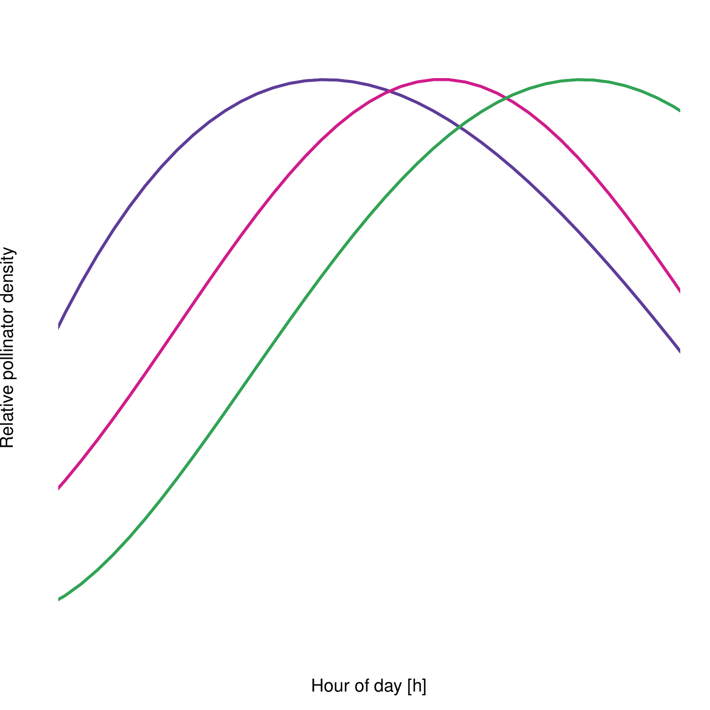
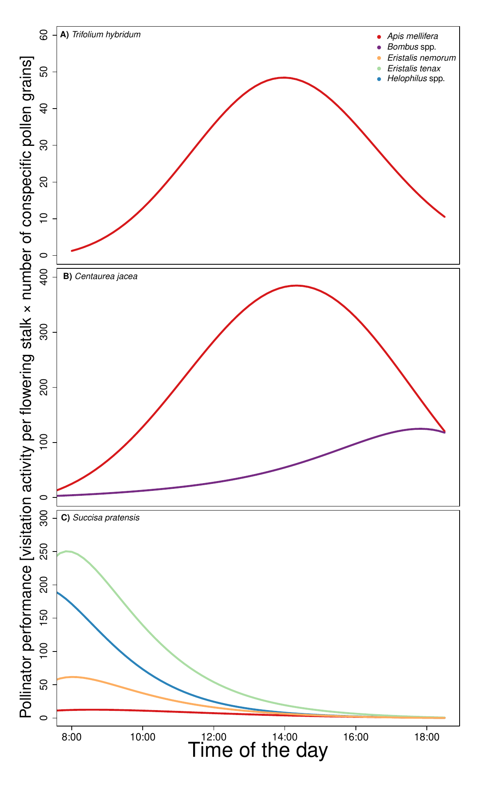
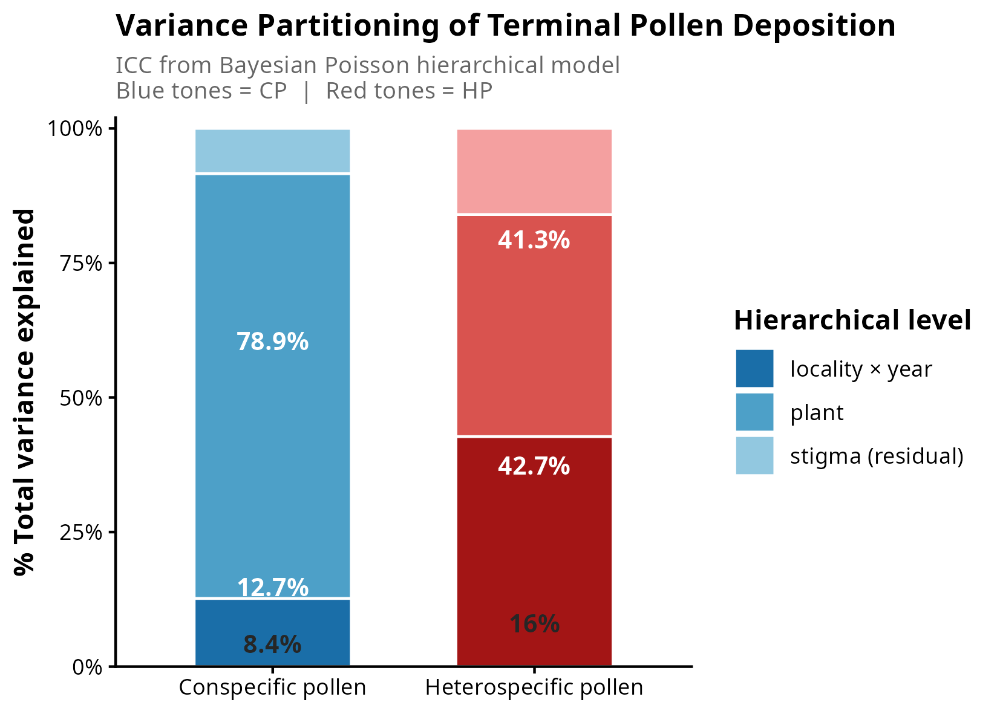
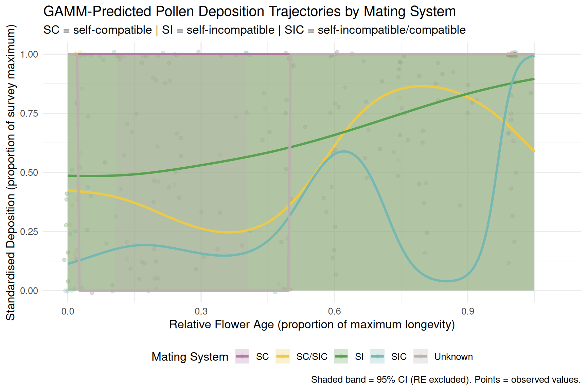
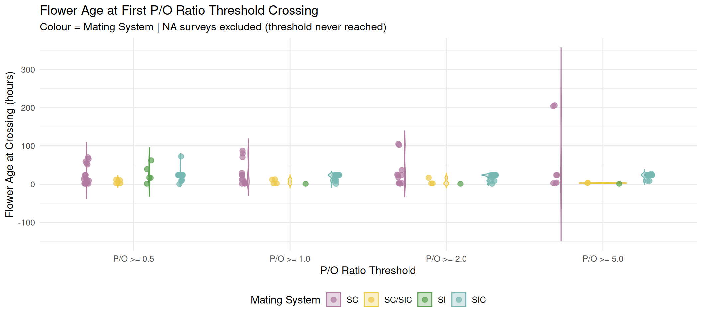
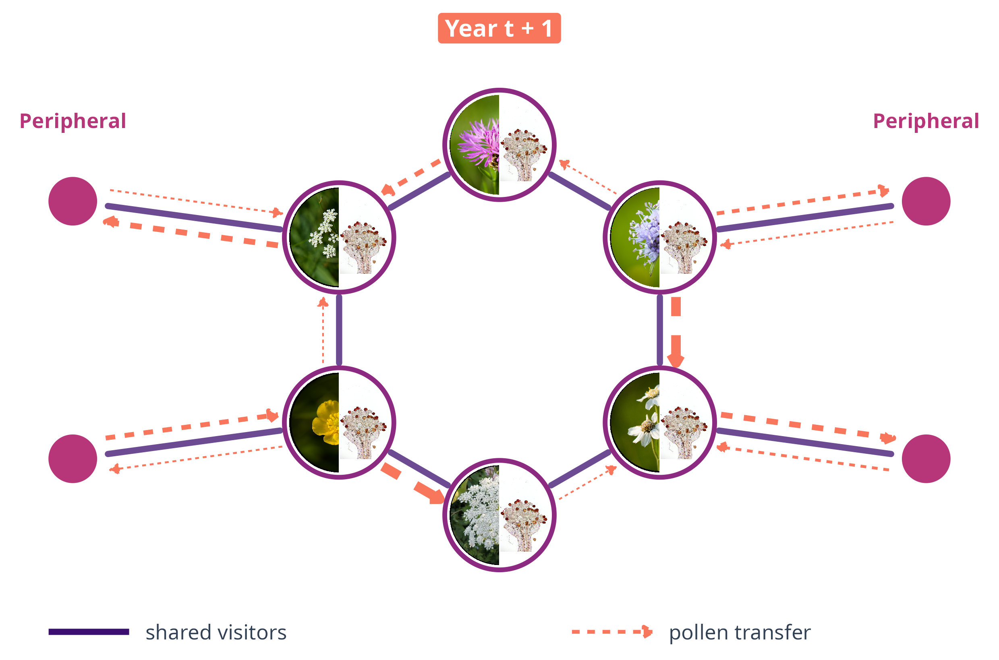
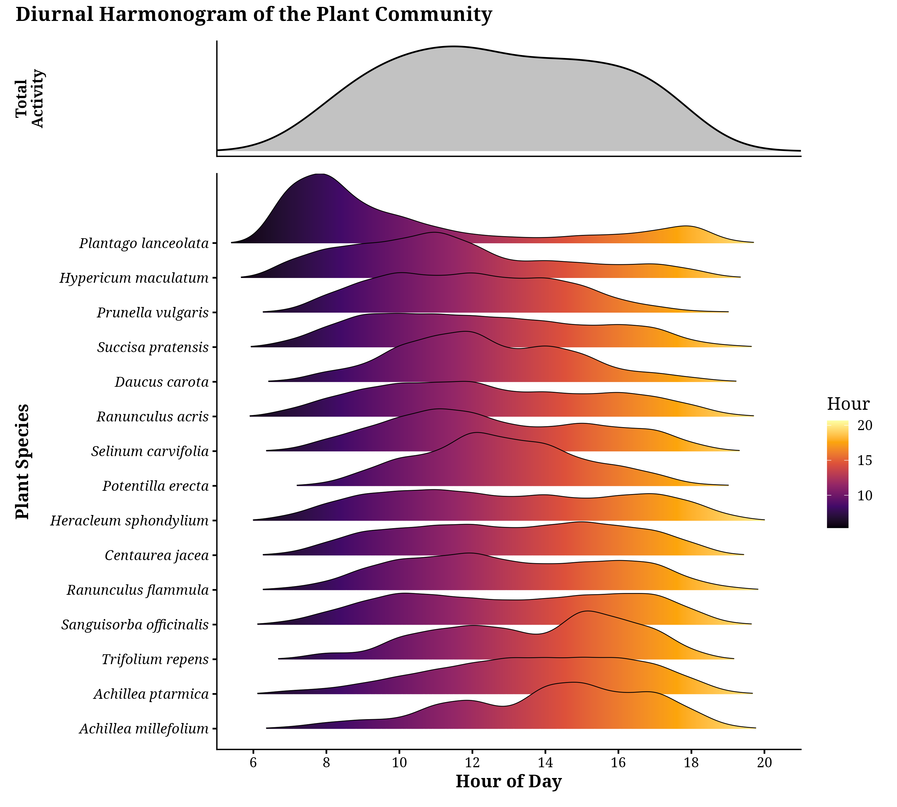
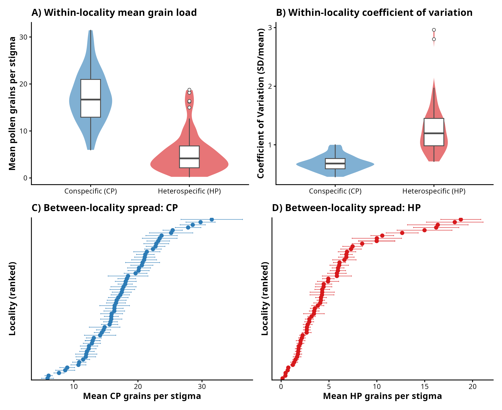
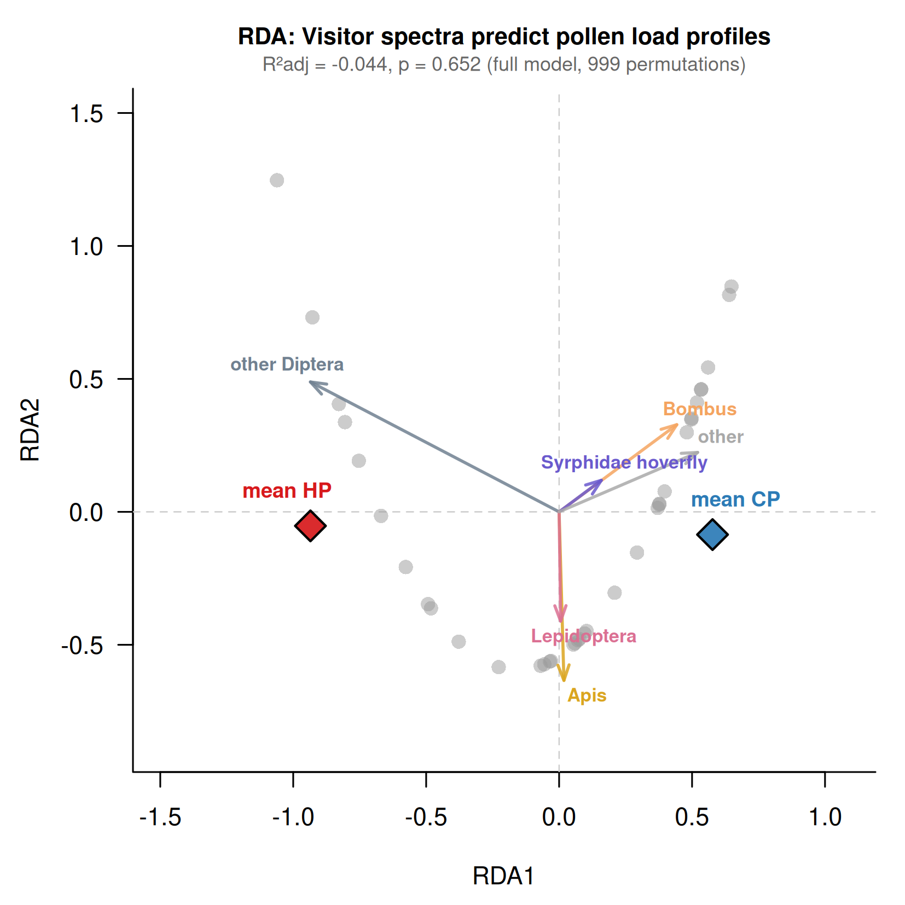

---
format:
  revealjs:
    embed-resources: false
    aspectratio: 43
    navigation: horizontal
    print-background: true
    partial-slides: true
    multiplex: false
    slide-number: c/t
    incremental: false
    theme: techroom/pp.scss
    css: techroom/gaps.css
    logo: images/pyl.png
    footer: "Jakub Štenc | Seminar Göteborg 2026 | Charles University & CREAF"
    background-transition: fade
    transition: none
    center-title-slide: false
    self_contained: true
    pdf-separate-fragments: true
bibliography: techroom/references.bib
keep-md: true
engine: knitr
---

<!--
=====================================================================
STORYBOARD  (40 min talk; timing chip in the top-right of each slide)
=====================================================================
Thread: "One pollen grain's journey through a shared meadow"
        anther -> pollinator body -> stigma -> community -> future

 0  Opening + the question ............................  3 min   (slides 1-4)
 1  The system: K Handrkovu ............................  5 min   (methods, 15 yrs, networks)
 2  Pollen presentation (published) ....................  7 min   Štenc et al. 2023 AJB; Štenc et al. 2025 PPEES;
                                                                    Freudenfeld et al. 2025 AoB Plants
 3  Pollen deposition (submitted + in prep) ............ 11 min   LLN paper (New Phytologist, submitted);
                                                                    Slavkovský les + plant height (Oikos, in prep);
                                                                    Deposition curves meta-analysis (in prep)
 4  Scaling up: the pollinator-sharing core ............  6 min   Annual pollinator sharing (in prep, SCAPE 2026)
 5  Work in progress & future ..........................  5 min   PAC bottleneck, DiuHanPolNet, HanSpaNet,
                                                                    pollen-transfer networks, SucTemDep
 6  Take-home + thanks .................................  3 min
                                                         -------
                                                          40 min
Orange dashed boxes (.gap) = things to fill or decide. Delete them when done.
=====================================================================
-->

#  {background-image="images/90985051_3160362750661404_9121786830419656704_o.jpg" style="text-align: center;"}

<h2 style="text-align:center;font-size: 32px;color:white; text-align:center;">

::: {style="background-color: rgba(0, 0, 0, .55); backdrop-filter: blur(6px); box-shadow: 0 0 1.5rem 0 rgba(0, 0, 0, .6); border-radius: 8px; padding: 18px;"}
Sharing without losing: the journey of pollen through a species-rich meadow

**Jakub Štenc**^1,2,3^ & the Handrkov team

^1^Charles University (Botany) | ^2^Charles University (Zoology) | ^3^CREAF, Spain

:::

</h2>

{.absolute bottom="0%" left="0" width="230"}

{.absolute bottom="8%" left="0%" width="170"} {.absolute bottom="8%" right="0%" width="170"}

::: notes
Working title, alternatives:
- "From anther to stigma to community: how meadow plants cope with shared pollinators"
- "Pollen on the move: presentation, deposition and network structure in a Czech meadow"
Seminar audience in Göteborg: assume a broad ecology/plant biology department, not only pollination specialists. Keep jargon low, define CP/HP/SVD/TPD when first used.
:::

##  {background-video="images/video_intro_reduced_shorter.mp4" background-video-loop="true" background-video-muted="true"}

::: notes
[0:30] Let the meadow speak. Handrkov in August: dozens of plant species in flower at the same time, hundreds of insect species.
:::

## Sharing is the norm

≈ 1.5 min

::: r-stack
{fig-align="center" width="620"}

{.fragment fig-align="center" width="625"}

{.fragment fig-align="center" width="630"}
:::

::: notes
In species-rich meadows most plants are generalists and share most of their visitors.
Sharing is a problem for a plant: pollen is lost to other species (consumption, wrong stigmas) and foreign pollen arrives on its own stigma (heterospecific pollen, HP).
Central question of the whole talk: how do plants in such a meadow still get enough of their own pollen (conspecific pollen, CP)?
:::

## The journey of a pollen grain

≈ 1 min

::: {.gap style="margin-top: 20px;"}
Roadmap figure: a simple left-to-right schematic **anther → pollinator body → stigma → community network**, one icon per stage. Each stage is one part of the talk. Reuse the fly / stigma silhouettes from the LLN graphical abstract (scripts/generate_graphical_abstract_v2.R) so the style stays consistent.
:::

1The meadow

2Pollen presentation <small>anther → pollinator</small>

3Pollen deposition <small>pollinator → stigma</small>

4The community <small>sharing network</small>

5What's next

::: notes
Guiding idea: plants cannot choose their visitors, but they can control WHEN they offer pollen, and they profit from HOW MANY visits they get and WHERE they grow. Each part shows one of these levers.
:::

# The system: K Handrkovu {background-color="#40695B"}

1The meadow

2Presentation

3Deposition

4Community

5Next

## The locality

≈ 1 min

::::: {style="display: flex; justify-content: center; align-items: flex-end; gap: 50px; margin-top: 30px;"}
::: {.fragment style="text-align: center; flex: 1;"}

Czech Republic

:::

::: {.fragment style="text-align: center; flex: 1.3;"}

&gt; 50 entomophilous plant species

:::
:::::

::: {.fragment style="text-align: center; font-size: 34px; font-weight: 600; margin-top: 40px;"}
15 years of data collection (2011–2025)
:::

::: notes
K Handrkovu near Vernýřov, Central Bohemia (49.8466 N, 15.1498 E). Moist to mesophilous grassland mosaic, two flowering peaks (May, August), mown twice a year. Sampling at the August peak. Founded by Zdeněk Janovský [@Janovsky2013].
:::

## Permanent plots

≈ 1 min

::::: {style="display: flex; justify-content: center; align-items: flex-start; gap: 28px; margin-top: 30px;"}
::: {.fragment style="text-align: center; flex: 1;"}

plots are marked

:::

::: {.fragment style="text-align: center; flex: 1;"}

recovered every year

:::

::: {.fragment style="text-align: center; flex: 1.25;"}

93 plots in total

:::
:::::

::: {.gap .fragment style="margin-top: 10px; font-size: 17px;"}
Check plot number and size. The manuscripts disagree: SCAPE talk and LLN paper say 93 plots of 4 × 4 m, HanNullNet README says 96 plots of 4 × 4 m, HanSpaNet says 98 plots of 8 × 8 m with 64 subplots of 1 × 1 m.
:::

## Plant and pollinator survey

≈ 1.5 min

::::: {style="display: flex; justify-content: center; align-items: flex-start; gap: 28px; margin-top: 20px;"}
::: {style="text-align: center; flex: 1;"}

Flowering stalks in 64 cells per plot, twice per season

:::

::: {.fragment style="text-align: center; flex: 1;"}

"Snapshot" surveys: insects touching reproductive organs

:::
:::::

::: {.fragment style="text-align: center; font-size: 24px; margin-top: 14px;"}
42 378 plot surveys · 68 460 interactions · 176 pollinator taxa × 55 plant species
:::

::: notes
Numbers from the SCAPE 2026 dataset (2011–2025). Note: the DiuHanPolNet summary reports 58 451 interactions, 53 plants and 174 pollinators (different filtering). Use one consistent set in the talk.
:::

## From above

≈ 0.5 min

{fig-align="center" height="560"}

::: notes
Drone view: the scale of the meadow and the grid of plots. Short, atmospheric.
:::

## 15 years of networks

≈ 1 min

{fig-align="center" height="560"}

::: notes
One plant-pollinator network per year. Same meadow, same method, very different networks: this year-to-year turnover will come back in Part 4.
Transition: before networks, start with the smallest unit, the pollen grain leaving the anther.
:::

# Pollen presentation {background-color="#40695B"}

1The meadow

2Presentation <small>anther → pollinator</small>

3Deposition

4Community

5Next

## Why should timing matter?

≈ 1 min

::: {style="font-size: 26px; margin-top: 20px;"}
-   Only a tiny fraction of pollen reaches a conspecific stigma
-   Pollen presentation theory: plants can **dose** pollen to pollinators [@harder1989]
-   With shared pollinators, **when** pollen is offered may decide **who** carries it
:::

::: {.gap .fragment style="margin-top: 20px; font-size: 17px;"}
Optional: add Harder & Wilson 1994, LeBuhn & Holsinger 1998 and Stone et al. 1998 to techroom/references.bib (from Psani_clanku/2021/START_paper/pollen_presentation_references.bib).
:::

::: notes
Pollen is lost through consumption, grooming and transfer to the wrong species. Gradual dispensing should pay off with many, inefficient pollinators; dumping all pollen at once should pay off with few, efficient ones.
:::

## Three species, three strategies

≈ 1 min

::: {.gap style="margin-top: 10px;"}
Three photos side by side, each with one line of text:

- ***Succisa pratensis***: open flowers, accessible pollen, mainly pollen-feeding hoverflies
- ***Centaurea jacea***: pollen pumped out gradually (Asteraceae pump), mainly bees
- ***Trifolium hybridum***: closed flowers, explosive release when opened, bees only

Photos available: images/Succisa_pratensis.png, images/Centaurea_jaceae.png. A *Trifolium hybridum* photo is missing.
:::

## When is pollen available?

≈ 1.5 min

{fig-align="center" height="480"}

::: src
@Stenc2023
:::

::: {.fragment .absolute top="30%" left="15%" width="70%"}
::: bigmsg
*Succisa* releases its pollen in the morning. *Centaurea* and *Trifolium* peak in the early afternoon.
:::
:::

::: notes
Štenc et al. 2023, American Journal of Botany. Pollen available per inflorescence over the day.
:::

## Pollinators track pollen

≈ 1 min

{fig-align="center" height="440"}

::: {.gap style="font-size: 17px;"}
This image is a schematic (no axis values). Replace it with the real visitation-vs-pollen figure of START I (e.g. Tablo2.pdf or kombograf_ultra_mega6.pdf in Psani_clanku/2021/START_paper), or keep it as a concept and say so.
:::

::: notes
Key result of START I: visitation of C. jacea and T. hybridum closely matched pollen availability; S. pratensis pollinators peaked with a slight delay after the morning release.
:::

## What do pollinators carry?

≈ 1.5 min

::::: columns
::: {.column width="45%"}
{fig-align="center" height="520"}

::: src
@stenc2025pollen
:::
:::

::: {.column width="55%"}
::: {.fragment style="font-size: 23px; margin-top: 60px;"}
-   ***Succisa***: most pollen in the morning, then quantity **and** purity drop
-   ***Centaurea***, ***Trifolium***: more even loads through the day
-   Explained by plant density (*Centaurea*) and flower morphology with release strategy (*Trifolium*)
:::
:::
:::::

::: notes
Štenc et al. 2025, PPEES 67: 125868. Conspecific pollen on pollinator bodies over the day (log scale), by pollinator taxon.
:::

## Pollen must flow

≈ 1 min

{fig-align="center" height="530"}

::: src
@stenc2025pollen
:::

::: notes
Pollinator performance = visitation activity per flowering stalk × conspecific pollen grains on the body. Succisa is served by hoverflies early in the morning (Eristalis tenax, Helophilus), Centaurea and Trifolium by Apis in the afternoon. The plants split the day: diurnal stratification of pollen transfer lowers the cost of sharing pollinators.
:::

## And between years?

≈ 0.5 min

::: {.gap style="margin-top: 30px;"}
One slide on @freudenfeld2025interannual (AoB Plants): "Interannual differences in pollinator contributions to pollen transfer are mainly driven by changes in pollinator abundance". Suggested: one key figure plus one sentence. Figure source: ask Martin, or use Psani_clanku/2024/Martin. Optional: cut if time is short.
:::

::: notes
Bridge: who carries the pollen changes from year to year, mainly because pollinator abundances change, not because their per-capita behaviour changes. So what arrives on the stigma?
:::

## Part 2 in one sentence

≈ 0.5 min

::: {style="margin-top: 120px;"}
::: bigmsg
Plants cannot choose their pollinators, but they can choose **when** to offer pollen.
:::
:::

# Pollen deposition {background-color="#40695B"}

1The meadow

2Presentation

3Deposition <small>pollinator → stigma</small>

4Community

5Next

## From body to stigma

≈ 1 min

::::: {style="display: flex; justify-content: center; align-items: flex-start; gap: 60px; margin-top: 25px;"}
::: {style="text-align: center; flex: 1; max-width: 450px;"}
{height="420px" style="object-fit: contain; display: block; margin: 0 auto;"}

Pollen on the body

:::

::: {.fragment style="text-align: center; flex: 1; max-width: 450px;"}
{height="420px" style="object-fit: contain; display: block; margin: 0 auto;"}

Pollen on the stigma

:::
:::::

::: notes
Define terms once: conspecific pollen (CP) = own species; heterospecific pollen (HP) = other species. Single-visit deposition (SVD) = what one visit leaves. Terminal pollen deposition (TPD) = the final load on an old stigma.
Focal species from now on: Succisa pratensis, a core species of the meadow network (Part 4).
:::

## One visit is a lottery

≈ 1.5 min

{fig-align="center" height="440"}

::: {.gap style="font-size: 17px;"}
Add the key numbers from the LLN manuscript (New Phytologist, submitted 2026): drop from body load to SVD, and the result that SVD does not differ among *Eristalis*, *Helophilus* and *Bombus* (Kruskal–Wallis). Check that this figure reads well at slide size.
:::

::: notes
SVD experiments 2022–2024 on bagged Succisa inflorescences. Individual visits are highly variable and mechanically inefficient, and dominant pollinator taxa are functionally equivalent per visit.
:::

## But the final load is stable

≈ 1.5 min

::: r-stack
{fig-align="center" height="520"}

{.fragment fig-align="center" height="520"}
:::

::: notes
CV drops from body → SVD → TPD. Variance partitioning of TPD (years, days, plants, stigmas): temporal components explain negligible CP variance; most variance sits among individual stigmas and plants.
[Fill in the exact variance shares from MS_FML.qmd results.]
:::

## The law of large numbers

≈ 1.5 min

::: r-stack
{fig-align="center" height="520"}

{.fragment fig-align="center" height="520"}
:::

::: notes
Monte Carlo simulation parameterised by empirical SVD and visitation rates: accumulation of many independent, noisy visits is sufficient to reproduce the stable terminal CP loads observed in the field.
HP is different: not predicted by the null model, depends on the floral neighbourhood, and is diluted by high conspecific floral density.
Štenc et al., submitted to New Phytologist.
:::

## Does this hold across a landscape?

≈ 1 min

::: {.gap style="margin-top: 20px;"}
Map of Slavkovský les PLA with the 60 *Succisa* localities (coordinates in envi_blizny.csv). Plus a photo of a typical locality.

- 60 localities, 2022–2023, ≈ 3 000 stigmas (n = 2 931 in the trait model)
- 3 stigmas per plant, male-phase flowers, one sampling day per locality and year
- 20-min pollinator transects, morning and afternoon
- **Fill in:** number of plants sampled per locality (still TODO in the manuscript)

Credit: MSc thesis of Natálie Hanusová (2024), supervised by J. Štenc.
:::

::: notes
Handrkov is a single meadow. The Slavkovský les data test the same idea over a heterogeneous landscape of meadows, wetland margins and forest edges.
:::

## Where does the variance come from?

≈ 2 min

::::: columns
::: {.column width="55%"}
{fig-align="center" height="370"}
:::

::: {.column width="45%"}
::: {.fragment style="font-size: 22px; margin-top: 40px;"}
-   **CP**: mostly the individual **plant** (≈ 79 %), little locality × year (≈ 13 %)
-   **HP**: **locality × year** (≈ 43 %) as large as plant (≈ 41 %)
-   Visitor composition did not predict CP or HP loads
-   HP followed the landscape: flowerhead number, distance to water, marsh area (dbRDA)
:::
:::
:::::

::: {.gap style="font-size: 16px;"}
Fix the figure before use. Its percentage labels sit on the wrong segments: for CP, 8.4 % belongs to stigma and 12.7 % to locality × year (variance_components.csv). For HP, 16 % belongs to stigma.
:::

::: notes
Bayesian Poisson hierarchical model, ICCs. CP stays locally buffered, consistent with the law of large numbers across space. HP is a landscape-context problem.
HP dbRDA: n_flowerheads F = 21.5, p = 0.001; dist_water F = 7.9, p = 0.008; marsh area F = 5.1, p = 0.023; adj R² = 0.35.
:::

## Taller plants get more pollen

≈ 1.5 min

::: {.gap style="margin-top: 10px;"}
New figure needed: rate ratio plot (forest plot) of within-locality effects of **stem height** and **flowerhead diameter** on CP and HP. Data in outputs/tables/plant_trait_effects.csv. Photo idea: a tall *Succisa* above the grass.
:::

| Within-locality effect (per 1 SD) | CP | HP |
|---|---|---|
| Stem height | **RR 1.11** (1.04–1.19), p = 0.003 | 1.02, n.s. |
| Flowerhead diameter | 1.07 (1.00–1.14), p = 0.05 | **RR 1.10** (1.01–1.19), p = 0.02 |

: {tbl-colwidths="[40,30,30]" .striped}

::: notes
Within a locality, plants taller than their neighbours receive about 11 % more conspecific pollen per SD of height. Height does not affect HP. Larger flowerheads collect slightly more HP.
But: traits explain almost none of the plant-level variance (ICC 0.793 → 0.794). Height shifts the mean; most plant-to-plant variation remains position, microhabitat or chance.
:::

## Pollen deposition through a flower's life

≈ 2 min

::: r-stack
{fig-align="center" height="480"}

{.fragment fig-align="center" height="480"}
:::

::: {.gap style="font-size: 16px;"}
Redraw the GAMM figure: the confidence bands are broken and "Unknown" / "SC" add noise. Show SI vs SIC only. Literature synthesis: 36 species, 23 families, 49 surveys, 194 time-stamped records.
:::

::: notes
Meta-analysis of published deposition time series (Štenc, in prep.). Mating system best predicts the curve shape (deviance explained 56.8 %).
Self-incompatible species accumulate pollen over a broader part of flower life (median AUC 0.72 vs 0.14 in SIC; p_adj = 0.024) but rarely reach P/O ≥ 1 (1 of 7 surveys). Long accumulation without saturation: a sign of chronic pollen limitation in obligate outcrossers.
Bridge back to Succisa: protandrous, long-lived stigmas, hence the value of many visits.
:::

## Part 3 in one sentence

≈ 0.5 min

::: {style="margin-top: 100px;"}
::: bigmsg
Many noisy visits add up to a reliable dose of own pollen. Foreign pollen depends on the neighbours.
:::
:::

::: notes
Synthesis of Parts 2 and 3: TIME (presentation schedule), NUMBERS (law of large numbers), SPACE (plant height, landscape context for HP). All three depend on who else is in the community. That leads to the network.
:::

# Scaling up: the community {background-color="#40695B"}

1The meadow

2Presentation

3Deposition

4Community <small>sharing network</small>

5Next

## Plants linked by shared pollinators

≈ 1 min

::: r-stack
{fig-align="center" height="540"}

{.fragment fig-align="center" height="540"}
:::

::: notes
From the bipartite plant-pollinator web to the plant-plant pollinator-sharing network. Every shared visitor is a potential route for HP.
Shortened version of the SCAPE 2026 story. If time allows, reuse the airport analogy slide from SCAPE.
:::

## A stable core

≈ 1.5 min

{fig-align="center" height="520"}

::: notes
k-core decomposition per year, null model of 1 000 permutations per year. Six species are central in the sharing network across 15 years: Centaurea jacea, Selinum carvifolia, Succisa pratensis, Pimpinella saxifraga, Achillea ptarmica, Ranunculus acris. Plant identity explains 38 % of centrality variance beyond floral abundance (44 %).
Note that the two best-studied species of Parts 2 and 3, Succisa and Centaurea, are both core species.
:::

## Drought concentrates visits on the core

≈ 2 min

::: r-stack
{fig-align="center" height="500"}

{.fragment fig-align="center" height="500"}
:::

::: notes
Recurring summer drought in 2011–2025. The core holds about 14 % of flowers but receives 67 % of visits on average, rising from 34–55 % (2011–14) to 84–88 % (2023–25). In dry years peripheral flowering drops about threefold, core flowering does not.
:::

## A more fragile network

≈ 1.5 min

{fig-align="center" height="500"}

::: src
Co-extinction simulation following @Memmott2004
:::

::: {.fragment .absolute top="27%" left="17%" width="66%"}
::: bigmsg
Losing the core costs more in dry years and more every year
:::
:::

::: notes
Co-extinction simulations (Memmott et al. 2004). Core-first removal: R from 0.69 (2011) to 0.41–0.43 (2023–25). Robustness gap grows by about 0.022 per year.
Link to pollen: if most visits go to a few core plants, those plants share almost every insect. What does that mean for the pollen arriving on their stigmas? That is the open question of Part 5.
:::

# Work in progress & future {background-color="#40695B"}

1The meadow

2Presentation

3Deposition

4Community

5Next

## Visits are not pollen

≈ 1.5 min

::: r-stack
{fig-align="center" width="85%"}

{.fragment fig-align="center" width="85%"}

{.fragment fig-align="center" width="85%"}

{.fragment fig-align="center" width="85%"}
:::

::: notes
Concept, not data. Pollen-transfer networks built from stigma loads and body loads, compared to visitation networks. Does pollen actually flow along the same routes, in the same direction and strength?
:::

## The price of being in the core

≈ 1 min

::: {.gap style="margin-top: 20px;"}
Project "Apparent competition bottleneck" (pitch stage). Hypothesis: when drought crowds pollinators onto the core, core plants share nearly every insect. This should increase **heterospecific pollen deposition** on core stigmas and may be a hidden cost that prevents competitive exclusion.

Suggested visual: pollinator-sharing network in a wet year (2012) vs a dry year (2015), side by side, plus the question "more HP on *Succisa* in dry years?". Link to SucTemDep: *Succisa* stigma loads 2022–2024 at Handrkov as a first test.
:::

## Time of day as a niche axis

≈ 1 min

::: {.gap style="margin-top: 20px;"}
Project DiuHanPolNet (manuscript draft). Diurnal stratification structures the network: "global generalists, local specialists".

- Hourly interaction rewiring ≈ 34 %
- Diurnal stratification reduces apparent competition by > 40 % per year
- Pollinators shift foraging time away from dominant competitors (*Apis*, dominant Diptera)

This scales Part 2 (three species) to the whole community. Decide whether the harmonogram below reads well at slide size.
:::

{fig-align="center" height="300"}

## Space as a niche axis

≈ 1 min

::: {.gap style="margin-top: 10px;"}
Project HanSpaNet. Fine-scale spatial clumping of plants: aggregated species "steal" visits from dominant foragers, dispersed neighbours lose. This scales the Slavkovský les and plant height results to the community. Decide whether to show the graphical abstract below or one result plot.
:::

{fig-align="center" height="360"}

## The next dry summers

≈ 0.5 min

{fig-align="center" height="480"}

::: {.gap style="font-size: 17px;"}
Optional: HanFutNet (ERGM): binary structure stays stable under drought, interaction strengths rewire. HanNullNet: is stability built by spatial or temporal turnover? Pick at most one, or keep both as "questions we are working on" in one line each.
:::

## Take-home messages

≈ 2 min

:::::: columns
::: {.column width="33%"}
::: {style="background: #FFFFFF; border: 1px solid #E2E8F0; border-top: 6px solid #3B0F70; border-radius: 10px; padding: 10px 8px 12px 8px; box-shadow: 0 4px 12px rgba(0,0,0,0.05); text-align: center;"}
<h3 style="font-size: 25px; color: #3B0F70; margin: 2px 0 6px 0;">01 Timing</h3>

Pollen presentation schedules split the day among co-flowering plants

:::
:::

::: {.column width="33%"}
::: fragment
::: {style="background: #FFFFFF; border: 1px solid #E2E8F0; border-top: 6px solid #F8765C; border-radius: 10px; padding: 10px 8px 12px 8px; box-shadow: 0 4px 12px rgba(0,0,0,0.05); text-align: center;"}
<h3 style="font-size: 25px; color: #F8765C; margin: 2px 0 6px 0;">02 Numbers</h3>

Many noisy visits give a stable dose of own pollen. Foreign pollen follows the landscape

:::
:::
:::

::: {.column width="33%"}
::: fragment
::: {style="background: #FFFFFF; border: 1px solid #E2E8F0; border-top: 6px solid #40695B; border-radius: 10px; padding: 10px 8px 12px 8px; box-shadow: 0 4px 12px rgba(0,0,0,0.05); text-align: center;"}
<h3 style="font-size: 25px; color: #40695B; margin: 2px 0 6px 0;">03 Community</h3>

A stable core carries the network, and drought makes it ever more important

:::
:::
:::
::::::

::: {.gap .fragment style="margin-top: 16px; font-size: 17px;"}
Add one small image per card (reuse takehome_*.png style from SCAPE or new icons).
:::

## The Handrkov team

≈ 0.5 min

{fig-align="center" height="460"}

::: {.gap style="font-size: 17px;"}
Acknowledgements: co-authors (Janovský, Hadrava, Mikát, Matoušková, Freudenfeld, Švanda, Ryšan, Pijálková, Horčičková, Straka, Bosch), students (N. Hanusová), field volunteers, funding (GAČR, GAUK, CREAF postdoc). Check funding numbers.
:::

## Join us

{fig-align="center" width="950"}

  <a href="https://pollination-ecology-group.github.io/Handrkov/" target="_blank" style="color: #40695B; font-weight: 600; text-decoration: underline;">https://pollination-ecology-group.github.io/Handrkov/</a>
  |
  <a href="mailto:jakubstenc@gmail.com" style="color: #374151; text-decoration: none;">jakubstenc@gmail.com</a>

::: notes
Optional: Ecoflor 2027 in Prague invitation (logo2027.png and ecoflor_qr.png are in images/).
:::

##  {background-image="images/Fin.jpg"}

 

Thank you for your attention!

Jakub Štenc

jakubstenc@gmail.com

Charles University, Prague &amp; CREAF, Barcelona

{.absolute bottom="0%" right="25%" width="190"} {.absolute bottom="0%" left="0" width="230"} {.absolute bottom="8%" left="0%" width="170"} {.absolute bottom="8%" right="5%" width="170"}

# Backup slides {background-color="#333"}

## Backup: community stability 2022–2024

{fig-align="center" height="540"}

::: notes
LLN paper: Morisita–Horn similarity of visitor spectra and plant community across the three years; per-capita visitation vs local Succisa abundance (density dilution).
:::

## Backup: Succisa abundance in space and time

{fig-align="center" height="540"}

## Backup: Slavkovský les CV

{fig-align="center" height="540"}

## Backup: visitors vs pollen loads (dbRDA)

{fig-align="center" height="540"}

## Backup: deposition curves by life form

::: r-stack
{fig-align="center" height="520"}

{.fragment fig-align="center" height="520"}
:::

::: notes
Semelparous species: higher cumulative deposition than iteroparous ones.
:::

## Backup: pollen on stigma and pollinator

{fig-align="center" height="540"}

## References

::: {#refs style="font-size: 16px;"}
:::
