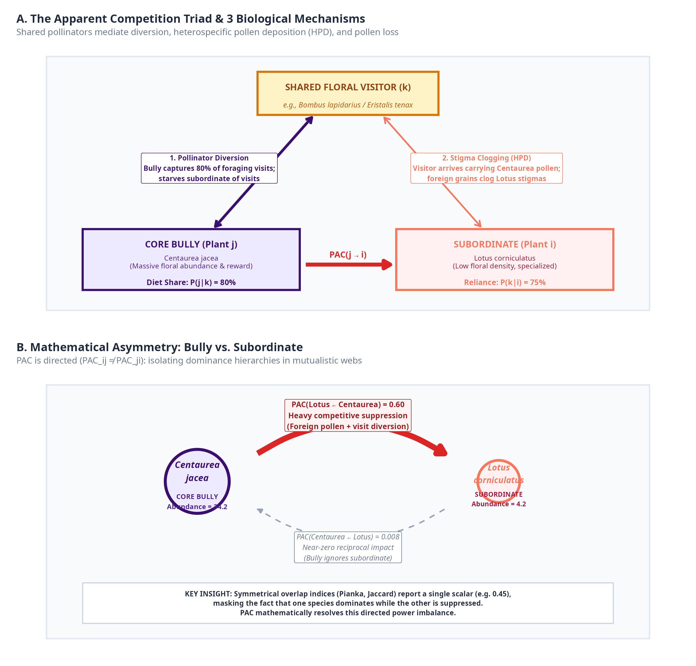
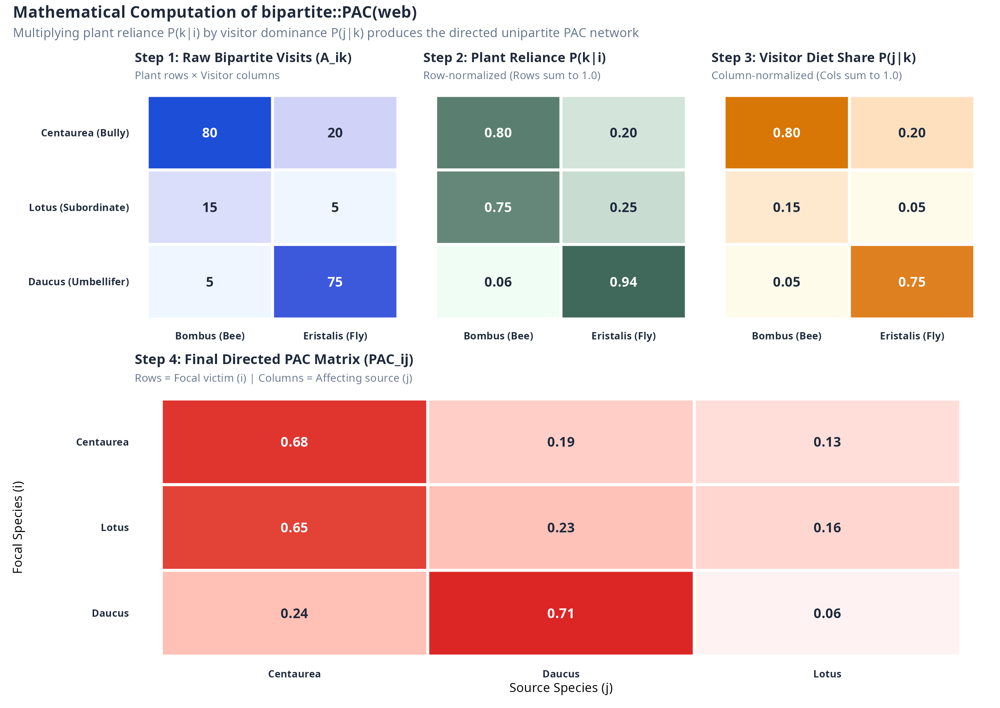
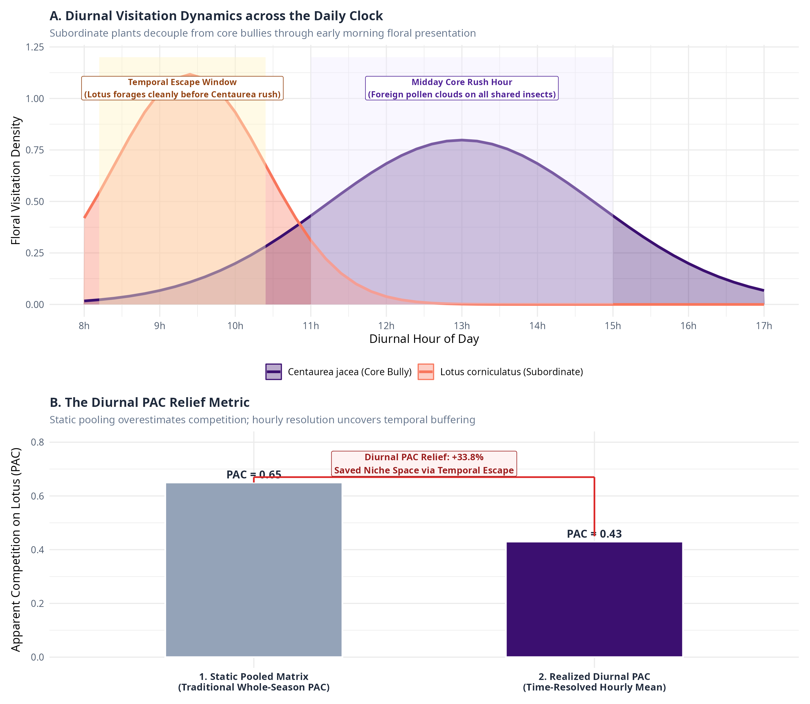

# The Potential for Apparent Competition (PAC): Origins, Formulation, Application, and Limitations

**Author**: Jakub Štenc et al.  
**Context**: Handrkov 15-Year Project & *Ecology Letters* Manuscript (*HanDriverNet*)  
**Date**: October 2026  

---

## 1. Executive Summary: What is PAC in Three Sentences?

The **Potential for Apparent Competition (PAC)** is a quantitative network metric that measures the indirect, consumer-mediated interaction between two resource species sharing common visitors. Originally derived for host–parasitoid food webs and later adapted to plant–pollinator mutualisms, it calculates the joint probability that a visitor arriving at plant species $i$ has had its foraging activity shaped, sustained, or diverted by a co-flowering plant species $j$. Because it is inherently **asymmetric and directed** ($PAC_{ij} \neq PAC_{ji}$), it captures the unequal competitive pressure that abundant generalist floral "bullies" exert upon subordinate or specialized community members.

---

## 2. Where Did the Index Come From? (Theoretical Genesis)

### 2.1 The Ecological Concept: Holt (1977)
The theoretical concept of *apparent competition* was introduced by Robert D. Holt in a landmark paper:
> **Holt, R. D. (1977).** Predation, apparent competition, and the structure of prey communities. *Theoretical Population Biology*, 12(2), 197–229.

Holt demonstrated mathematically that two prey species that do not compete for any limiting abiotic or food resource can nevertheless exhibit negative indirect interactions if they share a common predator. An increase in prey species 1 elevates predator density or foraging activity, which in turn increases predation pressure on prey species 2. To an external observer, the two prey species appear to be competing directly, even though the interaction is strictly mediated through the third-party consumer.

### 2.2 The Quantitative Matrix: Müller et al. (1999)
For over two decades, apparent competition remained largely a theoretical or pairwise concept. In 1999, Charles Godfray's team published the first quantitative, multi-species matrix formulation in *Nature*:
> **Müller, C. B., Adriaanse, I. C., Belshaw, R., & Godfray, H. C. J. (1999).** The structure of an aphid–parasitoid community. *Nature*, 399(6735), 433–436.

Studying 22 aphid species and 18 hymenopteran parasitoids in an abandoned agricultural field, Müller et al. defined $d_{ij}$ as the **probability that a parasitoid attacking host species $i$ developed in host species $j$**. This was the very first mathematical formulation of what would later become the PAC metric.

### 2.3 Experimental Validation and Metric Formalization: Morris et al. (2004)
Five years later, Rebecca Morris and colleagues validated the $d_{ij}$ metric experimentally in a tropical rainforest:
> **Morris, R. J., Lewis, O. T., & Godfray, H. C. J. (2004).** Experimental evidence for apparent competition in a tropical forest food web. *Nature*, 428(6980), 310–313.  
> *See also extensive mathematical formulation in*: **Morris, R. J., Lewis, O. T., & Godfray, H. C. J. (2005).** Apparent competition and insect community structure: analysis of a tropical food web. *Journal of Animal Ecology*, 73(5), 828–840.

Morris et al. experimentally removed abundant host species from a species-rich leaf-miner–parasitoid community in Belize. They showed that the observed reduction in parasitism on remaining leaf miners matched the quantitative predictions of the $d_{ij}$ matrix: species with high theoretical $d_{ij}$ values experienced the strongest real-world indirect demographic relief.

---

## 3. Translation to Plant–Pollinator Networks

### 3.1 How Mutualists Mediate Competition: Carvalheiro et al. (2014)
In 2014, Carvalheiro and colleagues translated the Müller–Morris parasitoid framework into plant–pollinator mutualistic webs in *Ecology Letters*:
> **Carvalheiro, L. G., Biesmeijer, J. C., Matias, M. G., et al. (2014).** Species richness and the proportion of specialists drive the strength of indirect interactions in plant–pollinator networks. *Ecology Letters*, 17(11), 1388–1397.

In pollination ecology, apparent competition between plants sharing floral visitors operates via three distinct biological mechanisms:
1. **Pollinator Diversion / Preference**: Abundant, highly rewarding flowers (e.g., *Centaurea jacea*) distract generalist pollinators away from co-flowering subordinate species, leaving subordinates pollen-limited.
2. **Heterospecific Pollen Deposition (HPD)**: When pollinators move between flowers of different species, foreign pollen is deposited on heterospecific stigmas, clogging receptive stigmatic papillae and inhibiting conspecific pollen tube growth.
3. **Pollen Loss / Wastage**: Conspecific pollen carried on an insect's body is lost or scraped off onto intervening flowers of other species before reaching a conspecific stigma.

Carvalheiro et al. evaluated PAC across 23 worldwide bipartite plant–pollinator networks, proving that indirect interactions mediated by shared pollinators are ubiquitous and strongly governed by community species richness and the proportion of specialized interactors.


### 3.2 Graphical Summary: Biological Mechanisms and Asymmetry

{width="100%"}

**Figure 1. Biological mechanisms and mathematical asymmetry of PAC.**  
**(A)** The Apparent Competition Triad: Shared floral visitors mediate three distinct indirect interactions: (1) *Pollinator Diversion* (abundant flowers monopolize visitor foraging bouts); (2) *Heterospecific Pollen Deposition (HPD)* (visitors arrive coated in foreign pollen, physically clogging stigmas); and (3) *Conspecific Pollen Loss* (pollen wasted on heterospecific floral structures).  
**(B)** Directed Asymmetry: Unlike symmetric overlap indices (Pianka, Jaccard), PAC is directed ($PAC_{ij} 
eq PAC_{ji}$). A core dominant like *Centaurea jacea* imposes severe apparent competition on subordinate *Lotus corniculatus* ($PAC = 0.60$), but experiences virtually zero reciprocal pressure ($PAC = 0.008$), mathematically capturing the dominance hierarchy.

### 3.3 The Mathematical Formulation

Let $\mathbf{A}$ be a quantitative bipartite interaction matrix with $R$ plant species (rows $i, j$) and $C$ pollinator taxa (columns $k$). $A_{ik}$ represents the interaction frequency (number of recorded flower visits) between plant $i$ and pollinator $k$.

The potential for plant $j$ to impose apparent competition on plant $i$ ($PAC_{ij}$) is defined as:

$$PAC_{ij} = \sum_{k=1}^C \left( \frac{A_{ik}}{\sum_{l=1}^C A_{il}} \times \frac{A_{jk}}{\sum_{m=1}^R A_{mk}} \right)$$

This formula is the exact algorithm implemented in the standard R package `bipartite::PAC`:
```r
# Exact implementation from bipartite::PAC:
for (i in 1:nrow(web)) {
  for (j in 1:nrow(web)) {
    dd <- numeric(ncol(web))
    for (k in 1:ncol(web)) {
      # Term 1: visitor k's share of plant i's visits
      p_k_given_i <- web[i, k] / sum(web[i, ])
      # Term 2: plant j's share of visitor k's foraging diet
      p_j_given_k <- web[j, k] / sum(web[, k])
      dd[k] <- p_k_given_i * p_j_given_k
    }
    res[i, j] <- sum(dd, na.rm = TRUE)
  }
}
```

### 3.3 Deconstructing the Probabilistic Logic

The product inside the summation consists of two conditional probabilities:

$$\underbrace{P(k \mid i)}_{\text{Term 1: Dependence}} = \frac{A_{ik}}{\sum_{l=1}^C A_{il}}$$
* **Biological meaning**: "Out of all visits received by plant $i$, what fraction is provided by pollinator $k$?"
* High value $\implies$ Plant $i$ is heavily reliant on pollinator $k$.

$$\underbrace{P(j \mid k)}_{\text{Term 2: Dominance}} = \frac{A_{jk}}{\sum_{m=1}^R A_{mk}}$$
* **Biological meaning**: "Out of all visits performed by pollinator $k$ in the entire community, what fraction is directed to plant $j$?"
* High value $\implies$ Pollinator $k$ spends most of its foraging time visiting plant $j$.

#### Multiplying Term 1 and Term 2:
$$d_{ij, k} = P(k \mid i) \times P(j \mid k)$$
"If a flower of plant $i$ receives a visit, what is the joint probability that the visitor is species $k$, AND that species $k$'s foraging bout is dominated by plant $j$?"

Summing over all insect taxa $k$ gives the overall directed coupling:
$$PAC_{ij} = \sum_{k=1}^C d_{ij, k}$$


### 3.4 Step-by-Step Toy Matrix Calculation

{width="100%"}

**Figure 2. Step-by-step matrix walkthrough of the `bipartite::PAC` algorithm.**  
* **Step 1 (Raw Matrix $\mathbf{A}$)**: Interaction counts between 3 plants and 2 visitor guilds.  
* **Step 2 (Row Normalization $P(k \mid i)$)**: Calculates the plant reliance vector (rows sum to 1.0).  
* **Step 3 (Column Normalization $P(j \mid k)$)**: Calculates the pollinator diet share vector (columns sum to 1.0).  
* **Step 4 (Directed PAC Matrix $\mathbf{PAC}$)**: Matrix multiplication yields the directed apparent competition network. Off-diagonals quantify the directed potential for apparent competition.

### 3.5 Why Asymmetry is Crucial ($PAC_{ij} \neq PAC_{ji}$)
Notice that $PAC_{ij}$ is **asymmetric**. Consider an empirical pair from Handrkov:
* **Plant $j$ = *Centaurea jacea*** (Dominant core composite; massive floral abundance):
  * Bumblebees (*Bombus lapidarius*) spend 80% of their time visiting *Centaurea* ($P(Centaurea \mid Bombus) = 0.80$).
* **Plant $i$ = *Lotus corniculatus*** (Subordinate Fabaceae; low floral abundance):
  * *Lotus* relies on *Bombus lapidarius* for 75% of its total visits ($P(Bombus \mid Lotus) = 0.75$).

Calculate the directed impacts:
$$PAC_{Lotus \leftarrow Centaurea} \approx 0.75 \times 0.80 = \mathbf{0.60} \quad (\text{Massive competitive pressure on Lotus})$$
$$PAC_{Centaurea \leftarrow Lotus} \approx P(Bombus \mid Centaurea) \times P(Lotus \mid Bombus) \approx 0.40 \times 0.02 = \mathbf{0.008} \quad (\text{Negligible impact on Centaurea})$$

*Centaurea* dominates the pollinator's foraging pool, meaning *Lotus* receives bees whose bodies are saturated with *Centaurea* pollen, or loses visits because bees bypass *Lotus* patches. Meanwhile, *Centaurea* suffers almost zero reciprocal pressure from *Lotus*. Standard symmetric indices (e.g., Jaccard similarity, unweighted overlap) completely miss this asymmetric dominance hierarchy.

---

## 4. How Did We Adapt and Use PAC in Our Study?

Standard studies calculate a single, static PAC matrix by pooling all flower visits observed across an entire site and season. In our work, we identified that **static pooling creates severe spatial and temporal aggregation biases**. 

We extended PAC in three novel ways:

### 4.1 Dyadic Variance Partitioning (DVP)
Instead of treating PAC as a single static scalar per pair, we recognized that PAC fluctuates across physical dimensions:
1. **Across Space**: $PAC_{ij}^{(p)}$ calculated within each 1-m² plot $p \in \{1, \dots, 93\}$.
2. **Across Climate/Years**: $PAC_{ij}^{(y)}$ calculated across 15 separate years $y \in \{2011, \dots, 2025\}$.
3. **Across Diurnal Time**: $PAC_{ij}^{(h)}$ calculated across 10 hourly intervals $h \in \{08:00, \dots, 17:00\}$.

We then partitioned the variance of every directed dyad $(i, j)$:
$$\text{Total Var}(i, j) = \text{Var}_{\text{Space}}(i, j) + \text{Var}_{\text{Year}}(i, j) + \text{Var}_{\text{Time}}(i, j)$$
$$\% \text{Space} = \frac{\text{Var}_{\text{Space}}}{\text{Total Var}}, \quad \% \text{Year} = \frac{\text{Var}_{\text{Year}}}{\text{Total Var}}, \quad \% \text{Time} = \frac{\text{Var}_{\text{Time}}}{\text{Total Var}}$$

This mapped every link into a **3D Driver Simplex (Ternary space)**, proving that network compartments are governed by orthogonal physical axes:
* **Core Module**: 80.4% Space-bound (driven by micro-spatial clumping).
* **Connector Bridges**: 25.2%–43.5% Year-bound (driven by macro-climate volatility and insect population booms).

### 4.2 The Diurnal PAC Relief Metric
To quantify whether subordinate plants actively escape apparent competition through diurnal phenological staggering, we defined the **Diurnal Relief Index**:

$$\text{Relief}_{ij} = \frac{PAC_{ij}^{\text{static}} - \overline{PAC}_{ij}^{\text{diurnal}}}{PAC_{ij}^{\text{static}}} \times 100\%$$

* $PAC_{ij}^{\text{static}}$: Apparent competition computed from the time-aggregated matrix (what a traditional ecologist would measure assuming all species interact simultaneously).
* $\overline{PAC}_{ij}^{\text{diurnal}}$: The true realized apparent competition experienced hour-by-hour ($\frac{1}{H} \sum_h PAC_{ij}^{(h)}$).

#### Key Finding:
* Core bullies cannot escape each other ($\text{Relief} \approx +1.2\%$ for *Centaurea* $\leftarrow$ *Succisa*).
* Subordinate herbs and Fabaceae (*Lysimachia*, *Crepis*, *Trifolium*, *Lotus*) gain up to **+33.4% relief** by presenting flowers early in the morning (08:30–10:00) before *Centaurea*'s midday rush hour.


### 4.3 Graphical Summary: Diurnal Staggering and the Relief Metric

{width="100%"}

**Figure 3. The temporal escape mechanism and the Diurnal PAC Relief metric.**  
**(A)** Daily Interaction Curves: Subordinate plants (*Lotus corniculatus*) present pollen and nectar in early morning hours (08:30–10:00), foraging cleanly before *Centaurea jacea* enters its intense midday rush hour (11:00–15:00).  
**(B)** Diurnal Relief Calculation: Standard static whole-season matrices pool all hours together, creating the artificial assumption that *Lotus* and *Centaurea* compete simultaneously ($PAC_{\text{static}} = 0.65$). Calculating PAC hour-by-hour reveals that realized competition drops to $0.43$, representing a **+33.8% Diurnal PAC Relief** achieved through temporal niche partitioning.

### 4.4 In Silico Thermal Diurnal Compression
We used PAC as a stress-testing tool for global change:
By progressively restricting the diurnal interaction window (from a 10-hour full day to a 4-hour severe midday heatwave), we simulated thermal compression of insect activity. Because subordinate plants lose their morning temporal refuge when insects are forced into midday intervals, their realized PAC increased by **+7.2% to +28.0%**, exposing the hidden vulnerability of temporal buffering.

---

## 5. Critical Limitations and Assumptions of PAC

While PAC is mathematically elegant and empirically tractable, every practitioner must understand its boundaries and assumptions:

| Limitation | Ecological Reality | How We Addressed / Interpreted It |
| :--- | :--- | :--- |
| **1. Potential vs. Demographic Realization** | PAC measures *potential* based on interaction frequencies. It does not measure whether foreign pollen actually prevents ovule fertilization or reduces seed set. | We interpret PAC as the structural potential for competition. In the presentation deck and discussion, we explicitly outline our follow-up research connecting PAC to stigma pollen loads, pollen tube growth, and seed set. |
| **2. Visit Quantity vs. Visit Quality** | The standard formula assumes every flower visit is functionally identical ($A_{ik}$). A hoverfly carrying 5 pollen grains is counted identically to a bumblebee carrying 5,000 grains. | For Handrkov, we validated interaction counts against floral visitor guild categories. When effectiveness weights ($E_{ik}$) are available, the weighted formula $A_{ik} \times E_{ik}$ can be directly substituted into `bipartite::PAC`. |
| **3. Sign Ambiguity: Competition vs. Facilitation** | Sharing pollinators can be **facilitative** at low floral densities (joint magnet-species attraction) and **competitive** at high densities (pollinator swamping or stigma clogging). | PAC quantifies the *intensity of indirect coupling*. Following Carvalheiro et al. (2014) and Ghazoul (2006), high PAC in dense meadows with saturated pollinator pools overwhelmingly indicates competitive pollen loss and stigma interference. |
| **4. Linear Density Dependence** | The conditional probability assumes pollinator sharing scales linearly with floral visitation without saturation thresholds (Holling Type I). | Micro-spatial clumping within 1-m² plots accounts for local density saturation, which is why spatial variance dominates 76% of dyads. |
| **5. Aggregation Artifacts in Static Networks** | Pooling data over entire summer seasons creates phantom links between species that never flower in the same month or diurnal hour. | Our entire paper is dedicated to solving this limitation through Dyadic Variance Partitioning across plots, years, and diurnal hours. |

---

## 6. Key Literature & Essential Reading List

### Foundational Theory & Formulation
1. **Holt, R. D. (1977).** Predation, apparent competition, and the structure of prey communities. *Theoretical Population Biology*, 12(2), 197–229. [DOI: 10.1016/0040-5809(77)90042-9](https://doi.org/10.1016/0040-5809(77)90042-9)  
   *The origin of the apparent competition concept.*
2. **Müller, C. B., Adriaanse, I. C., Belshaw, R., & Godfray, H. C. J. (1999).** The structure of an aphid–parasitoid community. *Nature*, 399(6735), 433–436. [DOI: 10.1038/20860](https://doi.org/10.1038/20860)  
   *First mathematical derivation of the $d_{ij}$ indirect interaction matrix.*
3. **Morris, R. J., Lewis, O. T., & Godfray, H. C. J. (2004).** Experimental evidence for apparent competition in a tropical forest food web. *Nature*, 428(6980), 310–313. [DOI: 10.1038/nature02394](https://doi.org/10.1038/nature02394)  
   *The gold-standard experimental field test proving the demographic validity of the PAC matrix.*
4. **Morris, R. J., Lewis, O. T., & Godfray, H. C. J. (2005).** Apparent competition and insect community structure: analysis of a tropical food web. *Journal of Animal Ecology*, 74(1), 111–120.  
   *Comprehensive mathematical analysis of the asymmetric $d_{ij}$ matrix.*

### Plant–Pollinator Networks & Mutualisms
5. **Carvalheiro, L. G., Biesmeijer, J. C., Matias, M. G., et al. (2014).** Species richness and the proportion of specialists drive the strength of indirect interactions in plant–pollinator networks. *Ecology Letters*, 17(11), 1388–1397. [DOI: 10.1111/ele.12342](https://doi.org/10.1111/ele.12342)  
   *Introduced PAC to plant–pollinator ecology across 23 global networks; direct inspiration for using PAC in plant communities.*
6. **Dormann, C. F., Gruber, B., & Fründ, J. (2008).** Introducing the bipartite package: analysing ecological networks. *R News*, 8(2), 8–11.  
   *Formalized the `PAC()` function in R.*
7. **Ghazoul, J. (2006).** Floral diversity and the facilitation of pollination. *Journal of Ecology*, 94(2), 295–304. [DOI: 10.1111/j.1365-2745.2006.01098.x](https://doi.org/10.1111/j.1365-2745.2006.01098.x)  
   *Key synthesis on the boundary conditions between apparent facilitation and apparent competition.*
8. **Morales, C. L., & Traveset, A. (2008).** Interspecific pollen transfer: magnitude and consequences for plant fitness. *Critical Reviews in Plant Sciences*, 27(4), 221–238. [DOI: 10.1080/07352680802205631](https://doi.org/10.1080/07352680802205631)  
   *Mechanistic review of heterospecific pollen transfer and stigma clogging.*

### Handrkov System & Spatial-Temporal Dynamics
9. **Janovský, Z., Mikát, M., Hadrava, J., et al. (2013).** Conspecific and heterospecific plant densities at small-scale can drive plant–pollinator interactions. *PLoS ONE*, 8(10), e77361. [DOI: 10.1371/journal.pone.0077361](https://doi.org/10.1371/journal.pone.0077361)  
   *The foundational Handrkov paper demonstrating small-scale spatial heterogeneity in pollinator assemblages across tens of metres.*
10. **CaraDonna, P. J., Petry, W. K., Brennan, R. M., et al. (2017).** Interaction rewiring and the rapid turnover of plant–pollinator networks. *Ecology Letters*, 20(3), 385–394. [DOI: 10.1111/ele.12740](https://doi.org/10.1111/ele.12740)  
    *Demonstrates high temporal turnover in pollination networks, supporting the need for time-resolved PAC.*
11. **Štenc, J., et al. (2026, in prep.).** Network modularity is governed by multi-dimensional physical drivers. *Ecology Letters*.  
    *Our paper introducing Dyadic Variance Partitioning and Diurnal PAC Relief.*
